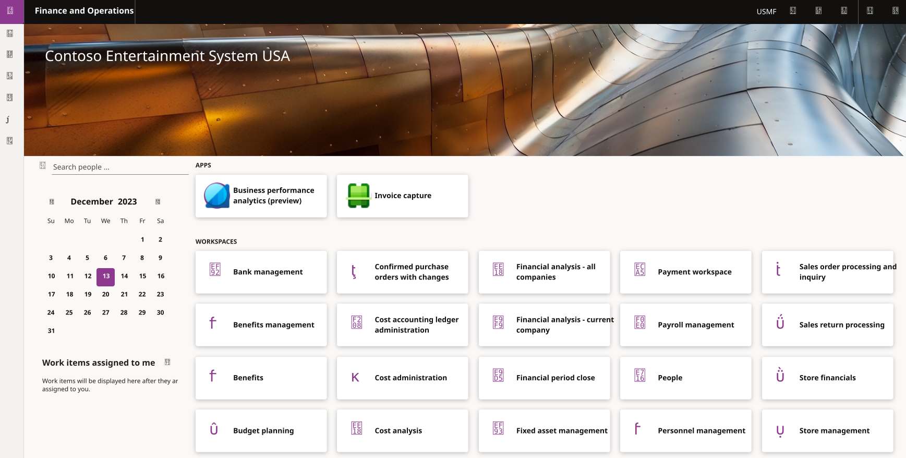

<!-- https://learn.microsoft.com/en-us/training/modules/build-workspaces-finance-operations/introduction -->
# Introduction

Completed

* 3 minutes

Workspaces in finance and operations apps are links, tiles, and lists specific to each user to help aid in completing their role at their organization. You can use Workspaces as a single point of entry into the application.

In workspaces you can design and embed KPIs to monitor business performance and use Report Definition Language (RDL) to create reusable report functions. Workspaces can be used to manage day to day responsibilities specific to each user.

