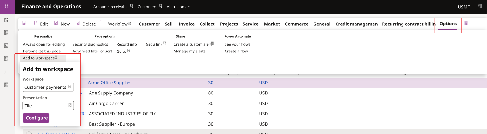

<!-- https://learn.microsoft.com/en-us/training/modules/build-workspaces-finance-operations/4-built-in-kpi -->
# Implement built-in KPIs, charts, and other reporting components

Completed

* 7 minutes

Workspaces can contain main elements, such as those discussed in this
module. Workspaces can also include built-in KPIs, charts, and other
components that make the user interface experience more efficient and
useful. In finance and operations apps, users can create a workspace and add
existing elements to a workspace from the user interface.

When adding an element to a workspace from the user interface, you can
select the presentation of the data. The presentation types are Tile,
List, and Link. The **Tile** option has additional configuration where
you can enter the tile name, display the record count, and select one of four tile sizes. Before
creating the tile, you can filter the form to view only the records that you want to see on the tile. The **List** option allows you to name the tab and select the list style. You can also select the columns that you want to display. The **Link** option will create a hyperlink to the workspace so you can quickly access other form.

When the **Saved views** feature is turned on, the content that you push to a workspace is linked directly to a view. The view's query retrieves the data for the workspace, and the tile or link opens the page with that view applied, so updating the view also updates the workspace element. If the **Saved views for workspaces** feature is enabled, you also select the workspace view that the element is added to in the **Workspace options** section of the **Configure** dialog box.

In the developer environment, developers can create KPI tiles that
display calculated measures. To create a KPI in the developer
workspace, you can create and modify KPIs by using aggregate data that is
contained in aggregate measures. A key benefit of developing KPIs is
that after a KPI is defined, users can customize it at run time. To
develop and create a KPI in the developer environment you should follow
these high-level steps:

1. Create the KPI object.
2. Define KPI range, goals, and/or tends.
3. Create a tile for the KPI to display on.
4. Add the KPI to the tile.

You can also embed Power BI reports into your workspace. To do this, you
will need to populate the local Entity Store database with the
appropriate aggregate measurement. You can set up a batch job to
periodically update the aggregate measurement. You will then need to
connect Power BI to the Entity Store database and choose which tables
and views to report on. From there, you can create reports, charts, and
dashboards, and then publish the report and pin it to the workspace.