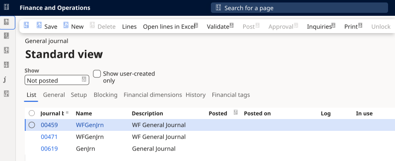
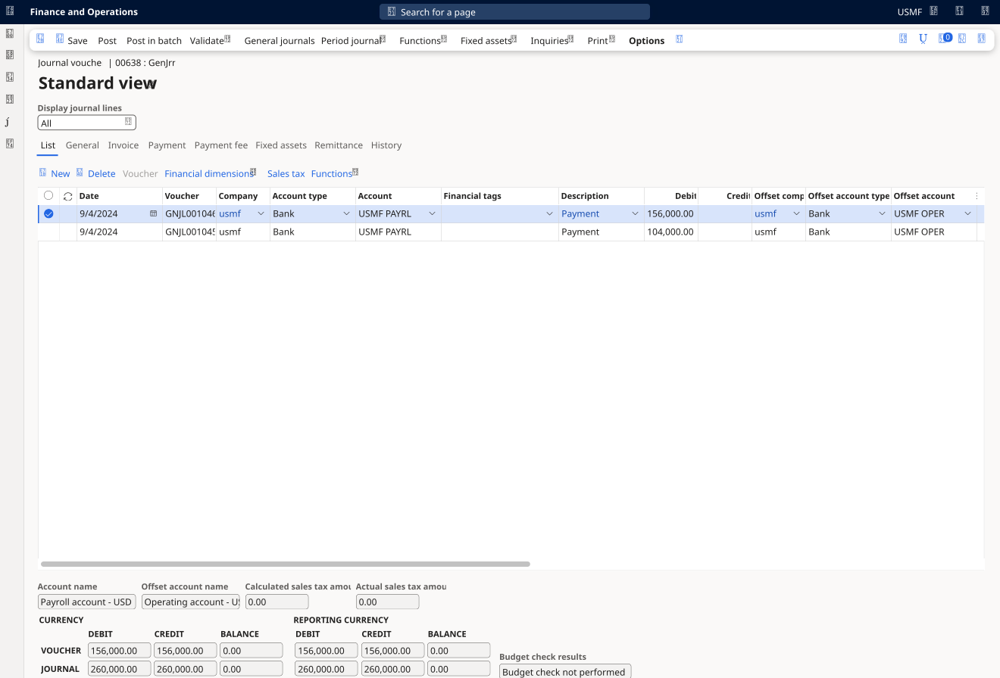

<!-- https://learn.microsoft.com/en-us/training/modules/configure-ledgers-journals-dyn365-finance/2-types -->
<!-- refetched: original harvest URL returned 404 -->
# Understand the different types of journals and their setup

Completed

* 5 minutes

Before you can create a general journal, you must first create your journal names and assign a journal type, which will determine where the journal can be used in the system. Let's first review the journal types.

## Ledger journal types

There are manually generated journals and system-generated journals in Finance.

Examples of system-generated journals are allocation journals and elimination journals. These journals are created automatically and are never created manually.

**General ledger > Journal entries > General journals**

Manual journal entries are generated by postings entered into the system such as a general journal entry. When you use a manual journal entry, the transactions are not posted immediately.

The journal name also indicates what type of transaction will be posted in Finance and the journal type defines where a journal can be used. For example, a Customer payment journal type is used to record your customer payments or issue refunds for them.

The following are few of the many built-in journal types in Finance:

* **Daily** - Create daily transactions in a general journal.
* **Periodic** - Create periodic transactions for the periodic journal.
* **Invoice register** - Register basic information about vendor invoices.
* **Customer payment** - Create customer payment transactions.
* **Allocation** - Create allocation transactions in an allocations journal. Before you can create an allocation journal, you must create an allocation rule on the Ledger allocation rule page.
* **Approval** - Post vendor invoices that have been approved to the appropriate ledger accounts.
* **Vendor invoice recording** - Post vendor invoices that are in a journal.
* **Bank check reversal** - Reverse a posted check. To use this journal type, select the Use review process for payment reversals option on the Cash and bank management parameters page.
* **Budget** - Process budget appropriations. To use this journal type, select the Enable budget appropriation option on the General ledger parameters page. The budget journal entries will include information that is based on the ledger accounts that are defined on the Posting definitions page.
* **Customer bank remittance** - Create a bill of exchange remittance file that can be sent to your organization’s bank. To use this journal type, clear the Automatic settlement option on the Accounts receivable parameters page.

Now that you understand the concept of journal types, let’s continue to the next unit to configure the ledger and set up journal names.