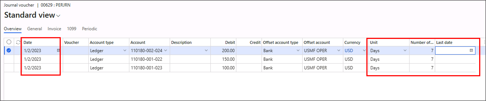

<!-- https://learn.microsoft.com/en-us/training/modules/configure-ledgers-journals-dyn365-finance/use-cases -->
# Describe use cases for periodic journals

Completed

* 5 minutes

Some organizations have requirements to create similar journals with the same amount, accounts, dimensions, and other information on a regular interval. You use the Periodic journal to fulfill this requirement. Periodic journals, often called recurring journals, need to specify the period interval for the recurrence, such as days, months, or years.

To create a periodic journal, the first step is to create a journal name of type **Periodic** under the **Journal setup** menu in the **General ledger** module.

You can set up other configurations of journal name, such as voucher setup or approval, according to business requirements.

The next step is to go to **Periodic journal** under the **Periodic tasks** menu in the **General ledger** module. Create a new journal and then select the **Lines** button on the **Action** pane. This action takes you to the **Journal lines** page, where you can create multiple journal lines that you expect to generate at a regular interval.

In the **Date** column, you can enter a date, or you can leave it blank.

In the **Unit** column, you can define the time unit (such as days, months, or year). The system generates journal lines based on the selected unit.

In the **Number of units** column, you can define a number that helps determine the frequency of the journal lines that are generated.

For example, if you select **Days** in **Unit** and enter **7** in **Number of units**, the journal lines are created on every seventh day, starting from January 1, 2023.

Select **General journal** under the **Journal entries** menu of the **General ledger** module. Create a new journal and then open the **Journal lines** page. Select the **Retrieve journal** button under **Period journal** in the **Action** pane.

The **Period journal** dialog appears, where you need to select the previously created periodic journal in the **Periodic journal number** lookup.

In the **To date** field, enter the date up to which journal lines should be created, for example **2/2/2023**.

The default value of the **Copy or move journal** field is **Copy**. It ensures that, after you created new journal lines on the **General journal** page, the periodic journal page retains the journal lines. If you change the value to **Move**, after the journal lines are created in the general journal page, the journal lines are removed from the periodic journal.

After you select the **OK** button in the dialog, 15 journal lines are created. The selected date in the periodic journal lines was 2 January 2023. Based on the **To date** selection (2 February 2023), journals are created on five dates, as follows:

* 2 January 2023
* 9 January 2023
* 16 January 2023
* 23 January 2023
* 30 January 2023

Because three journal lines are in the periodic journal, a total of 15 journal lines are in the newly created general journal.

After you create the general journal, the **Date** field of the periodic journal is updated with the next journal line creation date of 2/6/2023. The **Last date** column of the periodic journal line updates with today’s date.

If the date fields in the periodic journal lines are blank, then you can select a date in the **From date for lines without a date** field from the **Period journal** dialog.

Three sets of general journals are created, dated 1/15/2023, 1/22/2023, and 1/29/2023. The **Date** field of the periodic journal remains blank, and the **Last date** field updates with today’s date.

In the last scenario, consider a situation where the **Date** column of the periodic journal is blank and the **From date for lines without a date** field of the **Period journal** dialog is also blank. In this case, only a single set of journal lines are created in the **General journal line** page, and the dates are the same as the **To date**.