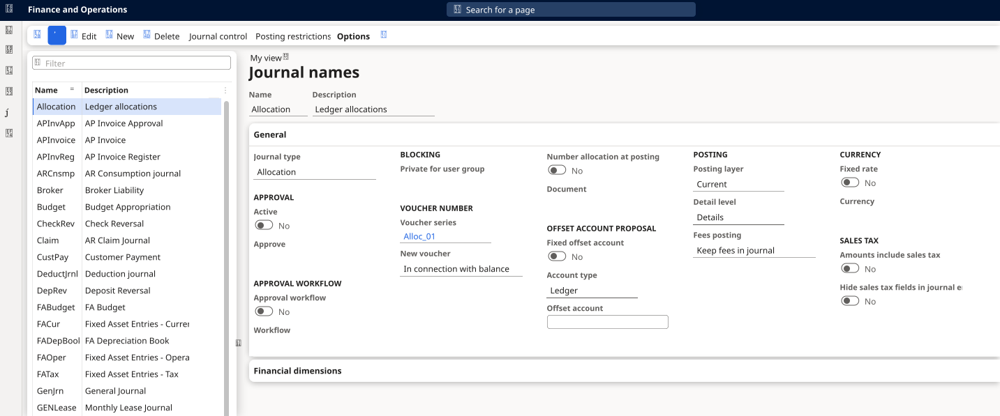
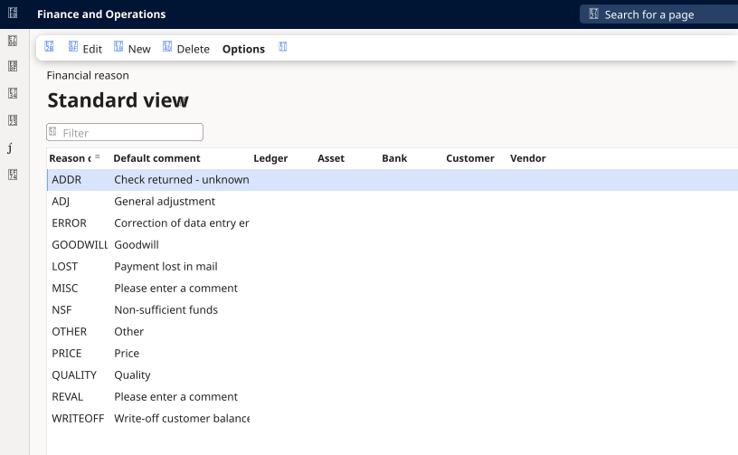

<!-- https://learn.microsoft.com/en-us/training/modules/configure-ledgers-journals-dyn365-finance/3-setup -->
<!-- refetched: original harvest URL returned 404 -->
# Configure ledger and journal setup

Completed

* 20 minutes

You can use journals quickly and efficiently once they're set up. There are several components that must be set up in order to use general journals.

## Ledger

Each legal entity has one ledger, and each ledger can be linked to one chart of accounts. Multiple ledgers can be linked to the same chart of accounts, which allows you to share the same chart of accounts with more than one legal entity. You also need to indicate which account structure or structures to attach to the ledger for each legal entity.

Ledger settlement automation reduces the number of manual steps by automatically matching debit and credit transactions in the General ledger and marking them as settled. The process runs as a background process depending on the rules specified. You can define the frequency of the automated settlement and matching rules that are based on transaction attributes. Ledger settlement automation defines the following details:

* When ledger settlements are run.
* Which criteria are used to match the debits and credits that can be automatically settled.
* Which order the ledger settlement information is processed in.

Note

To enable the **Automate ledger settlement process** feature, **Awareness between ledger settlement and year-end close** must be enabled.

## Balancing financial dimension

Inter-unit accounting is the requirement that you generate a balanced balance sheet for a specific financial dimension. Therefore, all accounting entries that are made to the general ledger must be balanced for the values of the financial dimension, which is referred to as the *balancing financial dimension*. The balancing financial dimension that is used for inter-unit accounting is selected in the **Ledger** page in **General ledger > Ledger setup > Ledger**. When you enter the balancing financial dimension in Finance, every accounting entry must balance both at the total level and at the level of the financial dimension values.

If the accounting entry doesn't balance at the level of the financial dimension values, more accounting entries are created automatically to balance the accounting entry.

After adding account structures, you’ll want to link them to the ledger.

## Journal names

One of the most important areas to set up is journal names. You can define a journal name for a specific task according to its type.

It's a good idea to define specific journal names for each purpose, such as intercompany, accrual adjustment, and error correction. You can tailor each journal name to help make data entry for each purpose easy and secure.

On the **Journal names** page in **General ledger > Journal setup**, you can set up the different elements such as the following.

* **Approval workflow** – To increase internal control, define journal workflows that establish materiality limits for review and approval steps, based on criteria such as total debit amount. The materiality concept is the universally accepted accounting principle that all important matters are to be reported while trivial matters can be disregarded
* You set up workflows for the general journals on the **General ledger workflows** page.
* **Default values** – Select default values for offset accounts, currency, and financial dimensions.
* **Journal control** – You can set up restrictions on the company and account type, and also the segment values.

## Journal setup

There are manually generated journals and system-generated journals in Finance.

Examples of system-generated journals are allocation journals and elimination journals, that are created automatically and are never manually.

Manual journals entries are generated by postings entered into the system, such as a general journal entry. When you use a manual journal entry the transactions aren't posted immediately. Before you can post a manual entry, journals can be in the following states.

* Changed
* Reviewed
* Approved
* Deleted

In Finance, you can use journals to do the following tasks.

* **Control different kinds of entries** - You can apply an approval system so that special journals are posted only after they're approved.
* **Review data imported from external ledger systems** - You can ensure that all valid fields contain a value and that all restrictions for the transaction are fulfilled.

It's important to make sure that the necessary voucher series is set up before you create journals. You can set up number sequences and attach them to the appropriate references.

You cannot use both the manual approval system and the workflow approval system for the same journal name.

Finance provides 10 posting layers. Each journal name is assigned to a single posting layer, and that assignment can't be changed after the journal name is created.

* **Current** - Default layer that is used.
* **Operations** – Used for entry of transactions.
* **Tax** – Where you record transactions that impact tax reporting.
* **Custom 1** through **Custom 7** – Seven configurable layers that you can use for other reporting frameworks, such as International Financial Reporting Standards (IFRS) or local statutory requirements.

A **None** option is also available for books that shouldn't post to the general ledger.

Note

You can change the journal name on a general journal only before the journal header is committed. After the header is committed, the journal name is locked to preserve data consistency and the control settings that are tied to the journal name.

In the **Detail level** list, you can specify how journal lines should be summarized.

* **Details** - Every instance of an account number in the journal lines is posted as a separate account transaction.
* **Summary** - A summation of journal lines into one transaction is performed automatically during posting if voucher with date, account number, dimension, and currency code contain the same values.

It's important to know that the summation isn't performed on transactions with sales tax.

## Posting restrictions

Posting restrictions determine whether specific users or user groups can post to that specific journal. You can restrict journal posting to the user who created the journal for those who are assigned the control. If the user isn't assigned to a posting restriction, they can post all journals for the journal name.

Select from the following parameters.

* **By user group**
* **By user**
* **No posting restrictions** - The posting restrictions feature enables an organization to specify, on a journal name basis, if specific users or user groups can only post the journals that the user or user group members entered or created. Posting restrictions can be defined by user group or user.

  

  For example, the Accounts receivable (AR) manager at Contoso, is a member of the AR user group. The AR user group is assigned to a posting restriction for AR journals. Because of this posting restriction assignment, members of the AR user group can post AR journals that only they created themselves.

  The Accounting manager, decides to allow Accounts receivable manager to post all AR journals, not only those that they created. The Accounting manager must clear the posting control for the Accounts receivable manager so that the AR manager can post to all AR journals.

In advanced bank reconciliation, you can select the posting date of transactions. You can select the bank statement line booking date with separate voucher numbers as posting date of new transactions. If the accounting period is closed, you can select the bank statement import date with the combined voucher number for the posting date for new transactions.

Watch this video to learn how you can create a journal name, work with journal types, and set up posting restrictions.

## Journal controls

A journal control is a setting that you can have on your journal name to specify restrictions or limitations as to what can be used and posted on the journal. You set up journal control options to set up posting rules for the journal name in **General ledger > Journal setup > Journal names > Journal control**.

You can restrict the type of accounts that users can use on the journal, or which specific company and which specific account type they can post on that journal.

For example, the bank journal name is set up so that it only is possible for users to make bank account postings, and the customer payment journal only allows customer account postings. For example, if for some reason the user accidentally specifies a ledger account or vendor account on the customer payment journal, Finance will display an error message to say that users can only use an account type of customer by using the journal with this specific journal control.

You can also specify the dimension values that can be used along with the ledger account so even though the account structure may allow multiple dimensions to be selected, on that specific journal, users can only use certain dimensions.

## Journal descriptions

Use journal descriptions to enter and reuse transaction text when you record in journals. Users frequently enter the same transaction text every time that they post a certain transaction. For example, users transfer from petty cash to bank or payment of invoice number. You can save the transaction text in a table with a search name so that you can reuse the transaction text.

The journal descriptions defined in the General ledger are shared across Finance financial sub-ledgers (modules).

## Default descriptions

Default descriptions can be used for automatic postings to the general ledger. You can set up default descriptions in various languages. It can be created for transactions such as vendor payments and can be configured in different ways to suit the customer’s needs.

To configure your first default description, follow this procedure.

1. Go to **General Ledger > Journal setup > Default descriptions**.
2. Select **New** at the top to create a new Default description.
3. Use the drop-down menu on the **Description** field to select the **Transaction reversal** type.
4. Select **en-us** in the **Language** field.
5. In the **Text** field, you can use fixed variables. These are called out in the **Reference** field at the bottom of the screen. For example, if you want invoice number, you would type “Invoice %2” in the **Text** field.
6. In the **Text** field, enter the default description. You can type text in the field, or you can use one or more of the following free text variables.

   * **%1** – Add the transaction date.
   * **%2** – Add an identifier that corresponds to the document type that is being posted to the general ledger. For example, for transaction types that are related to invoices, the %2 variable adds the invoice number.
   * **%3** – Add an identifier that is related to the document type that is being posted to the general ledger. For example, for transaction types that are related to invoices, the %3 variable adds the customer account number.

For certain transactions types in some countries or regions, you can include text in your default descriptions that come from fields in the Finance database. These fields are related to the transaction types.

## Transaction types

You can add other text to default descriptions for transaction types that are related to the following document types.

* Customer invoices
* Customer credit notes
* Customer cash payments
* Vendor payments
* Sales orders
* Purchase orders
* Inventory journals
* Master planning (MRP)
* Fixed assets

## Reason codes

A reason code is a standardized code that can be used in various transaction types or changes to field values to provide background data about the transaction. For example, auditors or managers might want to see reasons recorded for various transactions such as write-down adjustments or payment reversals.  
You set up reason codes in **Organization administration > Setup > Financial reasons**

When you use standard reason codes instead of transaction text, you have guidelines for which codes to select from. Standard reason codes also allow management and auditors to analyze transaction history by specific reason. Reason codes can be used with the General ledger, Accounts payable, Accounts receivable, Cash and bank management, and Fixed assets modules. A reason code can also be selected in the general journal entries, allocation requests, elimination proposals, and consolidations.