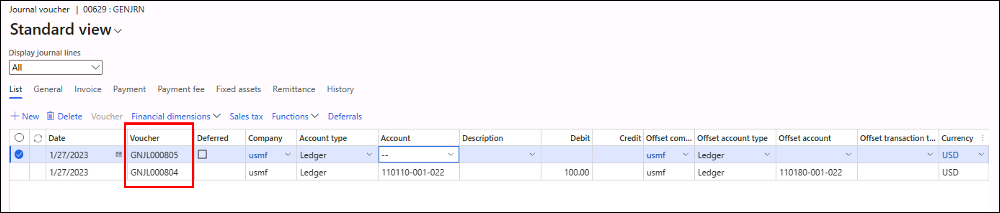

<!-- https://learn.microsoft.com/en-us/training/modules/configure-ledgers-journals-dyn365-finance/implement-voucher -->
# Discover options for implementing voucher numbers in journals

Completed

* 5 minutes

Journal name is one of the most important setups of journal processing. It helps you set up journals for specific purposes based on functional area, intercompany, accrual adjustments, error corrections, and so on. It also defines the voucher number rules.

On the **Journal names** page, you can access the **Voucher series** dropdown menu under the **Voucher Number** section. You can select the number sequence from this dropdown menu, which plays the most important role in numbering the voucher. Number sequence can be continuous or non-continuous. A continuous number sequence ensures that no number is skipped while the system is allocating the voucher number; however, numbers might not be used sequentially. You can use numbers from a non-continuous number sequence sequentially, but the number sequence might skip numbers. The use of continuous number sequences can cause slower performance, so you should only use it for legal reasons in your country/region.

## Number allocation at posting

You can enable **Number allocation at posting** by selecting the feature in the **Voucher Number** area.

Enabling the **Number allocation at posting** feature allows the system to gain performance at entry and allows a sequence of voucher numbers to be allocated at posting time instead of at entry time. A temporary voucher number will be assigned at entry time when this setting is turned on for a journal.

The **Journal names** page includes the **New voucher** dropdown menu in the **Voucher number** section. This field has three values that define the numbering system of a new voucher in a journal.

## In connection with balance

The **In connection with balance** setup is the most common configuration for new voucher numbers in a journal. This setup enables you to create a new voucher number from the number sequence when a new journal line is created.

The journal line might have an offset account that balances the amount. In that case, the next journal line will pick up a new voucher number from the number sequence.

If the journal number doesn’t have an offset account, the next journal line will carry the same voucher number. The same voucher number will be continued until the journal amount is balanced. After the amount has balanced, a new voucher number will be chosen from the number sequence.

## Manual

It's also possible to have **Manual** as the configuration, where the user enters the voucher number manually. The voucher number should follow the format of the number sequence that has been selected on the **Journal names** page.

The number sequence should have the **Manual** option selected to allow manual entry of the voucher number.

## One voucher number only

The **One voucher number only** configuration ensures a single voucher number for all journal lines in a journal. This feature allows multiple subledger transactions in the context of a single voucher.

One voucher functionality can result in issues in several financial processes, such as settlement, tax calculation, transaction reversal, reconciliation from subledger to general ledger, and more.

However, certain scenarios exist where the **One voucher number only** approach is preferred, including:

* A bank posts a single withdrawal for making multiple vendor payments. Summarizations of the vendor payments are managed through one voucher only.
* Bills of exchange and promissory notes require that one voucher be used because the transactions move the customer or vendor balance from one Accounts receivable/Accounts payable ledger account to another, based on the state of the payment.
* In case a reimbursement periodic task is run from the Accounts receivable module for a prepayment transaction, it creates a transaction to move the balance from a customer to a vendor.

