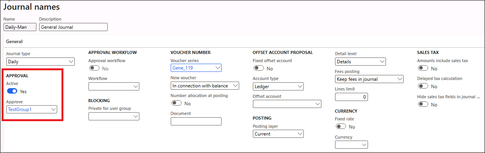
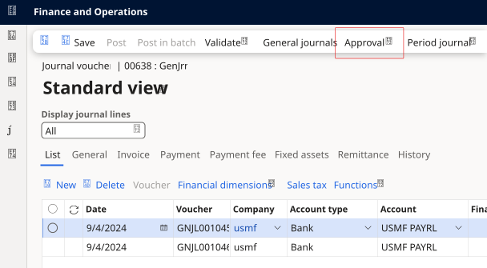
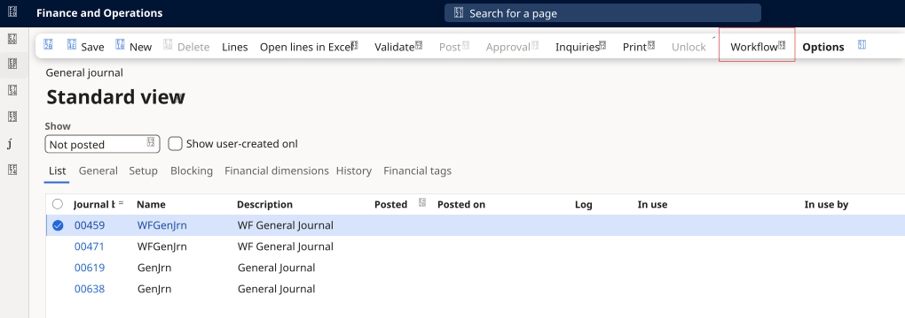

<!-- https://learn.microsoft.com/en-us/training/modules/configure-ledgers-journals-dyn365-finance/journal-approvals -->
# Set up journal approvals

Completed

* 3 minutes

Organizations might require that journals be approved before posting. You can do the approval based on manual configurations. Alternatively, you can use the standard workflow framework for the approval of journals.

You can manage this configuration from **Settings** on the **Journal names** page. The three possible options that are related to journal approval are:

* No approval
* Manual approval
* Workflow approval

## No approval

If the journal doesn’t require approval, the **Journal names** page doesn’t require configuration. The **Active** toggle in the **Approval** section will be turned off. The value of the **Approval workflow** toggle in the **Approval Workflow** section will also be turned off. With this setup, the same user can create and post the journal without intermediate review.

## Manual approval

In the manual approval process, the value of the **Active** toggle in the **Approval** section will be turned on. Then, the value of the **Approval workflow** toggle in the **Approval Workflow** section will be turned off. From the **Approve** dropdown menu, select the user group that contains the list of users who are eligible to approve the journal.

With this setup, the journal has a new menu option of **Approval**. After finalizing the journal, you'll need to select the **Report as ready** option from the **Approval** dropdown menu. Now, the approver can access the journal to approve or reject. You can post the journal after it's been approved.

## Workflow approval

In the workflow approval process, the value of the **Approval workflow** toggle in the **Approval Workflow** section will be turned on. Then, the value of the **Active** field in the **Approval** section will be turned on also. From the **Workflow** dropdown menu, select the workflow that you want to associate with the journal.

You can define workflow from the **General ledger workflow** menu under the **Journal setup** menu in the General ledger module. In the **General ledger workflow** page, you need to select the **New** button and create a workflow of type **Ledger daily journal workflow** if you want to set up workflow approval for a general journal. Similarly, for other journals, you need to go to their respective modules and create a workflow for the specified journal. Make sure that you select this newly created workflow in the **Workflow** dropdown menu of the **Journal names** page.

With this setup, a new menu option, **Workflow**, will appear on the journal page. You can submit the journal from the **Workflow** menu. The workflow process starts as it's set up in the workflow editor.

