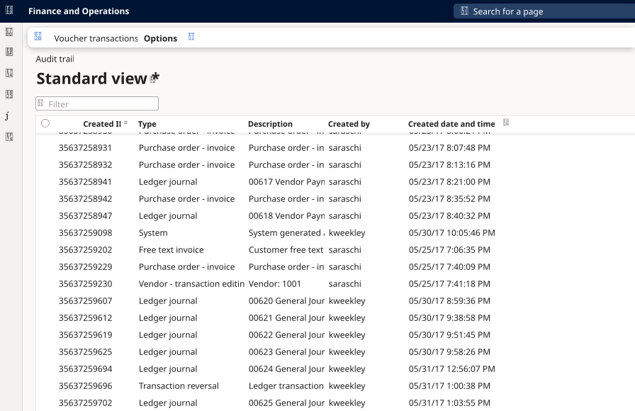
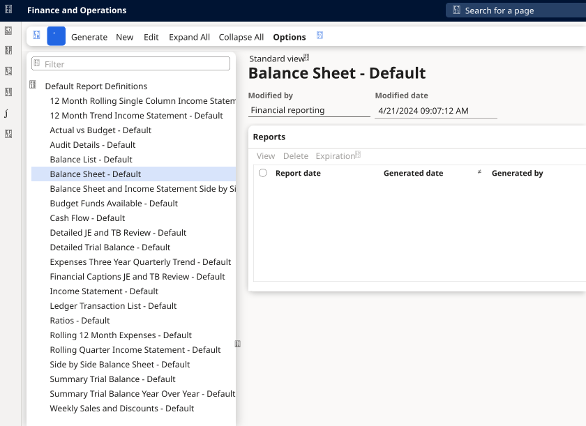

<!-- https://learn.microsoft.com/en-us/training/modules/configure-ledgers-journals-dyn365-finance/4-journals -->
<!-- refetched: original harvest URL returned 404 -->
# Configure and use journals

Completed

* 6 minutes

Like all other modules in finance and operations apps, there’s a **Parameters** page in the General ledger module. You can set up specific parameters for the module such as how you want to handle the fiscal year close process, the maximum penny difference for rounding, what your number sequences are going to be, and how you want to transfer postings to the ledger, among many other aspects that may also affect other modules but must be set up on this page.

Before using journals, you must make sure that the **General ledger parameters** page in **General ledger > Ledger setup > General ledger parameters** is configured correctly for your customer’s requirements.

For example, consider some of the following values for the **Check for Voucher used** field.

* **Reject duplicate** - Prevents the use of different transaction dates for the same voucher number.
* **Reject duplicates within fiscal year** - Allows for different transaction dates for the same voucher number in different fiscal years.
* **Accept duplicates** - Uses different transaction dates for the same voucher number in the Transaction date field in journal lines.
* **Warn in case of duplicates** - Sets up the system to notify you if journal lines with different transactions dates have the same voucher number

## Working with journals

The process of working with journals is the following steps.

1. Create a new journal
2. Add journal lines
3. Validate
4. Post

**Create a new journal** - Many of the modules in Finance use journals for entering transactions. In General ledger, use journals for ledger posting. In Accounts receivable, use journals for postings. When you open a journal dialog box, create new journals by using the template that is associated with the journal type.

**Create journal lines and post transactions** - When a new journal is created, enter posting transactions in the journal and post it or transfer the journal for someone else to review and approve.

## View journal entries and transactions

You can view journal entries and transactions in various ways. You can use inquiry pages that provide drill-down capabilities, or you can use various report options in the general ledger.

You can view the posted transactions in many ways by using inquiries such as Trial balance, Audit trail, and Voucher transactions.

You can filter on a single value or a range. When defining a range, make sure that the correct syntax is used. The values should be separated by a double period (..).

## Voucher transactions

**Voucher transactions** in **General ledger > Inquiries and reports** is a page where you can select from various tables and fields to specify criteria for the balance or transaction that you're searching for.

For example, you can view all transactions for a specific date or account, or all transactions of the **Posting type** that are in a specific **Posting layer**.

By default, the page shows the journal number, voucher, date, and main account, but you can add additional tables, fields, and criteria to narrow down your search.

## Audit trail

**Audit trail** is a page in **General ledger > Inquiries and reports** that shows the types of transactions, descriptions, who the transactions were created by, and when they were created. On the **Audit trail** page, you can view the voucher transactions.

Each ledger transaction is part of a voucher. When a voucher or group of vouchers is posted, the system creates an audit trail entry with a unique numeric identifier. The entry includes an automatically generated transaction text that identifies the origin of the entry.

Click the **Voucher** button to view the vouchers that are contained in the audit trail entry. The entry also includes references to the user who created the entry and to the entry date and time.

You can use the **Ledger transaction** list to view a list of all posted transactions on the current account. The entries result from posting transactions in journals, sales, and purchase orders and any other modules that post to ledger.

The information in the fields in the ledger transactions cannot be modified. To correct an entry, make a transfer which then appears on the **Audit trail** inquiry page.

## Ledger account alias

You can associate a shortcut to a ledger account by using a ledger account alias in **General ledger > Chart of accounts > Accounts**. When you type the shortcut and press the Tab key, the account and dimensions are populated, and the initial focus field is where the cursor or focus will move to.

## Financial reports

You can also explore and analyze general ledger transactions by running financial reports in **General ledger > Inquiries and reports > Financial reports**. Because the design of financial reports can be based on accounts, dimensions, account categories, or a combination of the three, you can view the transactions by drilling down in various ways.

If you want more information for general ledger transactions, you can also include multiple transaction properties as part of the report design. If you want to see the transactions that make up a general ledger balance, you can drill down to account transactions, just as you can from the **Trial balance** list page.

## Ledger reports

In addition to the financial reports, you can use the following ledger reports to view general ledger transactions.

* **Dimension statement** - Shows transactions by day and account, and there are also options to show transactions by dimension and period.
* **Ledger transaction list** - Shows transactions in transaction, accounting, and reporting currencies for an account.
* **Print journal** - Shows the result of a posted journal. You can run the report by journal batch number or journal type or add additional fields.
* **Posted transactions by journal** - Shows the transactions that have been posted to a journal, grouped by voucher. When running this report, you will need to enter a from and to date, which must be in the same fiscal year.
* **Transaction list by date** - Shows all the transactions by date, together with the journal number, voucher, and ledger account. It also shows the transactions in the transaction, accounting, and reporting currencies.
* **Transaction origin** - Shows the account by journal, and by transaction, accounting, and reporting currency. It also shows each line of the journal that was used as an offset.

## Publish journal lines and documents from Microsoft Excel

The Microsoft Excel add-in for journal entry provides an additional level of automation and makes data entry easier. The **Open lines in Excel** action is available on the **General journal** and **Journal voucher** pages.

You can enter and publish lines for financial journals from Excel. After you create a journal, the **Open lines in Excel** button displays the templates that are available. Templates are designed to support specific scenarios, however not every combination of account type is supported in the journal.

When the lines are published, they are validated to make sure that they comply with the rules that are set up in the financial journals. You can edit or post the vouchers from Finance.

To add financial dimensions to a template, additional changes are required. After dimensions are added to the entity, they are available in the Excel designer and can be added to the template.

For more information ahout how to add dimensions to Excel templates, go to [Add dimensions to Excel templates](/en-us/dynamics365/fin-ops-core/dev-itpro/financial/dimensions-overview/?azure-portal=true).