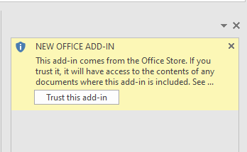

<!-- https://learn.microsoft.com/en-us/training/modules/configure-ledgers-journals-dyn365-finance/journal-lines-excel -->
# Publish journal lines to Microsoft Excel

Completed

* 5 minutes

Excel integration with Dynamics 365 Finance simplifies journal line management, enabling efficient data entry, validation, and publishing. This learning unit explores the process of using Excel for journal lines, from setup to troubleshooting.

## Microsoft Excel for journal lines

Using Excel for journal lines in Dynamics 365 Finance offers several advantages:

* Streamlined data entry with templates tailored to specific transaction types.
* Enhanced validation to ensure compliance with financial rules.
* Integration with Dynamics 365 Finance for seamless publishing and posting.

Excel's familiar interface and powerful tools make it an ideal choice for managing journal lines efficiently.

## Prerequisites and setup

Before using Excel for journal lines, ensure the following prerequisites are met:

* Microsoft Excel 2016 or later is installed.
* The Dynamics Excel add-in is configured and trusted.
* Your Microsoft Entra ID tenant supports authentication for the Excel add-in.

Follow these steps to set up the Excel add-in:

1. Open Excel and navigate to the **Home** or **Insert** tab (your selections vary depending on your version).
2. Select **Store** under the **Add-ins** group, or search for Browse Add-ins.
3. Search for "Microsoft Dynamics Office Add-in" and select **Add**.
4. Select **Add server information**.
5. Configure the server URL to point to your Dynamics 365 Finance instance.

## Export or create journal lines in Excel

Dynamics 365 Finance provides various templates for exporting or creating journal lines in Excel. These templates support different account types and scenarios, such as ledger journals, invoice registers, and payment journals.

To export or create journal lines follow these steps:

1. In Dynamics 365 Finance, create a journal and select **Open lines in Excel**.
2. Choose the appropriate template based on the transaction type.
3. **Open** the generated workbook, which includes binding information for the entity and the Excel add-in, by downloading it.

   Tip

   The add-in can encounter errors when you open from Excel in the browser. Download the file when this occurs.
4. Enable editing and sign in using your Dynamics 365 Finance credentials.

Tip

The add-in installs itself and correct to the environment the first time you use it from Dynamics 365 Finance. You need to **Trust this add-in** as shown in the image.

Templates can be customized to include more fields by developers, such as financial dimensions. For more information, see [Add dimensions to Excel templates](/en-us/dynamics365/fin-ops-core/dev-itpro/financial/dimensions-overview/?azure-portal=true). You can also use the designer in the Data Connector panel to add fields to the template and store the template for the organization in **Organization administration > Setup > Office integration > Document templates**.

## Enter and validate journal data in Excel

Excel allows you to enter and validate journal data before publishing it to Dynamics 365 Finance. Validation ensures compliance with financial rules and prevents errors during posting.

To enter data, follow these steps:

1. Use the Excel add-in pane to edit existing records or add new ones. Notice the lookup information in the Data Connector on the right for the appropriate fields.
2. Ensure all mandatory fields are filled and key fields are correctly bound.

## Publish journal lines to Dynamics 365 Finance

After entering and validating data, publish the journal lines to Dynamics 365 Finance using the Excel add-in.

Follow these steps to publish:

1. Select **Publish** in the Excel add-in.
2. Monitor the publishing process for any errors or warnings. If you receive errors, don't select **Yes** to the message indicating the data is refreshed. That wipes out any changes you made. Instead, reply **No**, correct your errors, and then **Publish** again.
3. Verify the published data in Dynamics 365 Finance.
4. Select **Validate** to check for errors.

If dependencies exist between data sources, adjust the publishing order in the Excel add-in settings.

Tip

Use the Simulate posting feature in Dynamics 365 Finance when testing the journal for errors before actual posting.

## Post journal entries in Dynamics 365 Finance

Once journal lines are published, you can post them directly in Dynamics 365 Finance.

Follow these steps to post journal entries:

1. Navigate to the **General journal** page in Dynamics 365 Finance.
2. Validate the journal using the **Validate** function.
3. Select **Post** to finalize the entries.

Use the **Global general journal** feature to post across multiple legal entities simultaneously.

## Common issues and fixes

Some common issues when using Excel for journal lines include:

* **Load applets link shown in Excel:** Ensure correct user permissions and sign-in credentials.
* **Forbidden message:** Verify the signed-in account has access to the targeted service.
* **Time-out during publishing:** Reduce the published batch size in the Excel add-in settings.

For more information on troubleshooting steps, see [Office integration troubleshooting](/en-us/dynamics365/fin-ops-core/dev-itpro/office-integration/office-integration-troubleshooting/?azure-portal=true).

## Best practices and workflow tips

The follow optimize your workflow:

* Define specific journal names for different purposes, such as intercompany or error correction.
* Use recurring journals for automated processing.
* Save frequently used voucher templates for quick access.
* Regularly update Excel templates to include relevant fields and dimensions.

Note

Dynamics 365 Finance doesn't allow deletion of posted transactions. Ensure accuracy before posting.

Following these best practices, can enhance efficiency and accuracy in managing journal lines using Excel.

For more information on publishing journal lines and documents, see [Publish journal lines and documents from Excel](/en-us/dynamics365/finance/general-ledger/open-lines-excel-journals-documents/?azure-portal=true)