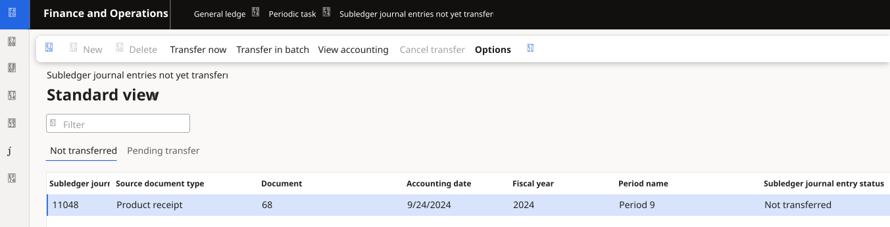

<!-- https://learn.microsoft.com/en-us/training/modules/configure-ledgers-journals-dyn365-finance/set-up-batch-transfer-rules -->
# Set up batch transfer rules

Completed

* 10 minutes

Transactions within a module first post to a subledger. For example, posting a vendor invoice posts to the Accounts payable (AP) subledger.

The AP subledger determines which accounts a transaction impacts and the amount to be posted to each account. The AP subledger also affects balances of entities supported by the subledger such as vendor balances, customer balances, and bank balances. These balances are only held within the subledgers, not the ledger.

Transactions in the subledger are immediately recorded when you post. The subledger feeds the general ledger but it is not the general ledger. Transactions posted to the subledger must be transferred to the general ledger.

## Configuration options

Given the amount of activity across all modules in the system, transfers to the general ledger could become a bottleneck. For this reason, transfers do not happen at the same time as postings to the subledger. They occur later. You can configure transfer settings to control how much later transfers happen.

There are two options available for posting through to the general ledger, **Asynchronous** and **Scheduled batch**.

* **Asynchronous** - Near real-time. The subledger transfers entries to the general ledger before anyone can look in the general ledger and realize they are not there. The transfer occurs as soon as it is possible.
* **Scheduled batch** - Transfers to the general ledger on a regularly scheduled interval. You can configure the frequency at which a batch job runs to perform transfers.

### How do you select the best configuration for your environment?

It really depends on whether you can afford a delay in having the information transferred and not available in the general ledger. If you use scheduled batch and schedule the batch for every five minutes, transactions may not be visible in the general ledger for as long as five minutes. On the other hand, the more you group transactions to transfer together, the better your system performs.

Your best option is to use **Asynchronous** and only switch to **Scheduled batch** if you are experiencing contention in your general ledger due to frequent transfers.

Go to **General Ledger** and then select **Ledger setup**. On the **General Ledger parameters** page select **Batch transfer rules** to configure the **Transfer mode** field.

You may notice that there is a **Synchronous** transfer option. This option was available in prior versions of the product but is no longer available. If you try to select **Synchronous** you are notified that this option is no longer supported. The **Synchronous** option posted straight through to the general ledger each time a post occurred in the subledger. This both delays the subledger post and can cause contention in the general ledger.

You can configure the following options on the **Batch transfer rules** page.

| Column | Options | Description |
| --- | --- | --- |
| Rule type | **Company**, **Document** | You can use different transfer methods for different companies and different modules. In this column, select whether this rule applies to a specific document, a specific company, or all companies. A consolidation or elimination company may not need to post as often as an operational company. |
| Source document type | If the rule type is Company, you select either **All** or a specific company/legal entity. If the rule type is **Document**, you must select a specific source document type including **Purchase order** or **Project invoice**. | Timesheets post at the end of a timesheet period. There is no need to immediately process timesheets. You may choose to use Scheduled batch for timesheets to maximize the benefit from batching timesheets all together. |
| Summarize account entries | **Yes**, **No** | If you select **Yes**, you can summarize any account entries in the general ledger that post to the same account string on the same date with the same currency and same posting. This reduces the number of ledger entries in the system; the details are still available in the subledgers. |
| Notification group | User group | Sometimes errors occur and entries do not transfer successfully. If this occurs, the group specified is notified. If you want separate groups of users notified for different document types, use the **Document** rule type, and enter multiple transfer rules. |

The video shows how to use batch transfer rules in vendor invoices. The setup covers the General ledger parameters, and how to create a vendor invoice to process a purchase order. When the invoice has been posted, **Transfer now** can be used to run the selected batch.

## Review entries that don't post through to the general ledger

Under rare circumstances, entries may not transfer from the subledger to the general ledger. There is a form to review the transactions that are stuck. Go to **General Ledger > Periodic tasks > Subledger journal entries not yet transferred** to view these entries.

If you have an entry that did not transfer to the general ledger, it looks like the following screenshot.

The entries may not have transferred because of a change in the account structure or the suspension of an account or dimension. You can review the subledger entries to help you determine why the entries did not transfer by selecting **View accounting** from the menu.

When you determine why an entry does not transfer to the general ledger. You can select **Transfer now** or **Transfer** in batch to transfer the entries to the general ledger.

The **Batch transfer for subledger journals** page allows you to select a specific source document type (or all types) and a fiscal year/period to transfer. Depending on whether you set the **Summary** option set to **Yes** or **No**, transferring a batch may reduce the number of entries in your general ledger.

## Subledger transfer to general ledger performance optimization

There is a feature that you can enable in the **Feature Management** workspace named **Subledger transfer to General Ledger performance optimization**. This feature changes the **Asynchronous** transfer mode to act more like the **Scheduled batch** transfer mode. Smaller transactions are grouped together and transferred to the general ledger together. This feature is enabled by default.

Go to **System Administration > Setup > Process automations** to configure batch runs. If your subledgers are not transferring as quickly as you would expect, change the repeat interval on this task. You may want to change this to run batches more often.

For process automation to run, the batch job **Process automation polling system job** must be running. This job should run every minute to look for new work to process. Transfers of entries from subledgers to the general ledger may be delayed if this job does not run often enough.