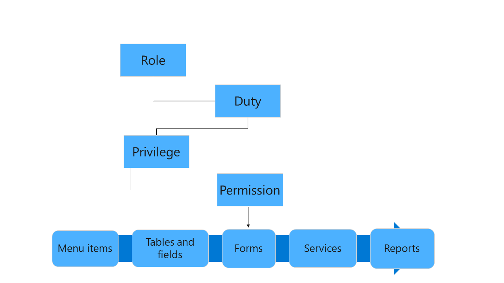

<!-- https://learn.microsoft.com/en-us/training/modules/configure-your-data-dynamics-365-finance-operations-apps/manage-security -->
# Manage security

Completed

* 2 minutes

Knowing how to implement security correctly with help companies cover their
security requirements. These requirements may be legal, regulatory, or business
ones. Dynamics automatically hides data, forms, etc., that a user does not have
access to.

The Finance and Operations applications implement role-based security – what a
person sees depends on what job role(s) they’re assigned. A role is made up of
duties, which have privileges, and at their most granular contain permissions.
See the chart below for a depiction:

Users may be assigned to roles in System administration, Security, Assign users
to roles.

The resulting screen shows all the roles in the system on the left-hand side. If
you highlight a role, you can see the users assigned to that role. You can also
create a rule for automatic role assignment, so that the administrator does not
need to manually intervene with every role change.

To change the privileges of a role, navigate to System administration, Security,
Security configuration.

There is a great deal of flexibility here to add and remove security: for
example, duties to a role. It’s easy to select a role and drill down to the
privileges of that role, to add or remove as needed.

The Duties tab offers privileges and roles, and the Privileges tab relates to
menu items and entities.

For a security audit, navigate to System administration, Inquiries, User log.

When the **User security governance** feature is turned on, additional auditing
tools are available at System administration, Security, Security governance.
They include the **User activity aging** report that tracks sign-ins, the **Role
audit trail** report that shows when roles were assigned or unassigned and by
whom, and the **Security analysis** report that shows role usage and the change
history of roles, duties, and privileges. A **License usage summary** report
helps you review the license that each role requires.

There’s much more information available on security. We recommend these modules
on Learn: [Plan and implement security in Finance and Operations apps](/en-us/training/modules/plan-implement-security-finance-operations/)
and [Implement role-based security in Finance and Operations apps](/en-us/training/modules/role-security-finance-operations/).