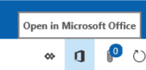

<!-- https://learn.microsoft.com/en-us/training/modules/configure-your-data-dynamics-365-finance-operations-apps/exercise-use-excel-view-update-data -->
# Exercise – Use Excel to view and update data

Completed

* 2 minutes

We’re going to make a simple change to a customer record in Excel, and publish
it back to Dynamics.

1. Navigate to **All customers** in the **Accounts receivable** menu.
2. In forms in Dynamics, you see the Office logo with an option to
   **Export to Excel** (which is a simple export) or, if the option is
   available, to **Open in Excel**, along with any entities available.

   

   
3. **Open in Excel** allows for updates. Select that and explore the options
   available: Download, save to OneDrive, and save to SharePoint. Select **Download**, **Open file**.

   
4. You may need to enable editing, trust the add-in, and sign in. You are then presented
   with your data (in the screenshot, customer data) in spreadsheet format.

   
5. Change a field (say, the Name) and select **Publish**.

   
6. Return to Dynamics and refresh your screen to see the update:

   