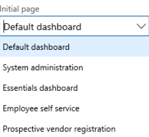

<!-- https://learn.microsoft.com/en-us/training/modules/configure-your-ui-dynamics-365-finance-operations-apps/manage-menus-dashboards-role -->
<!-- refetched: original harvest URL returned 404 -->
# Manage menus: Dashboards by role

Completed

* 1 minute

The dashboards that are displayed to a user differ by security settings.
Specifically, the role a user is assigned to has a say in their dashboards.
Within the role, users may set a preference in user Options for their initial
dashboard on login.

The **Initial page** field is on the **Preferences** tab of the **User options** page. Each
user can set their own initial page, and a system administrator can set it for another
user from **System administration** > **Users** > **Users** > **User options**.

Besides the default dashboard, **Immersive Home** is available as an initial page. It's an
AI-first landing page that surfaces your prioritized work items, agent activity, and a
ranked list of workspaces, with favorite workspaces at the top. Immersive Home requires
version 10.0.44 or later, the **Immersive Home** feature turned on in Feature management,
and the **View immersive home** privilege. For more information, see [Immersive Home overview](/en-us/dynamics365/fin-ops-core/fin-ops/copilot/immersive-home).

The dashboards available to you depend on your role, and are found in the Workspaces menu.

