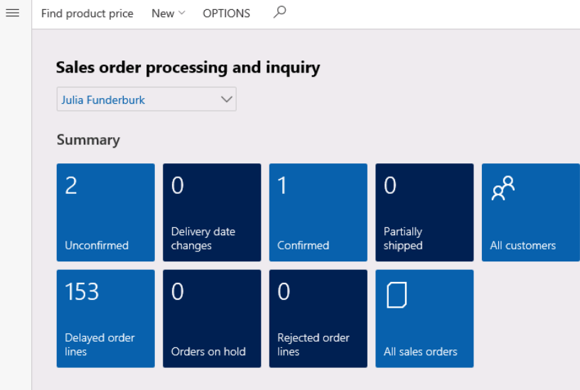

<!-- https://learn.microsoft.com/en-us/training/modules/configure-your-ui-dynamics-365-finance-operations-apps/manage-menus-key-performance-indicators -->
<!-- refetched: original harvest URL returned 404 -->
# Manage menus: Key performance indicators

Completed

* 2 minutes

Microsoft Dynamics 365 Finance uses Power BI for data exploration. Many Power BI
apps are provided for you.

Navigate to Workspaces and Sales order processing and inquiry.

Notice the tiles and KPIs available to you. For example, in the screenshot below, there are two unconfirmed sales orders. If you select that tile, you’re brought to a form, which shows these two orders.

Each tile is a quick link to the underlying data that it summarizes.

The dashboard also shows lists with quick data
under the heading **Orders and favorites**. You can view these same unconfirmed
orders right here.

Finally, at the far right, you can see a group list of Links.

You can customize the dashboard as well, if you built a canvas app in Power Apps. Select **Options** and **Personalize this page**.

You can hide parts of the page, add fields, and add an app. On the **Personalization**
toolbar, select **More** and then **Add a page**, choose the region of the page to place
the app in, and then, in the **Add an app** pane, select **Power Apps**. You can also
embed a canvas app under the **Power Apps** menu button on the Action Pane, or create a
full-page experience for the app from the dashboard. The same **Add an app** experience
lets you embed a [third-party website](/en-us/dynamics365/fin-ops-core/dev-itpro/get-started/embed-website).

For a canvas app, many options are available – the name, App ID, input context, size, and
which legal entities it pulls data from. Remember to save the change to a view, and
publish that view when you want other users to see the app. For more information, see
[Embed canvas apps from Power Apps](/en-us/dynamics365/fin-ops-core/dev-itpro/get-started/embed-power-apps).

