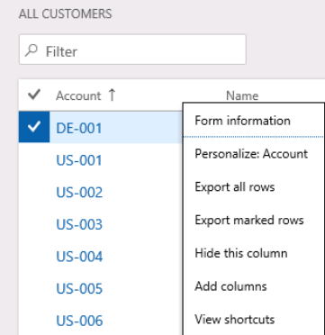
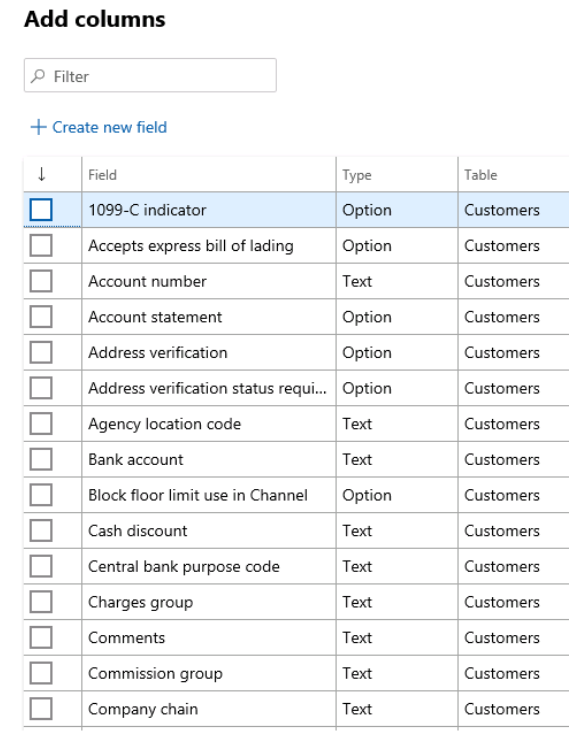

<!-- https://learn.microsoft.com/en-us/training/modules/configure-your-ui-dynamics-365-finance-operations-apps/manage-forms-fields -->
<!-- refetched: original harvest URL returned 404 -->
# Manage forms: Fields

Completed

* 3 minutes

#### Adding fields

The finance and operations apps make it easy to add fields to a form from
the form’s underlying datasource.

To see just how easy it is, navigate to Modules, Accounts receivable, Customers, All customers.
You’ll be in the All customers list page. Right click in the grid header and
select the option to **Insert columns**.

You'll see a list of all the columns that can be added, by name, datatype,
and source table. The dialog separates **Recommended fields**, which other users in your
organization already added, from **All fields**. Select the boxes for the fields you want,
select **Update**, and the fields are in!

#### Changing fields

To change a field in a form, right-click in the field or its
label, and select Personalize. You can do any of these: change the field name, hide
it, skip it while tabbing through the form, mark that it can't be edited, make it
required for data entry, or show it in the FastTab header.

#### Removing fields

To hide a field in a form, right-click in the field or its
label, and select Personalize. You can then hide it. You can also right-click the column
header of a grid and select **Hide this column**.

Personalizations are saved to the current view, so select **Save** or **Save as** in the
view selector to keep them.