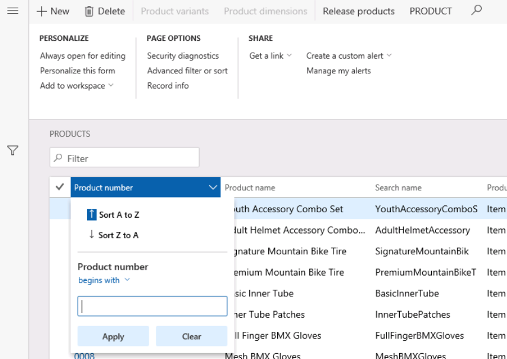
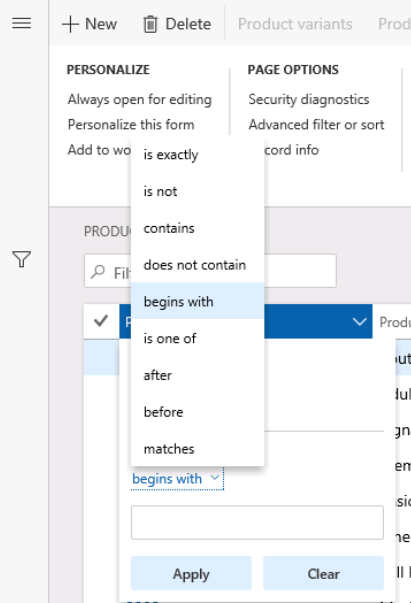

<!-- https://learn.microsoft.com/en-us/training/modules/configure-your-ui-dynamics-365-finance-operations-apps/manage-forms-filters-ranges -->
<!-- refetched: original harvest URL returned 404 -->
# Manage forms: Filters and ranges

Completed

* 5 minutes

#### Basic filters and ranges

It’s easy to limit the data that shows in a form. Filtering is most commonly done in
list pages, which use grids, but can be used anywhere.

Select the drop-down to the right of a field and notice your options for sorting
and filtering.

The filtering criteria options depend on the data type of the field. For a text field
they include: is exactly, is not, contains, does not contain, begins with, is one of,
and matches. Numeric and date fields also offer operators such as after (greater than),
before (less than), greater than or equal, less than or equal, and between. The
**matches** operator is available for every data type when you need to enter query
symbols such as `*` or `..` directly.

You can’t do multiple levels of sorting on the basic sort, by sorting multiple fields. You can use multiple ranges.

You can also select **Show filters** to open the Filter pane, an inline pane that slides in
from the left and lets you apply several filter criteria to the page at the same time. For
more information, see [Filtering options](/en-us/dynamics365/fin-ops-core/dev-itpro/user-interface/filtering).

#### Advanced filter

To use the advanced filter, Select Options, then Advanced filter or
sort.

The resulting screen will allow you to modify the query used in the form by:

* Specifying a range for fields
* Specifying sorting

  Note

  here you may specify multi-level sorts
* Adding datasources via joins

You can also save the query for future use. On pages that have a large view selector,
save the filters and sorting to a view: select the view name, select **Save as**, name the
view, and optionally select **Pin as default**. Views aren't saved automatically, so an
asterisk (\*) next to the view name means that you have unsaved changes. For more
information, see [Saved views](/en-us/dynamics365/fin-ops-core/dev-itpro/get-started/saved-views).

