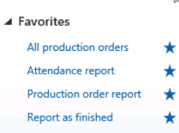

<!-- https://learn.microsoft.com/en-us/training/modules/configure-your-ui-dynamics-365-finance-operations-apps/exercise-create-favorites -->
# Exercise – Create favorites

Completed

* 5 minutes

For this lab, your persona will be that of a production manager. You want to
create shortcuts to several menu items that you frequently navigate to.

1. Open Dynamics 365.
2. Navigate to the **Production control** module.
3. Open the Production orders node and hover over All production orders, then
   click the star that appears.
4. Open the Adjustments node and hover over Report as finished, marking that
   one as a favorite.
5. Open the Production node under Inquiries and reports, and favorite the
   Production order report.
6. In the Time and attendance module, favorite the Attendance report under  
   Attendance in the Inquiries and reports submenu.
7. Verify that your favorites menu looks like this:

