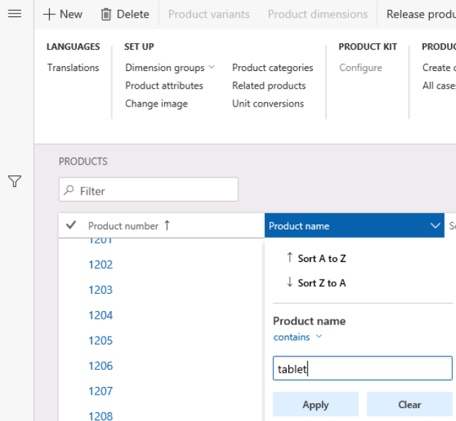
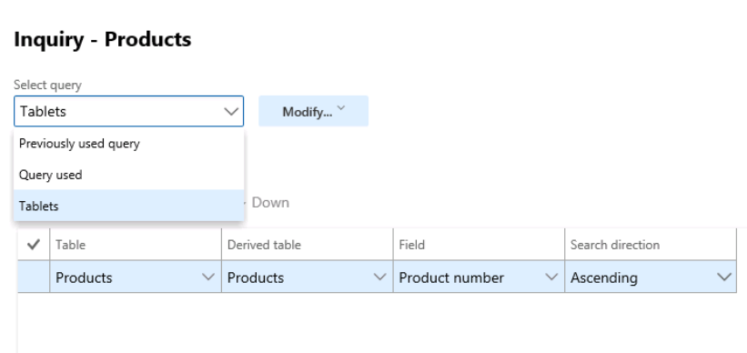

<!-- https://learn.microsoft.com/en-us/training/modules/configure-your-ui-dynamics-365-finance-operations-apps/exercise-change-form-fields-queries -->
# Exercise – Change form fields and queries

Completed

* 5 minutes

Let’s say that you frequently go to the Products screen, and typically use only
a small subset of products. You can create a query to show those products, and
multiple queries as needed.

1. Navigate to the **Product information management module**, **Products**, **All
   products and product masters**.

2. Say that you work primarily with Tablets. Select the drop-down to the right
   of Product name in the grid, and you’ll be presented with criteria. Change
   “begins with” to “contains” and type tablet in the box.

3. Select apply or simply press Enter and ensure that the filter has been
   applied.

This is great, but it’s only good for the current instance of the form. How do
you save it for future use?

1. Select **Options** and **Advanced filter or sort** under **page options**.
2. Add a different sort by navigating to the Sorting tab and changing the field
   from Product number to Search name.
3. You’ll be offered an index; accept.
4. Select OK to apply the query to the page.
5. Select the view name at the top of the page to open the view selector, select
   **Save as**, name your view, and select **Save**. Filters and sorting are saved with
   the view because this page has a large view selector.
6. Now, whenever you return to the form, you can open the view selector and choose your
   Tablets view. Select **Pin as default** if you want it to open automatically.
7. Add additional views for different circumstances as needed.

