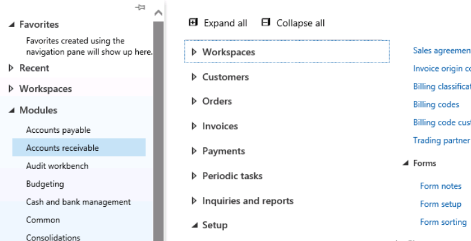

<!-- https://learn.microsoft.com/en-us/training/modules/configure-your-ui-dynamics-365-finance-operations-apps/exercise-change-report-output -->
# Exercise – Change report output

Completed

* 5 minutes

It’s quick and easy to make several types of common changes to existing reports.

1. Navigate to the **Accounts receivable** module, under **Setup**, **Forms**,
   and select **Form setup**.

2. Since you’re in Accounts receivable, you’ll be offered options for customer
   forms. If you were elsewhere, you would get forms relevant to that module.
3. Navigate to the Free text invoice tab, and change Print tax exempt number on
   invoice to Yes.
4. Navigate to the Accounts receivable module, under Invoices, and select All
   free text invoices.
5. Highlight a “Not posted” invoice and under Document, select View and Copy.
6. When the invoice copy renders, see that “Your tax exempt number” is on the
   invoice.

Many further customizations may be done via [Business document management](/en-us/dynamics365/fin-ops-core/dev-itpro/analytics/er-business-document-management),
which enables quick, easy editing using templates.