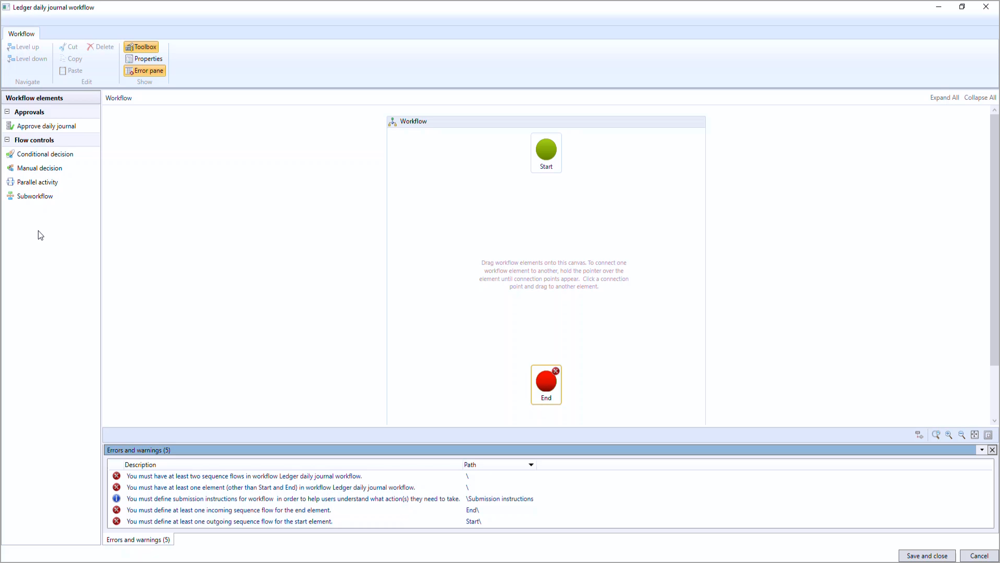

<!-- https://learn.microsoft.com/en-us/training/modules/create-use-workflows-finance-operations/3-setup -->
<!-- refetched: original harvest URL returned 404 -->
# Create and set up workflows

Completed

* 15 minutes

Workflow can be described as the tasks, procedural steps, and people that are required to input and output information, and the tools that are needed for each step in a business process.

At the end of this unit is a video that shows you the process.

The overall process of creating a workflow is as follows:

1. Select a workflow type from a module of finance and operations apps from the **General ledger > Journal setup > General ledger workflows** list page.
2. Select **New** to view and select a workflow in the **Workflow type** column to open the **Workflow editor**.

   Note

   This will launch an application that will require login credentials.
3. The **Workflow elements** area of the workflow editor contains the elements that you can add to your workflow. To add elements to the workflow, drag them onto the canvas.
4. To connect one workflow element to another, hold the pointer over an element until connection points appear. Click a connection point and drag it to another element. Be sure to connect all the elements.
5. Configure the properties of the workflow.
6. Configure the elements of the workflow.
7. Resolve any errors or warnings.
8. Save and activate the workflow.

### Workflow elements

A workflow consists of the following elements:

* **Tasks** - A task is a unit of work that must be performed. Two types of tasks can be added to a workflow: manual and automated.
* **Approval processes** - An approval process is a process that consists of separate steps.
* **Line-item workflow elements** - A workflow can be created to process either documents or the line items on a document.
* **Flow-control elements** - An example of flow-control elements would be manual and conditional decisions, in addition to parallel activity and sub-workflow.

### Manual task

A manual task is a unit of work that must be performed by a user.
For example, an expense report workflow can have manual tasks that require the assigned users to complete the following actions:

* Review the receipts that are submitted together with an expense report.
* Call an employee's manager.

### Automated task

An automated task is a unit of work that must be performed by the system. No human interaction is required.
For example, a sales order workflow can have automated tasks that require the system to complete the following actions:

* Perform a credit check.
* Create a customer record for the customer if a record doesn't already exist.

### Approval processes

At each approval step, the user can perform the following actions:

* Approve the document.
* Reject the document.
* Request a change to the document.
* Assign the document to another user for approval.

### Line-item workflow elements

You can add a line-item workflow element to its document workflow.
For example, a purchase order line workflow can be added to the purchase order workflow as shown in the following figure.

When the line-item element is run, each line item on the document is submitted for processing. You might want all the line items to be processed by the same line-item workflow, or you might want each line item to be processed by a different line-item workflow.

### Manual decision

A manual decision is a point where a workflow divides into two branches. A user must make a decision, and this decision determines which branch is used to process the document that was submitted.

### Conditional decision

A conditional decision is also a point where a workflow divides into two branches. However, the system decides which branch is used to process the document that was submitted. To make this decision, the system evaluates the document to determine whether it meets specified conditions.

### Parallel activity

A parallel activity is a workflow element that includes two or more workflow branches that run at the same time.

### Sub-workflow

A sub-workflow is a workflow that runs in the context of another workflow.

## Click-once workflow editor

The workflow editor is a graphical interface you can use to create finance and operations apps workflows by arranging workflow elements on a design surface.

To open the workflow editor, select a Workflow type to open the **Click-once workflow editor**.

This is similar to how you would graphically model a business process using Microsoft Visio. You can add, delete, and reposition workflow elements so that they precisely model the business processes you want to automate.

The components of the workflow editor include:

* **Action Pane** - The Action Pane that runs along the top of the workflow editor contains buttons you can use to navigate in the workflow, copy and paste workflow elements, and configure properties. To configure properties of the whole workflow, select the canvas. To configure properties of a specific workflow element, select that element.
* **Workflow elements** - A workflow consists of various elements. These elements can be tasks, approval processes, or flow control elements. Workflow elements can be added to the workflow that you are creating. To add elements, drag them from the **Workflow elements** area onto the canvas.
* **Canvas** - The canvas is the main area where workflow elements can be arranged. The flow of the business process you are modeling is indicated by connectors that join the elements. Some elements can contain other elements, which in turn creates a parent-child relationship. For example, an approval element contains one or more approval steps; these steps are child elements of the parent approval element. If you double-click the approval element, you can add and configure the approval steps.

When the workflow editor is open, you can configure the properties of this workflow. To do so, select **Basic settings** from the ribbon. The **Workflow properties** page is displayed.

The workflow owner is the person who will manage and maintain this workflow. You can provide instructions to users who will be submitting documents for processing and approval. This documentation refers to these users as originators.

If you want to personalize the text, you can insert placeholders. Placeholders will be replaced with the appropriate data when displayed to users. The place holder’s value will be populated from the purchase requisition document when the workflow is used. This enhances business intelligence for the users working with the workflow.

You can use the translations features of finance and operations apps to translate text into a different language. Make sure that the text being translated is verified by a native speaker.

You can create multiple workflows that are based on the same type. For example, you could create a purchase requisition workflow for each country or region in which you operate, such as Purchase Requisitions Denmark and Purchase Requisitions Spain.

When you have multiple workflows that are based on the same type, you need to specify when each workflow should be used. Continuing with the example, you would need to specify that:

* Purchase Requisitions Denmark should be used when: country/region = DK
* Purchase Requisitions Spain should be used when: country/region = ES

When a document is submitted for processing and approval, a workflow instance is created. You can send notifications to users when workflow instances (based on this workflow) are started, completed, terminated, or stopped because of an error.

The following events trigger notifications:

* **Started** - Select this check box to send notifications when a workflow instance has started.
* **Stopped** - Select this check box to send notifications when a workflow instance has stopped because of an error.
* **Completed** - Select this check box to send notifications when a workflow instance has completed.
* **Unrecoverable** - Select this check box to send notifications when a workflow instance has stopped due to an unrecoverable error.
* **Terminated** - Select this check box to send notifications when a workflow instance has been terminated.

You need to specify who should receive the notification by selecting one of the following options:

* **Participant** - It contains users who are assigned to a specific group or role. If you select this option, select the **Role based** tab to choose the appropriate role.
* **Hierarchy** – It lets you assign the task to users in a specific organizational hierarchy.
* **Workflow user** - It contains users who are participants in this workflow. If you select this option, select the **Workflow user** tab to choose a participant of this workflow.
* **User** - It allows you to select specific finance and operations apps users. If you select this option, select the **User** tab to choose the appropriate finance and operations apps users.
* **Queue** - It allows you to assign the task to a work item queue. If this option is selected, you need to select the Queue based tab and select a queue type as either **Conditional work item queues** or **Work item queues**.
* **None** - This is a default option. You will need to change it to any of the above options.

If you plan to be out of the office or otherwise unavailable to act on work items, you can delegate, or reassign, your work items to other users.

You can create multiple workflows that are based on the same template. When you have multiple workflows that are based on the same template, you need to specify which workflow is the default. Documents that do not meet any of the conditions specified will be processed by the default workflow.

After you are done configuring the workflow, you can activate it to be used in finance and operations apps. When a workflow is active, users will be able to submit documents for processing and approval. As you build the workflow, the Errors and warnings pane dynamically displays the number of issues that you must resolve before the workflow is valid. Only a valid workflow can be made active.

You can easily identify issues for any workflow element visible on the canvas because the element will display an error icon at its upper right corner. If you hold the pointer over the error icon, an error or warning message will appear. You can access other issues by opening them from the Errors and warnings pane.

The **Description** column lists each issue and describes the problem. For example, the description might indicate that a workflow element, such as a task or approval, does not have instructions for the assigned user. The workflow editor selects the element in the workflow and opens the element properties for editing.

## Make faster decisions using workflow summary

Your organization can enable the **Workflow history summary** feature in the **Feature management** workspace to get an AI-generated summary of each workflow. The summaries provide relevant detail by using information such as the submitter, due date, next approver, completion policy, and recent records of similar documents.

This feature summarizes the workflow approval status within Dynamics 365 Finance. The summarization is found on the top of the workflow history page. The workflow summarization uses the submitter, due date, next approver, the completion policy and recent records of the same document type to help the approver make decisions. The summarization information is displayed on the workflow history page.

## Modify a workflow

When you modify a workflow, the system creates a new version of it. If a workflow has two or more versions, you can delete specific versions. For example, you might want to delete earlier versions of a workflow to avoid confusion and to prevent someone from making the wrong version the active one.

## Delete a workflow

It is possible to delete a workflow and all its versions or delete specific versions of a workflow. To delete a workflow, you must be an administrator or the workflow owner. You cannot delete a workflow that has an active instance. When you delete a workflow on the **Workflows** list page, you delete all versions of the workflow.

Watch this video to learn how to create a workflow for the daily general journal: