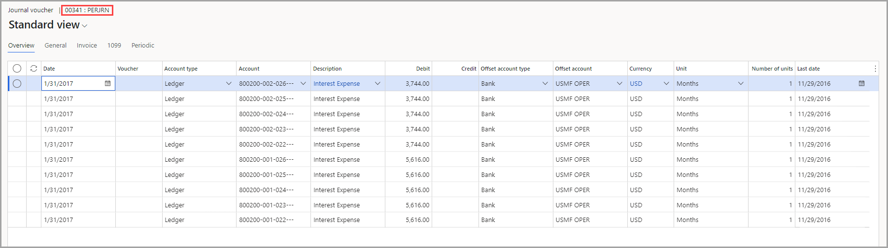

<!-- https://learn.microsoft.com/en-us/training/modules/create-use-workflows-finance-operations/5-work-items -->
<!-- refetched: original harvest URL returned 404 -->
# Use the daily journal workflow

Completed

* 8 minutes

Watch this video to learn how to use a workflow for a daily general journal, submit the workflow for approval, and use the work items to manage the workflow process based on the following scenario.

**Scenario**

Consider a scenario where a journal is posted monthly and must be submitted by an Accounts payable clerk to a workflow. As part of the process, periodic journals are set up to provide a template for common transactions so that they don’t have to be made each time they need to be posted.

The above example shows an interest entry that would be posted every month by the clerk. Given that a periodic journal can't be posted itself, it must be pulled into a general journal and this process is shown in the video below. This is where the Daily journal workflow process to fetch the data from a periodic journal in a daily journal, and then use the workflow for approval. When the Daily journal is successfully set up with the necessary accounts, it can then be submitted to the workflow and be approved by the approver as designated in the workflow.

As a functional consultant, you should explain that periodic journals can't be posted directly into finance and operations apps. The periodic journals are acting as a template for daily journals for periodic vouchers.
This helps you avoid unnecessary customization.

In this video, we show you the difference between the approval of a general journal and the use of a workflow, and also the use of a Period journal.