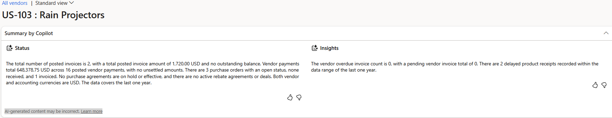

<!-- https://learn.microsoft.com/en-us/training/modules/describe-account-payables-account-receivables/3-describe-core-accounts-payable-components -->
# Describe core accounts payable components in Dynamics 365 Finance

Completed

* 15 minutes

Accounts payable is money owed to suppliers presented as a liability on a company's balance sheet as short-term debt. For example, a restaurant might receive a shipment of food before the food is paid for. This debt is part of its trade payables.

## Vendors

A company purchases goods and services from vendors. Each accounts payable transaction must be associated with a vendor. Use the **Vendors** page to create, maintain, and inquire about vendors.

Always enter as much data as possible when you set up a new vendor in Finance, because that data is used throughout the system for invoices, payments, and reports.

The base data automatically appears as the default for all transactions involving the vendor, but you can change default information if you need to override it.

To learn more about creating vendors, access the corresponding link in the Summary and resources unit at the end of this module.

### Vendor summary with Copilot

Finance and operations apps include an AI-generated **Summary by Copilot** FastTab that provides a quick overview of key vendor information directly on the **All vendors** details page. This summary helps users understand the vendor’s overall status without manually reviewing multiple pages.

Copilot analyzes available data such as posted invoices, overdue invoices, payments, and purchasing activity and presents the most relevant insights in a single panel. For vendors, this may include information like:

* The total number of posted and overdue vendor invoices.
* Outstanding balances and recent payment activity.
* Active purchase agreements or delayed product receipts.
* Vendor currency and accounting currency details.
* Status indicators that highlight trends or potential issues.

**Summary by Copilot** is personalized based on the user’s security roles and the data they work with most. This allows accounts payable users to quickly assess vendor health, monitor activity, and identify items that may require review or follow-up.

## Vendor invoices

To understand vendor invoices, you must first examine where they fit in with the business processes for Accounts payable.

When ordering a product or service from a vendor, you need to create purchase requisitions, enter purchase agreements, and enter purchase orders. Then, as a part of Accounts payable, you need to pay for the product or service. This process involves receiving and entering invoices, generating and submitting vendor payments, and managing vendor settlements.

Enter vendor invoices manually or receive them electronically through a data entity. Attach an electronic copy of the invoice to the record when creating it. After entering or receiving invoices, review and approve them using an invoice approval journal or the **Vendor invoice** page. Automate the review process with invoice matching, vendor invoice policies, and workflow so the system automatically approves invoices that meet specified criteria. Flag any remaining invoices for review by an authorized user.

A vendor invoice from a purchase order is produced when products or services are received according to a purchase order placed with a vendor. The vendor invoice contains a header and one or more lines for items or services. A vendor invoice completes the cycle from purchase order to product receipt to vendor invoice.

Although some vendor invoices connect to a purchase order, vendor invoices can also contain lines that don't correspond to purchase order lines. You can also create vendor invoices that aren't associated with any purchase order. These vendor invoices might represent ongoing services, such as a utility bill. You don't have to reference a purchase order when you add an ongoing service.

You can enter a vendor invoice in several ways:

* The vendor invoice register lets you quickly enter invoices that don't reference a purchase order so you can accrue the expense. It helps nonfinance clerks easily enter vendor invoices for a finance person to post later. By using the vendor invoice approval journal, you can select those invoices and post them to the vendor balance to reverse the accrual.
* In a single step, the vendor invoice journal lets you quickly enter invoices that don't reference a purchase order.
* Together with the vendor invoice pool, the vendor invoice register lets you quickly enter invoices to accrue the expense. You can open the associated purchase orders later to post the invoice against the expense account.
* The **Open vendor invoices** and **Pending vendor invoices** pages let you create vendor invoices from confirmed purchase orders.

### Workspaces for managing vendor invoices

Dynamics 365 Finance provides two workspaces that help accounts payable teams efficiently manage vendor invoices: **Vendor invoice entry** and **Vendor invoice automation**. These workspaces centralize key information, surface exceptions, and provide embedded **Power BI analytics** to help users monitor processing performance and identify issues quickly.

#### Vendor invoice entry workspace

The **Vendor invoice entry** workspace is designed for users who manually enter and process vendor invoices. It provides visibility of invoices awaiting entry, incomplete invoices, pending approvals, and invoices requiring policy or matching review. Embedded Power BI visuals highlight invoice volumes, processing times, and bottlenecks, helping accounts payable teams monitor workload and prioritize tasks.

#### Vendor invoice automation workspace

The **Vendor invoice automation** workspace supports organizations that import or process invoices electronically using Optical Character Recognition (OCR), Electronic Data Interchange (EDI), or other automated methods. The workspace displays automation exceptions, failed imports, unmatched product receipts, or invoices requiring more validation. Power BI analytics provide insights into automation success rates, exception trends, and processing throughput, enabling teams to continuously refine and improve their automation strategy.

## Purchase order

A purchase order is a document that represents an agreement with a vendor to buy goods or services. The document also helps keep track of product receipts made toward the order and, later, the accounting of vendor invoices that the vendor bills toward the order.

The **Purchase orders** page contains an overview of the available orders and lets you modify those orders. When you open a purchase order, you can select the **Header view**, which contains information that is specified only one time for each purchase order, such as the vendor details. Alternatively, you can select the **Lines view**, where you can modify order lines. Typically, you switch between these two views as you modify purchase order. Charges aren't listed directly on the **Purchase orders** page, but you can access them via menus on the order header and lines.

You can access numerous reports on purchase orders, product receipts, and vendor invoices within the **Procurement and sourcing** and **Accounts payable** modules.

The **Purchase order preparation** and **Purchase order receipt and follow-up** workspaces let you view lists of purchase orders in the various states they progressed to. They also provide a summary of the actions that must be taken. The **Purchase order preparation** workspace is focused on purchase order creation and review, order processing through approval, and confirmation with the vendor. The **Purchase order receipt and follow-up** workspace is focused on processing the receipt of goods or services against purchase orders. It includes lists that give insight into receipts that are overdue or that will soon be due for delivery by the supplier. These workspaces aren't used to perform the related receipt activities done in the warehouse. Those activities are performed by using pages in the **Inventory management** and **Warehouse management** modules. Processing vendor invoices should be done by using the **Vendor invoice entry** workspace, and payments should be done by using the **Vendor payments** workspace.

To learn more about the various stages a purchase order goes through, access the corresponding links in the Summary and resources unit at the end of this module.

### Purchase order summary with Copilot

The **Summary by Copilot** FastTab for purchase orders provides an AI-driven overview of open purchase orders. Copilot analyzes order lines and presents status indicators and actionable insights to help teams manage delays, receipts, and invoicing more efficiently.

The **Status** portion of the summary groups lines by their progress:

* **Not fully received**: Lines where quantities haven't been fully registered or received
* **Fully received, not fully invoiced**: Lines that have been received but not yet invoiced
* **Fully invoiced**: Lines where quantities are fully received and invoiced

When at least one order line meets a status condition, a corresponding filter button appears, allowing users to quickly view only the relevant lines.

The **Insights** section highlights other conditions that may impact order processing:

* **Overdue or nearly overdue lines**: Lines awaiting receipt where the expected receipt date is past or approaching
* **Lines without confirmed receipt dates**: Lines that are still awaiting receipt and don't have a confirmed receipt date

Insight filters appear when these conditions exist, helping users quickly isolate lines that may need follow-up. Together, these Copilot summaries provide a clear, actionable view of purchase order health without manual review of each line.

## Three-way matching policies

The term *three-way match* means that the purchase order, goods receipt, and supplier invoice need to line up within acceptable limits for correct and prompt payment.

Let's examine a two-way and three-way matching example for an item and vendor combination.

**Example:** At Fabrikam, a controller decides that all invoices based on purchase orders must match the order lines using a two-way matching policy. This means the invoice unit price and net amount must match those on the purchase order.

The volume and amounts are small, and Fabrikam had delivery problems with some vendors in Malaysia. For these reasons, the bookkeeper sets the level of control for certain items and vendor combinations procured in Malaysia to three-way matching.

The invoice matching policies in this example help people in the following roles meet these goals:

* The Fabrikam controller can assist members of the organization in detecting and resolving issues related to the procurement, reception, and payment for goods and services from suppliers.
* The bookkeeper for the Malaysia division can enforce corporate policy and make sure invoices are paid only after they're matched with purchase order lines and product receipts that represent the receipt of goods and services.
* The bookkeeper can also increase the level of control to three-way matching for specific items to control operational costs.

### Prerequisites

* The controller sets the matching policy at the legal entity level to **Two-way matching**.
* The controller sets the **Match price totals** field for the legal entity to **Percentage** and enters **10%** as the tolerance percentage.
* The controller sets the unit price tolerance for all items to **2%**.
* The bookkeeper sets the matching policy at the item and vendor combination level. For example, the bookkeeper set an item named PH2500 – Computer for the vendor Contoso to **Three-way matching**.
* A purchase order clerk at the Malaysia division issues purchase orders to Contoso to supply three items, as depicted in the following table. When the clerk creates the purchase order, the clerk overrides the matching policy for the wireless mouse to be three-way matching instead of two-way matching.

| **Item number** | **Quantity** | **Unit price** | **Net amount** | **Matching policy (default entry)** | **Matching policy (on the purchase order line)** |
| --- | --- | --- | --- | --- | --- |
| PH2500 – Computer | 2 | 2,500.00 | 5,000.00 | Three-way matching | Three-way matching |
| MM01 – Wireless Mouse | 2 | 40.00 | 80.00 | Two-way matching | Three-way matching |
| USB Drive | 200 | 10.00 | 2,000.00 | Two-way matching | Two-way matching |

### Scenario

1. The items arrive. A worker in the receiving department of the Malaysia division of Fabrikam is interrupted and doesn't post the product receipt immediately.
2. The accounts payable coordinator at Fabrikam enters and verifies the invoice submitted by Contoso. The coordinator verifies the following information:
   * For items that require three-way matching, the quantity on the invoice line matches the quantity received. The quantity received is indicated on the product receipt that is matched to the invoice.
   * For items that require two-way or three-way matching, the prices on the invoice line are within the tolerances defined in the application. This process includes the following types of price matching:

     + **Net unit price matching:** The net unit price on the invoice line matches the net unit price on the purchase order line, within the tolerance percentage. In this example, the net unit price tolerance is +2%.
     + **Price totals matching:** The net amount on the invoice line matches the net amount on the purchase order line, within the tolerance percentage, amount, or percentage and amount. In this example, the price total matching tolerance is +10%.

The paper invoice from Contoso contains the information shown in the following table.

| **Item** | **Quantity** | **Unit price** | **Net amount** |
| --- | --- | --- | --- |
| PH2500 – Computer | 2 | 2,500.00 | 5,000.00 |
| MM01 – Wireless Mouse | 2 | 41.00 | 82.00 |
| USB Drive | 200 | 10.05 | 2,010.00 |
| Total invoice |  |  | 7,092.00 |

The invoice line includes the information in the following table.

| **Item number** | **Quantity** | **Unit price** | **Line net amount** | **Matching policy** | **Product receipt quantity match** | **Price match** | **Price total match** |
| --- | --- | --- | --- | --- | --- | --- | --- |
| PH2500 – Computer | 2 | 2,500.00 | 5,000.00 | Three-way matching | Failed | Passed | Passed |
| MM01 – Wireless Mouse | 2 | 41.00 | 82.00 | Three-way matching | Failed | Failed | Passed |
| USB Drive | 200 | 10.05 | 2010.00 | Two-way matching |  | Passed | Passed |

Note

For the PH2500 – Computer line, the **Product receipt quantity match** column has a warning icon, because the invoice line isn't matched to a product receipt. For the MM01 – Wireless Mouse line, the **Product receipt quantity match** column has a warning icon, because the invoice line isn't matched to a product receipt. The **Unit price match** column has a warning icon, because the 2% net unit price tolerance is exceeded. For the USB Drive line, the **Product receipt quantity match** column is blank, because two-way matching doesn't match invoice line and product receipt line quantities.

If approval is required for invoices to be posted with invoice matching discrepancies, the **Approve posting with matching discrepancies** toggle on the **Invoice matching details** page must be selected before the invoice can be posted with price matching errors and quantity matching errors. If approval isn't required, invoice processing can continue if there are no other posting errors.