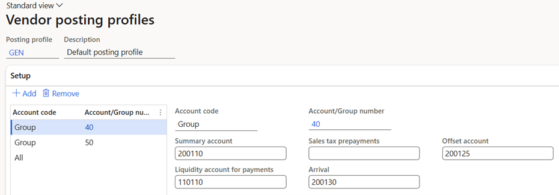

<!-- https://learn.microsoft.com/en-us/training/modules/describe-account-payables-account-receivables/4-describe-posting-profiles -->
# Describe vendor posting profiles in accounting

Completed

* 10 minutes

Vendor posting profiles determine how vendor-related transactions post to the general ledger. They define the ledger accounts used for invoices, payments, prepayments, and settlements. By providing consistent and controlled accounting for all vendor activity, posting profiles ensure that transactions follow the same financial rules across the organization, regardless of how many vendor groups or specialized account structures are in use.

By directing each type of vendor transaction to the correct ledger account, posting profiles simplify reconciliation, support accurate liability tracking, and maintain clean financial reporting. When combined with accounting dimensions, they help create complete and well-structured account strings that improve traceability, segmentation, and analysis of payables activity.

## Vendor posting profiles

Vendor posting profiles map vendor transactions to specific general ledger accounts. Because each business may have different accounting requirements, posting profiles provide flexibility by letting organizations define accounts at several levels:

* **All vendors**: The default accounts used for every vendor unless a more specific rule applies
* **Vendor group**: The accounts assigned to a group of similar vendors, such as services, domestic suppliers, or international suppliers
* **Individual vendor**: The most specific level, allowing you to override group settings for a specific vendor account

The *most specific* definition available is always used. For example, if an individual vendor has a posting profile assigned, that account is used instead of the vendor group’s or the global **All** profile.

Posting profiles allow organizations to structure accounts payable activity so reporting, reconciliation, and account segmentation all remain accurate.

A vendor posting profile can define several important ledger accounts. These accounts may include:

* **Summary account (Accounts payable account)**: The liability account where vendor balances are recorded
* **Sales tax prepayment account**: The account used when posting sales tax prepayments
* **Liability account for payments**: The account used when vendor payments are recorded
* **Arrival account**: The account used when goods are received but not yet invoiced
* **Offset account**: The balancing account used when posting vendor invoices or payments in journals

Each of these accounts ensures that vendor transactions follow the correct financial structure, especially in environments with multiple vendor types, or complex accounting rules.

### How posting profiles work with journal dimensions

When you post vendor invoices or payments in journals, the system uses the posting profile to select the correct vendor accounts and combines them with the accounting dimensions from the journal lines. This process ensures each transaction is posted to the right account with the proper details for reporting.

Financial dimensions such as department, cost center, business unit, or project are then applied to each line based on journal setup, vendor defaults, or user entry. Together, the posting profile and dimensions create a complete account string. This ensures each transaction is recorded in the correct account with the right level of segmentation for reporting and analysis.