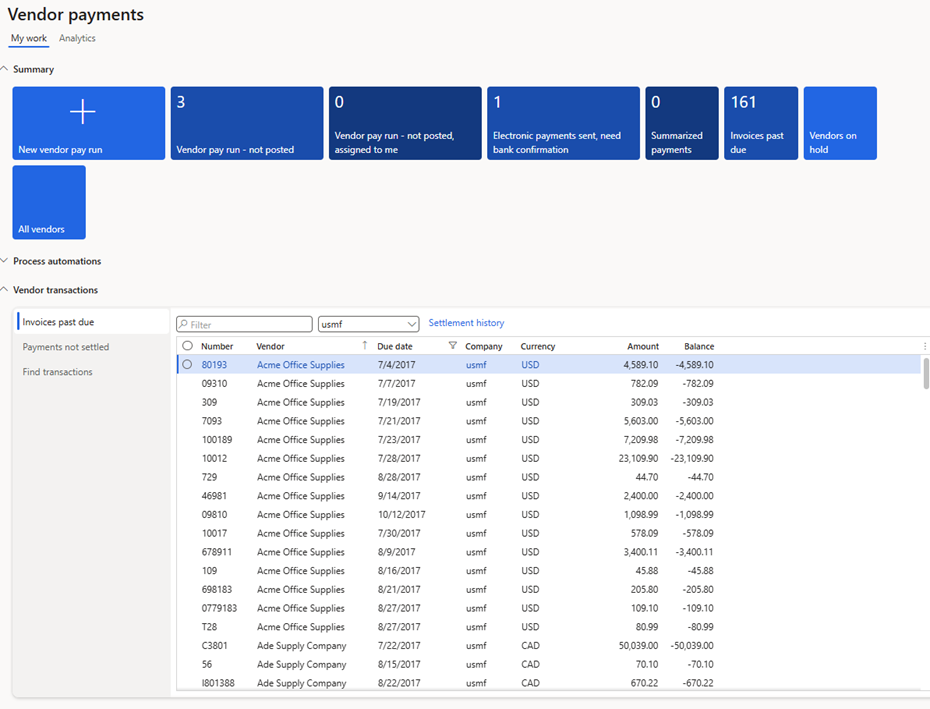

<!-- https://learn.microsoft.com/en-us/training/modules/describe-account-payables-account-receivables/5-describe-vendor-payments-settlements -->
# Describe vendor payments and settlements

Completed

* 15 minutes

When paying for a product or service ordered from a vendor, you need to receive and enter invoices, generate and submit vendor payments, and manage vendor settlements.

Multiple methods are available to enter a vendor payment, including using a payment proposal, manually entering a one-off payment, and prepayments. You manage them from **Accounts payable** > **Payments** > **Payment journal**.

## Create vendor payments by using a payment proposal

Payment proposals are often used to create vendor payments. You can use the query to quickly select vendor invoices for payment based on criteria such as the due date and cash discount.

Organizations often use payment proposals to create vendor payments, because the payment proposal query can be used to quickly select vendor invoices for payment based on the due date, cash discount, and other criteria.

The following table provides an example in which vendors issued the invoices.

| **Vendor** | **Invoice** | **Invoice date** | **Invoice amount** | **Due date** | **Cash discount date** | **Cash discount amount** |
| --- | --- | --- | --- | --- | --- | --- |
| 3050 | 1001 | June 15 | 500.00 | July 15 | June 29 | 10.00 |
| 3050 | 1002 | June 20 | 600.00 | July 20 | July 4 | 12.00 |
| 3075 | 1003 | June 15 | 250.00 | June 28 |  | 0.00 |
| 3100 | 1004 | June 17 | 100.00 | July 17 | July 1 | 1.00 |

On July 1, the accountant who handles payments and pays vendors uses a payment proposal to help complete this task more efficiently.

### Option 1: By cash discount

The accountant selects **Cash discount** as the proposal type. They enter a date range of June 26 to July 10. Given that, the following invoices are included in the proposal:

* **1002**: The discount date of July 4 is in the range of payment dates.
* **1004**: The discount date of July 1 is in the range of payment dates.

The following invoices aren't included in the proposal:

* **1001**: The discount date of June 29 has already expired, so this invoice is no longer eligible for the cash discount.
* **1003**: This invoice doesn't have a discount date.

### Option 2: By due date

The accountant selects **Per due date** as the proposal type. They enter a date range of June 26 to July 10. Given that, the following invoice is included in the proposal:

* **1003**: The due date of June 29 is in the range of payment dates.

The following invoices aren't included in the proposal:

* **1001**: The due date of July 15 is outside the range of payment dates.
* **1002**: The due date of July 20 is outside the range of payment dates.
* **1004**: The due date of July 17 is outside the range of payment dates.

### Option 3: By due date and cash discount

The accountant selects **Due date and cash discount** as the proposal type. They enter a date range of June 26 to July 10. Given that, the following invoices are included in the proposal:

* **1003**: The due date of June 29 is in the range of payment dates.
* **1002**: The discount date of July 4 is in the range of payment dates.
* **1004**: The discount date of July 1 is in the range of payment dates.

The following invoice isn't included in the proposal:

* **1001**: The discount date of June 29 has already expired, so this invoice is no longer eligible for the cash discount, and the due date of July 15 is also outside the date range.

To learn more about creating vendor payments using a payment proposal, access the corresponding links in the Summary and resources unit at the end of this module.

### Workspace for managing vendor payments

Dynamics 365 Finance includes a dedicated **Vendor payments** workspace that gives accounts payable users a consolidated and analytics-driven view of pending vendor payments. This workspace uses embedded Power BI visuals to present key information such as due invoices, upcoming payment deadlines, cash discount opportunities, and settlement status across all vendors.

The workspace centralizes everything needed to manage payment runs, including access to payment proposals, vendor balances, and payment journals. Power BI insights help accounts payable teams identify overdue invoices, track payment history, monitor trends, and act on items requiring settlement. This enables users to prioritize payment processing more effectively, reduce manual research, and ensure vendors are paid accurately and on time.

## Prepayments

Organizations might issue prepayments (advance payments) to vendors for goods or services before those goods or services are fulfilled.

You can choose from two methods to issue prepayments to vendors: **prepayment invoicing** and **prepayment journal vouchers**. To minimize risk, you can track prepayments by defining the prepayment on a purchase order. For this method, you must create a prepayment invoice that is associated with a purchase order. This method is referred to as prepayment invoicing. Organizations that don't want to track prepayments as closely or don't receive a prepayment invoice from their vendor can use prepayment journal vouchers instead of the prepayment invoicing method. You can create prepayment journal vouchers by creating journal entries and marking them as prepayment journal vouchers. For this method, you can't track which prepayments to a vendor are made against which purchase orders. However, you can mark a posted prepayment for settlement against a purchase order.

To learn more about prepayments, access the corresponding link in the Summary and resources unit at the end of the module.

## Settlements

Settlement is the process of applying payment to an invoice.

Now let's examine an example of settlement.

### Settle a partial vendor payment and the final payment in full before the discount date

In this scenario, partial payments are made for a vendor invoice, and a cash discount is taken.

Your company buys raw materials from a vendor, who gives a cash discount of 1 percent if the invoice is paid in 14 days. Invoices must be paid in 30 days. The vendor also gives cash discounts on partial payments. The settlement parameters are located on the **Accounts payable parameters** page.

### Vendor invoice on June 25

On June 25, the accountant of your company enters an invoice for $1,000.00 for the vendor. The accountant can view this transaction on the **Vendor transactions** page.

From the **Vendors** page, your accountant opens the **Settle transactions** page. The accountant can use the **Settle transactions** page to view the dates and amounts of cash discounts. The due date is July 25, and a cash discount of -10.00 is available if the invoice is paid by July 9.

### Partial payment on July 1 by using the Settle transactions page

The accountant of your company can create a payment journal for this payment by opening the **Payment journal** page in **Accounts payable**. The accountant creates a new journal and enters a line for vendor. The accountant then opens the **Settle transactions** page to mark the invoice for settlement. Then, the accountant marks the invoice and changes the value in the **Amount to settle** field to -500.00. They notice that the value in the **Cash discount amount** field is -10.00 for the full invoice and that the value in the **Cash discount amount to take** field is -5.05. Therefore, the accountant is settling -505.05 of this invoice.

The accountant wants to settle exactly half the invoice. Therefore, they change the value in the **Amount to settle** field to **-495.00**. The total settled amount is now 500.00. This amount includes a -5.00 cash discount.

After your accountant closes the **Settle transactions** page, a payment line for 495.00 appears in the journal, and the accountant then posts the journal. They can review the vendor transactions on the **Vendor transactions** page. The accountant notices that the invoice has a balance of -500.00 and notices a payment of 495.00 and a cash discount of 5.00.

### Remaining amount paid on July 8

The accountant pays the rest of the invoice for vendor 3064 on July 8, which is in the cash discount period. The accountant creates the payment journal on July 8 and marks the transaction for settlement. The accountant notices that the amount that must be settled is 495.00. The value in the **Estimated cash discount** field is -5.00, because the 5.00 discount was previously given.

The accountant posts the payment journal and reviews the vendor transactions on the **Vendor transactions** page. The balance for the invoice is now 0.00.

The following video explains the vendor payment methods.

Depending on the business requirements, different processes can be used for the vendor payment.

## Invoice matching

Accounts payable invoice matching is the process of validating vendor invoices against the related purchase order and product receipt to ensure pricing and quantities are correct before posting. When Dynamics 365 Finance compares these documents, any differences are identified as matching discrepancies. These discrepancies are evaluated against the tolerance rules configured for the legal entity. If a discrepancy exceeds the allowed tolerance, the system flags the issue on the **Vendor invoice** and **Invoice history** and **Matching details pages** so it can be reviewed and resolved before the invoice is posted.

### Types of invoice matching

Dynamics 365 Finance supports several types of invoice matching to help enforce purchasing controls:

* **Invoice totals matching** compares the overall invoice totals such as charges, discounts, sales tax, and the invoice amount to the expected totals from the purchase order.
* **Two-way matching** verifies that invoice prices fall within the allowed tolerance when compared to the purchase order.
* **Three-way matching** adds another check by ensuring that the invoice quantity matches the quantity received on the product receipt.
* **Charges matching** ensures that charges assigned to the invoice don't deviate from the corresponding charges on the purchase order.

Two-way and three-way matching can validate prices using either **net unit price matching** or **price totals matching**, depending on how the legal entity's invoice matching policies are configured. Invoice matching is typically performed automatically during invoice entry but can also be run on demand or reviewed as part of an approval workflow. Users can review or override discrepancies as needed.