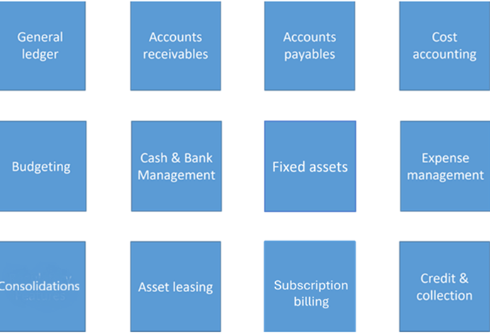

<!-- https://learn.microsoft.com/en-us/training/modules/describe-dynamics-365-finance-core-capabilities/2-describe-finance-capabilities-features -->
<!-- refetched: original harvest URL returned 404 -->
# Describe Dynamics 365 Finance capabilities and features

Completed

* 15 minutes

Finance is designed for the multi-company, multi-currency business of an organization and monitors the performance of a company on a real-time basis. Finance forecasts future results and makes data-driven decisions to boost the growth of the organization, regardless of its size and the industry in which it operates.

## General ledger

With the General ledger module, you can define and manage a legal entity’s financial records. The general ledger is a register of debit and credit entries. These entries are classified using the accounts listed in a chart of accounts.

**Use case:** An organization is implementing Finance to digitize its finance and accounting system. General ledger is the first module the organization designs. You need to configure the fiscal year followed by the chart of accounts and main accounts. Then you need to define the dimensions and dimension sets, followed by the accounting structures. Finally, you need to set up the ledger, where you link the fiscal year, chart of accounts, and accounting structure. You also need to define the default currency and default exchange rate in the ledger setup. All your accounting transactions follow the configuration you implemented in the ledger setup.

## Accounts receivable

Accounts receivable (AR) is the balance of funds due from a customer for products or services delivered and invoiced. The total value of all accounts receivable is listed on the balance sheet as current assets. You use AR to track customer invoices and incoming payments. You can create customer invoices that are based on sales orders or packing slips. You can create free text invoices if the invoices aren't related to sales orders. You can also receive payments by using several payment types, which include bills of exchange, cash, checks, credit cards, and electronic payments.

**Use case:** You’re an accounts receivable manager. You need to account for all the receivables transactions in your ledger book, such as customer invoices and vendor returns. The Accounts receivable module can settle all your receivables with the payment transactions. The module supports different modes of payments, payment terms, cash discount rules, payment days, and calendars.

## Accounts payable

Accounts payable (AP) are the amounts of money that a company owes its vendors or suppliers for goods or services that were received but not yet paid for. The total value of all accounts payable is listed on the balance sheet as the liability. You can manually enter vendor invoices or import them electronically through integration services. After you enter or receive invoices, you can review and approve them by using an invoice approval journal. The system enables the use of invoice matching, vendor invoice policies, and workflows to automate the review process. Invoices that meet certain criteria are automatically approved and the remaining invoices are flagged for review.

**Use case:** You’re an accounts payable manager who needs to account for all the payable transactions in your ledger book, such as vendor invoices and customer returns. The Accounts payable module can settle all your payables with the payment transactions you make. The module supports different modes of payments, payment terms, cash discount rules, payment days, and calendars.

## Cost accounting

Cost accounting is a branch of accounting focused on tracking and analyzing the costs a business incurs. The Cost accounting module helps you record, classify, and summarize costs. It also supports managing allocation bases, maintaining the cost ledger, entering costs, classifying costs, and understanding how costs behave.

**Use case:** You're the regional operations head of a multinational company. You're responsible for the operations of four countries/regions, represented by four legal entities. You have a cost center to manage the operations of the countries/regions. The Cost accounting module helps you account for the day-to-day operations of the legal entities. It helps you decide how to effectively use the resources by tracking and measuring them and studying their effects. It also guides you toward cost control.

## Budgeting

This module provides an overview of the budgeting functionality components, budgeting tools, and reporting capabilities. The Budgeting module in Dynamics 365 is divided into three primary sections: budget planning, budget entry, and budget control. Budget planning is the process that ensures the organization policies, procedures, and requirements are met while implementing the budget. Budget entry, the following step, helps register the budget line items in Finance and maps the line items with general ledger accounts. Budget control is the optional step that validates the financial transactions in Finance based on the registered budget lines.

**Use case:** You're the financial controller of an organization. You use Finance to ensure long-term strategic planning and annual budget planning to track financial transactions aligning with the organizational hierarchy. You can configure budget allocation for the main accounts and dimensions defined in the chart of accounts of the organization. You can also enforce budget control at the transaction level, based on the established budget. The level of control depends on the organizational culture and the organization's level of maturity.

## Cash and bank management

The Cash and bank module is used to maintain a legal entity’s bank accounts and the financial instruments that are associated with those bank accounts. These instruments include deposit slips, checks, bills of exchange, and promissory notes. You can also reconcile bank statements and print bank data on standard reports.

**Use case:** You’re an accountant who maintains organizational bank accounts and performs all bank-related operations from within the Cash and bank management module. If you need to reconcile a bank statement with your ledger book, you can import the bank statement to Finance and then automatically reconcile it from within bank transactions. You can also forecast the cash flow figures in this module. The accounts payable and receivable data along with the payment conditions can deduce the cash flow forecast of your organization.

## Fixed assets

This module provides access to resources that use fixed assets for Finance. Fixed assets are items of value owned by an individual or organization. The items include buildings, vehicles, land, and equipment.

**Use** **case:** Your organization relies on various fixed assets for its operations, which include tangible items like property, machinery, and inventory. You're an accountant for the company who uses these assets to generate the organization's products and services. The organization possesses intangible assets, including copyrights, brands, and goodwill, which contribute to its future value and worth and are occasionally more valuable than tangible assets. In the Fixed assets module, you maintain an asset’s profile, such as purchase details, current valuation, and depreciation profile.

## Expense management

With the Expense management module, you can create an integrated workflow to store payment method information, import credit card transactions, and track the money that employees spend. You can also define expense policies and automate the reimbursement of travel expenses.

**Use** **case:** A company has rules and policies defined for different expenses such as travel and food. You're the human resources manager for the company. In the Expense management module, you define all these policies based on the organizational hierarchy. For instance, when an employee logs expenses, they match the established policies. You can also record expenses for cross-legal entity scenarios. This is useful when an employee works on a project associated with a different legal entity and those expenses need to be allocated to that specific project.

## Consolidations

Finance and operations apps can roll up data from multiple legal entities within the application as well as external data from entities that aren't managed within the finance and operations apps instance. Reports on the consolidated data are often reported both internally and externally.

**Use case**: You're an accountant in a multinational organization that operates through five legal entities located in different countries/regions. Each entity manages its own financial operations, including period and year-end closings, in compliance with local regulations. The corporate headquarters requires consolidated financial statements for internal management reporting and external stakeholders.

## Asset leasing

Finance provides an advanced capability for managing, tracking, and automating financial transactions for leased assets. This module handles lease details, generates journal entries, and manages the entire lease lifecycle - from initial recognition to monthly journal entries, impairment, and lease termination.

**Use case:** Your company plans to expand business. Instead of purchasing furniture, you plan to lease those items. The asset leasing process includes transactions such as lease agreements, lease calculations, and lease transactions. These transactions are booked in the ledger book in accordance with a defined posting rule. Finance enables the company to maintain this process along with various lease components such as payment schedules, start and end dates, payment frequency, and lease amortization.

## Subscription billing

With subscription billing, you can manage subscription revenue and recurring billing by using a billing schedule. The functionality supports recurring contract billing, revenue, expense deferrals, and multi-element revenue allocation. You can use these components together or independently as your organization's needs require.

**Use case:** Your organization uses subscriptions and plans to use subscription billing features in Finance. You can include recurring software subscriptions, physical item subscriptions, and recurring fees for equipment rentals. Organizations with consumption-based billing can use subscription billing based on professional service hours provided.

## Credit and collection management

Customer credit management lets you manage credit limits and control the flow of sales orders through the posting process, based on credit rules that you create. Collections management centralizes the supervision of accounts receivable collections data. The Accounts receivable module provides the payment terms and schedules, which define the collection generation process. It can generate collection reminders based on the defined schedule. It can also generate interest if a payment is due.

**Use case:** You’re responsible for maintaining relationships with customers and generating sales orders in a sales organization. You can use the Credit management module to find credit eligibility of customers based on their credit score. Collection managers can use the centralized view to manage collections. Collections agents can begin the collections process either from customer lists generated by using predefined collection criteria or from the **Customers** page.

## Regulatory features

Finance and operations apps include regulatory functionality for different countries/regions. This functionality is enabled based on the primary address of the active legal entity. This functionality has regulatory updates to address new or changed country/region-specific legislation. Regulatory updates are delivered either as hot fixes (HF) or as part of a release preview (Preview). It also submits and reviews regulatory alerts. You can check [Regulatory updates](/en-us/dynamics365/finance/localizations/regulatory-updates) for the latest regulatory update plans.

**Use case**: You're an accountant in an organization in India. You need to implement the Goods and Service Tax (GST) in the electronic invoices created for your local customers. You can use the Regulatory features module to accomplish this task by downloading and implementing the Electronic Invoice under GST hotfix, which provides India-specific regulatory updates.