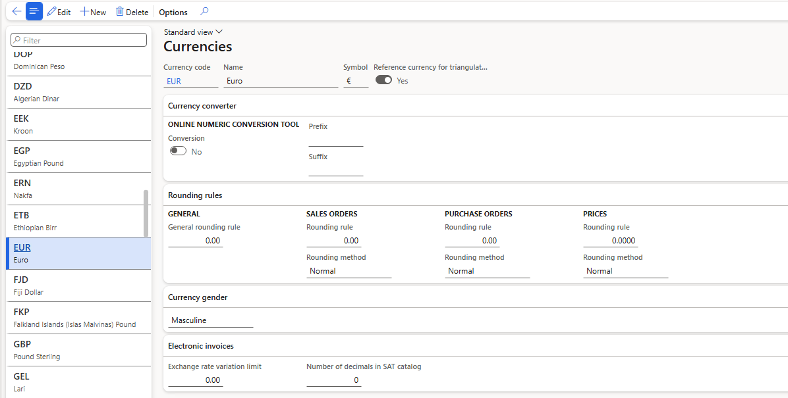

<!-- https://learn.microsoft.com/en-us/training/modules/describe-dynamics-365-finance-core-capabilities/3-describe-reporting-currency-accounting-currency -->
<!-- refetched: original harvest URL returned 404 -->
# Describe reporting and accounting currencies

Completed

* 15 minutes

You may need to use multi-currency functionality in your organization for several reasons; for example:

* Your organization is engaged in business with other countries/regions in other currencies.
* Your organization has branches in multiple places that use different currencies.
* Your branches are engaged in business in their respective currencies, but they report to headquarters in one reporting currency.

Finance and operations apps currency and exchange rate definitions are global and shared across all legal entities.

Finance is shipped with 177 standard global currencies. In some rare cases, customers may need to add currencies that aren't listed in the standard shipped application. Finance uses a reserved ISO code 999 in scenarios such as adding a new currency.

Each legal entity must have a primary currency, which is the accounting currency for that legal entity. The primary currency is the default currency for any transaction in the legal entity. If you want to do a transaction in another currency, you must define the exchange rate with the default currency. The system doesn't allow you to process the transaction if the exchange rate is undefined.

In Finance, you can define multiple exchange rate types. You can define different exchange rates for the same currencies and apply them for different processes. You can set a Default exchange rate type for regular transactions, with daily updates of the exchange rates. You can have an exchange rate type for budget to use for the creation of an annual budget. A tentative exchange rate is maintained in the budget exchange rate, which is applicable throughout the year.

When you select the **Exchange rates** buttons in the action pane, you can navigate to the **Currency exchange rate** page, where you can define the exchange rates between the currencies. In the **Add or remove exchange rate** FastTab, you can define the exchange rate based on dates. Multi-currency transactions pick up the correct exchange rate based on the transaction date and update the transactions accordingly.

The default currency and default exchange rate types of a legal entity can be defined in the Accounting currency and Accounting currency exchange rate type fields respectively in the **General ledger module > Setup > Ledger page**. You can also define the budget exchange rate type on the **Ledger** page. You can define the sales tax exchange rate type on the General ledger parameters page.

You can define the reporting currency on the **Ledger** page and use it as a second accounting currency. This functionality is referred to as dual currency.

The **General ledger** module includes two page links on the **Currency** menu: **Configure exchange rate providers** and **Import currency exchange rates**. These two menus help to configure the exchange rate provider and import the latest exchange rate in the specified exchange rate type.

You can also define the **Maximum penny difference** and **Maximum penny-rounding** in the reporting currency under the **General ledger parameters** page. For multi-currency journal posting, these two fields configure the penny difference threshold between the accounting currency and transaction currency.

The difference amount is posted in the main account defined against the posting type **Penny difference** in account currency in the **Accounts for automatic transaction** page. This page is available on the **Posting** setup menu in the **General ledger** module.

## Currency revaluation

During the period-end closing, companies operating in multiple currencies must revalue transactions by using the latest exchange rates, typically as of the last day of the period. Because exchange rates fluctuate daily, it’s essential to determine the current value of balances in each main account in both the accounting and reporting currencies. Foreign currency revaluation processes handle this fluctuation by posting adjustments to unrealized gain or loss accounts defined in the ledger.

This process doesn't alter the original transaction amounts in the subledger. Instead, it updates only the accounting and reporting currencies. Separate revaluation routines exist for bank balances, accounts payable, and accounts receivable. Main accounts revalued by the subledger revaluation process shouldn't be revalued in the ledger; main account should specify No to Foreign currency revaluation.

For example, consider a customer invoice for \$1,000 USD in a company whose accounting currency is EUR. At posting, the amount translated to €910, but the exchange rate later changes so that the amount is now €920. From the customer's perspective, the balance remains \$1,000 USD. In the company's books, however, the open accounts receivable is revalued to €920 in accounting currency, while the reporting currency remains \$1,000 USD.

Revaluation applies only when the accounting or reporting currency differs from the transaction currency. If all three currencies match, no adjustment is made.