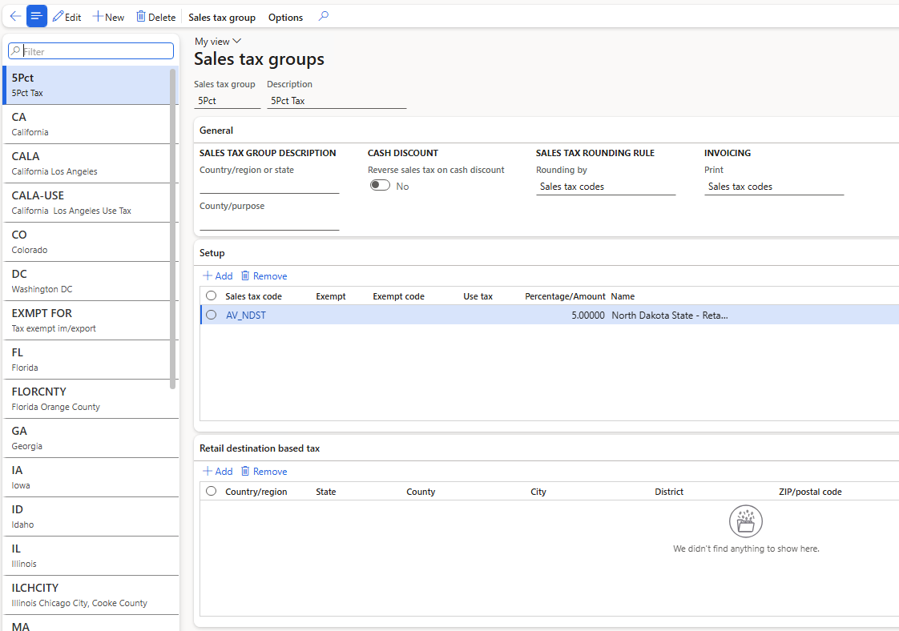

<!-- https://learn.microsoft.com/en-us/training/modules/describe-dynamics-365-finance-core-capabilities/4-describe-tax-capabilities -->
<!-- refetched: original harvest URL returned 404 -->
# Describe tax capabilities in Dynamics 365 Finance

Completed

* 25 minutes

Dynamics 365 Finance includes a comprehensive tax module designed to seamlessly integrate with all finance and operations modules. The tax module provides a configurable tax calculation framework that complies with various tax requirements, primarily with sales tax and withholding tax.

## Sales tax codes

You define the sales tax code in the module **Tax** > **Indirect tax** > **Sales tax** > **Sales tax codes.** You can then define the sales tax currency and settlement period for each sales tax code.

From the action pane of the sales tax codes page, you can select the Sales tax code > Values option to define tax calculation rules. You can define the sales tax percentages that are applicable between from and to dates. The sales tax percentages are also applicable between minimum or maximum amounts defined in this page.

Sales tax is calculated based on:

* percentage of gross or net amount
* percentage of other sales tax amounts
* quantity of items

Tax percentages may differ based on the ranges of invoice amount.

The **Ledger posting group** is a key configuration on the **Sales tax codes** page. With the **Ledger posting group,** you can define the main accounts for payable taxes and settlement.

## Sales tax settlement periods

Sales tax settlement periods define the period intervals for which sales tax needs to be reported and paid to the sales tax authorities. You can run a settlement process for a specific date interval and base the intervals on a defined period. You can also associate the settlement period with the sales tax code. Depending on how you set up the related Sales tax authority, the tax liability is posted either to a vendor or a general ledger account.

## Sales tax groups

Sales tax groups consist of sales tax codes linked to both customers and vendors. Additionally, they're associated with ledger accounts for transactions that don't involve posting to a vendor or customer.

A sales tax group includes all sales tax codes that apply when you trade goods or services with customers and vendors.

In most countries or regions, different tax rules apply when you trade with domestic and foreign customers. The tax rules for foreign trade are frequently split up based on bilateral and multilateral trade agreements. Therefore, you need to create tax groups depending on the taxes that might apply for a certain group of customers or vendors.

Analyzing the various kinds of clients and suppliers that the firm deals with is a great place to start figuring out the kinds of sales tax groups needed and how to set up those sales tax groups.

Because the geographic location of the customer or the supplier determines taxes, you usually assign the same sales tax group to similar trading partners in the system. The correct tax codes the system uses are attached to this sales tax group.

## Item sales tax groups

Because items generally determine taxes, you need to indicate how taxes are calculated for each item.

Item sales tax groups are groups of sales tax codes attached to resources like products.

The item sales tax group includes all the sales tax codes that apply when you sell that item. The item sales tax group also might include most of the sales tax codes in the system. When you create the item sales tax groups, you attach the group to items.

Sales tax for a transaction is calculated using the sales tax codes that are included in both the sales tax group and the item sales tax group. You must select a sales tax group and an item sales tax group for each transaction that requires sales tax. The **Item sales tax group** page lists the available sales tax codes.

Note

Every transaction for which you need to calculate and post sales tax must have a sales tax group and an item sales tax group.

Sales tax groups are linked to the party involved in a transaction, such as a customer or vendor. Item sales tax groups are linked to the resource, like an item or procurement category. Both types of groups contain lists of tax codes. Only the tax codes found in both the sales tax group and the item sales tax group are applied to the transaction.

## Sales tax reporting codes

Sales tax reporting codes refer to a field number on a sales tax report. They're used in country/region-specific report layouts and the **Sales tax payment by code** report to print sales tax amounts for a settlement period that is summarized for each reporting code.

You must report and pay sales tax to tax authorities at regulated intervals (monthly, quarterly, etc.). Finance provides functionality that lets you settle tax accounts for the interval and offset the balances to the tax settlement account, as specified in the ledger posting groups. You can access this functionality on the **Settle and post sales tax** page. Be sure to indicate the period for which sales tax needs to be settled.

After you create Sales tax reporting codes, you can refer to them on the **Report setup** FastTab on the **Sales tax code** page.

You can use this layout to filter the available reporting codes for a sales tax code. Each sales tax code belongs to a settlement period that belongs to a sales tax authority that uses a report layout.

After you pay the sales tax, you should balance the sales tax settlement account against the bank account.

If the sales tax authority specified on the sales tax settlement period is related to a vendor account, the sales tax balance is posted as an open vendor invoice. It can be included in the regular payment proposal.

The following is a sample of the **Sales tax code** report for Contoso Entertainment System.

## Sales tax code configuration

You can associate a sales tax group with a customer and a vendor. When you create a sales order or purchase order, the sales tax group is associated to the order header based on whether you select customer or vendor.

An item sales tax group is added to the finished product. When you select the item in an order line, the item sales tax group is also populated in the order line. Sales tax codes common to both sales tax group and item sales tax group are used for tax calculation on the specified order line. Sales taxes are added to the invoiced amount based on the configuration.

You can define the sales tax group and item sales tax group in the journals. These groups eventually identify the applicable common sales tax codes for the journals.

You can take what you learned in this unit and expand it by learning about cost accounting concepts.

The following video explains the sales tax configuration for a financial transaction.

This sales tax configuration is applicable for the transactions in Dynamics 365 Supply Chain Management and Dynamics 365 Commerce also.

## Purchase tax

In many countries and regions, purchasers are required to pay tax when the vendor doesn't charge it. In the United States, this is known as **Use tax**; in European countries/regions, the tax is typically value-added tax (VAT).

Purchase VAT is calculated differently from sales VAT. A significant portion of purchase VAT is often recoverable, meaning that the VAT paid on purchases can offset the VAT owed on sales and other purchases by the recoverable amount.
Purchase tax, like sales tax, relies on tax codes shared by both tax groups and item tax groups specified on the purchase order. When recording purchases in a journal, you can define the item sales tax group directly in the journal line, as the process uses main accounts instead of items.

## Withholding tax

You can define withholding tax codes in the **Tax** module under **Indirect tax** > **Withholding tax.** Based on the configuration of the withholding tax, you can deduct the tax while paying your vendor. You can base the tax percentage on net or gross invoice amount. The withholding tax percentage may change based on the invoice amount.

You can create a withholding tax group and associate each withholding tax code with a group. The vendor is then associated with the withholding tax group. When you make a payment to the vendor, the withholding tax is deducted from the payable amount.

Withholding tax is limited to just a few countries/regions and isn't available in legal entities that aren't in one of those countries/regions. This is NOT the Withholding tax we refer to on payroll statements. This is a purchase or sales tax. It refers to deducting a portion of the payable amount upfront, collected when the payment or credit is processed.