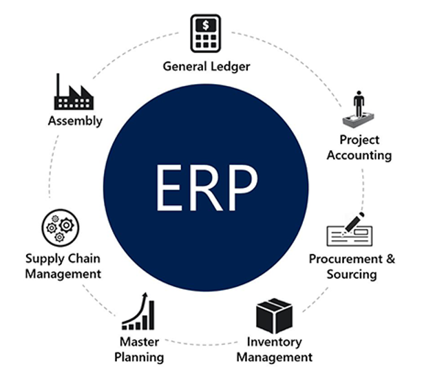
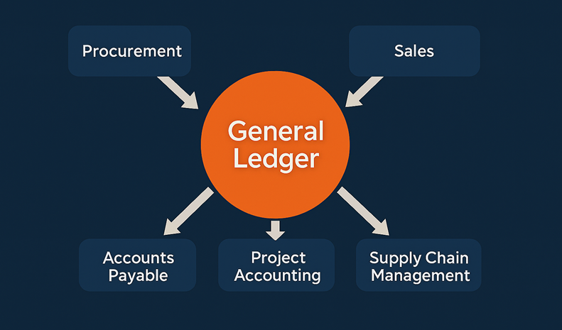

<!-- https://learn.microsoft.com/en-us/training/modules/describe-finance-operations-apps/2-describe-enterprise-resource-planning-erp -->
<!-- refetched: original harvest URL returned 404 -->
# Describe enterprise resource planning (ERP)

Completed

* 8 minutes

Generally, ERP software automates back-office processes for finance, sales, procurement, inventory management, and manufacturing. Organizations can gain a real-time view across their operations by using one central database. Multiple business functions are supported by an ERP system, such as:

* General ledger
* Project accounting
* Procurement and sourcing
* Inventory management
* Master planning
* Supply chain management
* Assembly

An effective ERP system also allows an organization to analyze transactional data, resulting in more efficient processes.

The core of the ERP is the general ledger. It's the central hub for all financial transactions. Since most enterprise resource planning (ERP) transactions have financial implications, data from procurement, sales, and project accounting all flow into the general ledger. Every other module you name within the ERP probably has transactions flowing into the ledger.

## Introducing Dynamics 365

Dynamics 365 is a set of intelligent business applications that work together. It provides customer relationship management (CRM) opportunities for marketing, customer service, field service, and sales through its customer engagement apps. Dynamics 365 also covers operations, finance, commerce, human resources, and project operations through its finance and operations apps. Finance and operations apps is the collective term for the category of apps that includes Finance, Supply Chain Management, Commerce, and Human Resources. Dynamics 365 combines CRM and ERP capabilities by bringing them together in a powerful set of applications and moving them to the cloud. Although CRM and customer engagement apps are an important part of the Dynamics 365 suite of applications, this module focuses on ERP and finance and operations apps.

Dynamics 365 connects with Microsoft Power Platform and Microsoft Dataverse for insights, innovation, and connectivity between your data and your business processes. Dynamics 365 consists of transactional applications, like Dynamics 365 Business Central, and finance and operations apps that help your organization automate processes and increase efficiency.

Microsoft Copilot is integrated with Dynamics 365 Finance and Dynamics 365 Supply Chain Management. Copilot opens the world of artificial intelligence (AI) to provide enhanced application experiences with generative help and guidance. Copilot provides AI-driven insights, automation, and decision support, which can lead to increased efficiency, reduced operational costs, and improved outcomes.

Finance and operations apps help businesses manage their global financial systems, operational business processes, and supply chains to empower people to make fast, informed decisions.

## Finance and operations apps

**Dynamics 365 Finance** helps you redefine your traditional global financial management to monitor performance in real time, predict future outcomes, and make data-driven decisions to drive business growth. You can automate processes to manage financial complexities, increase efficiency, and decrease operational expenses.

**Dynamics 365 Supply Chain Management** empowers employees and organizations with the ability to obtain a unified view of inventory, warehouse, manufacturing, service, and logistics with predictive analytics that turn data into insights to support better strategic decisions. It brings agility and efficiency to manufacturing by connecting and optimizing production planning, scheduling, operations, and cost management. It gives you real-time visibility into warehousing and transportation business processes to reduce costs, reduce delivery time, and increase accuracy.

**Dynamics 365 Commerce** delivers a comprehensive solution that unifies your back-office, in-store, call center, and digital experiences. Commerce enables you to build brand loyalty through personalized customer engagements, increase revenue with improved employee productivity, and optimize operations to reduce costs and drive supply chain efficiency, delivering better business outcomes.

**Dynamics 365 Human Resources** provides the workforce insights you need to build a data-driven employee experience. Human Resources can improve organizational agility, optimize operations, discover workforce insights, and transform employee experiences. Your human resources team can centralize personnel data, automate processes, and enable self-service.

**Dynamics 365 Project Operations** provides the visibility, collaboration, and agility needed to drive success across the project-centric business—from prospects to payments to profits. It connects sales, resourcing, project management, and finance teams in a single application. This comprehensive set of capabilities allows you to win more deals, accelerate project delivery, and maximize profitability.