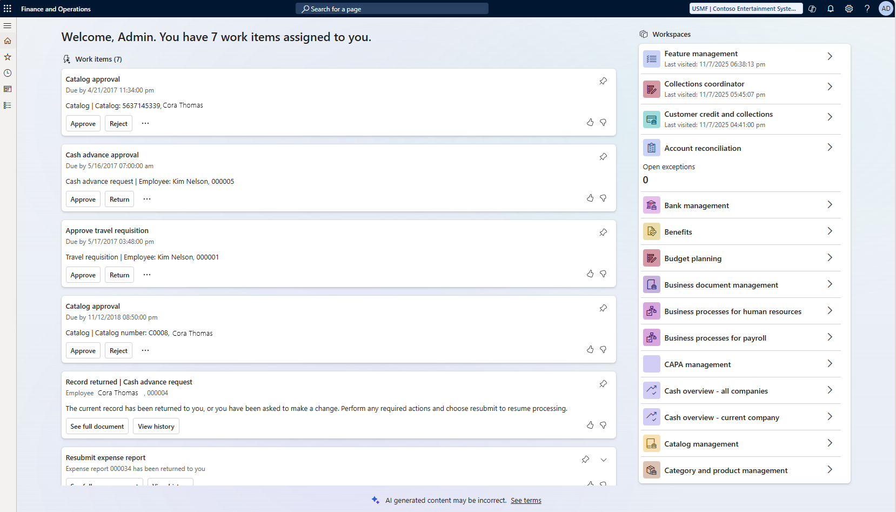

<!-- https://learn.microsoft.com/en-us/training/modules/describe-finance-operations-apps/3-describe-use-cases-ai-tools -->
<!-- refetched: original harvest URL returned 404 -->
# Describe use cases for using AI tools in finance and operations apps

Completed

* 12 minutes

Building on these intelligent capabilities, enterprise resource planning (ERP) apps now include specialized AI agents designed for diverse business areas. Finance teams can automate account reconciliation and collections management. Supply chain professionals can optimize inventory, warehouse, and logistics processes. Human resources teams can centralize personnel data and automate HR workflows. Commerce users can improve customer engagements and boost operational efficiency. Project operations professionals can accelerate project delivery and maximize profitability. These agents work within the conversational interface of Copilot, providing actionable recommendations and performing tasks on behalf of users in each business domain.
Now let’s explore the role of Copilot and agents in ERP environments, examine practical applications—such as collections agents in finance, inventory insights in supply chain, and workforce analytics in human resources—and consider how these innovations shape user experiences.

## Copilot capabilities

Copilot provides users with access to AI capabilities that enhance application experiences and functionality. Additionally, Copilot with finance and operations apps helps to ensure user privacy through stringent data protection measures. All finance and operations apps include Copilot features that are tailored to meet unique business needs specific to each app.

### In-app help and guidance

Copilot includes a conversational sidecar in the finance and operations apps. The sidecar helps users enter questions or express their needs directly in the app. The system can help interpret the context of user queries, and provide relevant, tailored information to help with resolution.
The Copilot in-app help and guidance reference the official public documentation for finance and operations apps to ensure the accuracy and best practices established by Microsoft.
Copilot uses generative AI to dynamically interpret user inquiries and compose responses in real time. AI enhances the clarity of the user's question through rephrasing, consults its indexed public documentation, and composes a clear, usable response. Here are some examples of the skills that Copilot capabilities can include:

* Provide guidance about app features and functionality.
* Answer questions about your data.
* Recommend and perform actions on the client.
* Automate operations.

The Immersive Home page feature in Dynamics 365 Finance is a modern, AI-first landing page. It simplifies the user experience and brings together personalized insights, task prioritization, and AI agent interaction—all in one centralized workspace.

* This adaptive homepage welcomes users with a personalized greeting and a concise summary of key work items. It features a Suggestions area that highlights actionable prompts, such as enrolling agent skills or enhancing agent performance. The Work items area displays priority-ranked activity cards that allow users to complete tasks directly from the homepage, reducing the need to navigate across modules.
* Immersive Home also includes:

  + An **Agent activity area**, which summarizes AI agent contributions, such as time saved or tasks completed.
  + A **ranked workspace view** based on user behavior, with frequently accessed and favorited tiles surfaced first.
* As the entry point to Copilot and autonomous agents, Immersive Home supports a more intuitive, efficient, and AI-enhanced experience for finance professionals. It introduces agent management and Copilot capabilities explored later in the course.

Note

The Immersive Home page is currently in preview. For more information about this feature, go to [Immersive Home overview](/en-us/dynamics365/fin-ops-core/fin-ops/copilot/immersive-home).

The following video demonstrates how users interact with the Copilot sidecar to get help when using finance and operations apps.

#### Dynamics 365 Finance

Using Copilot, you can generate customer account summaries, overdue invoices, and payment history. Copilot helps prioritize the customers who need attention. Personalized customer communication using AI-generated email saves time and increases overall efficiency by not having to navigate to multiple screens. This AI-assistance helps increase successful collection rates and proactively keeps customers in good standing.

Dynamics 365 Finance also provides a Collection coordinator workspace in collaboration with Copilot. This workspace helps you contact customers who have overdue balances.

#### Dynamics 365 Supply Chain Management

Copilot in Supply Chain Management can notify you about external issues such as weather, financials, and geography that can affect key supply chain processes. Copilot can help you take action on the impacted orders across materials, manufacturing, inventory, carriers, and distribution networks. You can use Copilot in Supply Chain Management to provide insight into on-hand inventory and help make informed decisions for order promising. This capability helps sales managers communicate with customers. Copilot supports the procurement process to efficiently manage and assess changes to purchase orders on a large scale. It can analyze the high or low impact changes along with the risk involved in the process.

#### Dynamics 365 Commerce

Copilot in Commerce is built for the product enrichment workflow in site builder. With Copilot for site builders, you can generate effective product enrichment and marketing content for your e-commerce websites. Copilot in site builder helps merchandisers create content quickly. The feature helps to ensure that the AI-generated market content created by Copilot is aligned to the target audience and brand tone. Copilot in site builder can help merchandisers achieve higher conversion rates with less effort.

#### Dynamics 365 Human Resources

Copilot in Human Resources can help simplify processes from employee interaction to administrative tasks, boosting efficiency. In recruitment, Copilot offers advantages that help improve the hiring cycle's speed and success. Employees can also use Copilot to analyze data on their self-service page, including time-off transactions and balances.

#### Dynamics 365 Project Operations

Project Operations integrates Copilot functionalities to simplify operations from the client-facing side to administrative tasks, enhancing efficiency for service delivery organizations. Copilot can evaluate projects to identify potential risks and suggest ways to mitigate them.

Project managers can generate a work breakdown structure by using generative AI. Generative AI can propose a hierarchical task structure for the project with durations that the project manager can edit. Project managers can also use Copilot to generate project status reports that provide updates on work progress, budget adherence, and schedule tracking.

The next section takes a high-level look at some of the intelligent agents currently available in Dynamics 365 Finance. It explores how Microsoft Copilot further enhances the user experience through embedded guidance, automation, and real-time insights.

## Agent capabilities

AI-powered agents automate tasks, provide insights, and offer guidance across business functions. They integrate with existing systems to help users work more efficiently and make better decisions. This enables organizations to focus on strategic activities while agents handle routine processes like collections and account reconciliation.

With the agent management feature in finance and operations apps, users can deploy AI-powered agents that autonomously perform predefined tasks. It enables discovery, configuration, and management of agents to automate routine operational processes.

Finance and Supply Chain Management agents boost productivity of users by delivering real-time insights, automating manual tasks, and integrating with Microsoft Outlook and Excel.

* In **Excel**: Agents simplify financial reconciliation with intelligent prompts, automated reports, and suggestions to resolve data discrepancies, working with data from various financial systems.
* In **Outlook**: Agents help with collections by connecting to ERP systems, providing customer insights, drafting emails, and saving communication summaries.

### Finance agents

#### Copilot agent for collections coordinators

Finance agents provide an AI-driven collections experience for accounts receivable (AR) professionals who integrate Dynamics 365 Finance with Outlook. Collections agents can summarize customer information by sourcing data directly from Finance. They can also summarize inbound emails and draft professional emails to customers.

AR professionals often switch between Outlook and their ERP system to manage customer balance inquiries. Finance agents in Outlook aim to simplify this process by enabling direct ERP integration through the Microsoft 365 Outlook add-in. This add-in allows AR personnel to access ERP customer data, get assistance drafting email responses, and save communication summaries and action items back into the ERP without leaving Outlook.

The Copilot agent for collections coordinators helps maintain steady and predictable cash flow, which reflects a healthy business. This agent ensures the availability of sufficient liquidity for daily operations and strategizing growth investments.

AI-powered Finance agents improve operational efficiency and ensure consistent workflows. These tools simplify tasks such as account reconciliation and collections, and enable financial professionals to focus on strategic decision-making.

Consider the following simulation.

#### Account Reconciliation Agent

The Account Reconciliation Agent improves the financial closing process by replacing the traditional, reactive reconciliation process that depended on SQL Server Reporting Services (SSRS) reports. You can use this feature to reconcile the general ledger with the accounts payable, accounts receivable, tax, and bank subledgers. It introduces a proactive, AI-driven approach through the **Account Reconciliation** workspace, which automatically raises exceptions and uses an intelligent agent to analyze them and suggest recommended actions. Users can schedule automated data analysis and reconciliation to run in the background during off-hours. Any exceptions identified are highlighted, allowing users to take direct corrective actions. When the Copilot-powered agent is enabled, it suggests the most appropriate actions, simplifying and accelerating the period-end account reconciliation process.

#### Financial Reconciliation Agent

The Financial Reconciliation Agent simplifies the bank reconciliation process by using AI. The agent matches bank transactions with ledger entries more accurately and efficiently. Integrated within Excel through the Finance agents add-in, it provides users with the ability to select data sets for comparison, define reconciliation vectors, and generate comprehensive reports with AI-generated summaries. The agent can operate in both assistive and autonomous modes—either guiding users through reconciliation tasks in real time or executing them independently based on predefined templates. The agent reduces manual effort and improves accuracy by intelligently identifying unmatched transactions and suggesting appropriate general ledger accounts. This capability accelerates the reconciliation workflow for finance professionals managing high-volume bank data.

### Supply Chain Management agents

#### Supplier Communication agent

The Supplier Communications Agent is an AI-based capability built on the Microsoft Power Platform (with Power Automate and Copilot Studio) to automate communication between an organization and its vendors.
It provides two key use cases:

* Proactively following up on purchase orders (POs) by detecting unconfirmed or delayed delivery, creating tasks, drafting vendor emails for review, and improving supplier responsiveness.
* Reading vendor emails about PO changes, identifying intent, matching to POs, suggesting updates, and classifying emails into confirmation, change request, rejection, or manual review. This process reduces manual processing and data-entry errors.

#### Inventory Visibility Add-in

The Inventory Visibility Add-in provides a near real-time, scalable microservice that provides a single view of stock availability across legal entities, warehouses, and connected systems, helping consolidate on-hand inventory, control oversell by restricting allocated quantities, and pre-allocate inventory by priority.
It covers three key capabilities:

* Soft reservations, where stock is reserved from external order systems without immediately affecting ERP, preventing overselling and later offset by hard reservations in ERP
* Allocation, where on-hand stock is pre-allocated to channels, regions, or customer groups using configurable allocation groups
* Available-to-Promise (ATP) via an On-hand Change Schedule that plans future supply/demand and returns date-specific availability without updating actual inventory until transactions are committed.

#### Demand Planning app

The Demand Planning app is a modern, collaborative forecasting solution that improves demand prediction and aligns supply planning with business expectations. It reduces manual effort and helps teams respond proactively to market changes and avoid disruptions.
The app uses machine-learning-driven statistical forecasting and a Power Platform based user-friendly interface. The configuration of the app follows five steps:

* Import data from finance and operations apps.
* Transform it into a time-series structure.
* Forecast using algorithms such as Auto ARIMA, Exponential Smoothing, Prophet, or best-fit selection.
* Review and adjust collaboratively.
* Export forecasts back to Supply Chain Management or other systems.