<!-- https://learn.microsoft.com/en-us/training/modules/describe-finance-operations-apps/4-explore-user-interface -->
<!-- refetched: original harvest URL returned 404 -->
# Explore the finance and operations user interface

Completed

* 10 minutes

Finance and operations apps include several categorizations of user interface (UI) elements, including navigation, controls, and filters.

## Navigation pane

In finance and operations apps, the leftmost pane is called the navigation pane, from which you can access any page. The following options are in the navigation pane:

* **Favorites:** You can mark and then select your most frequently used pages for easy navigation to these pages.
* **Recent:** Your recently opened pages are automatically saved under the **Recent** menu.
* **Workspaces:** All the workspaces are available in finance and operations apps under the **Workspaces** menu. Workspaces provide the option to create personalized dashboards for users based on their job profile and activities.
* **Modules:** You can find all the modules, submenus, and pages under the **Modules** menu.

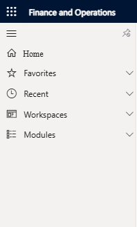

### Navigation bar

The uppermost title bar in finance and operations apps is called the navigation bar. The following screenshot displays the options in the navigation bar:

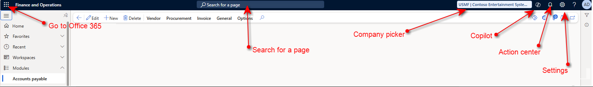

### Go to Microsoft 365

The waffle icon in the upper-left corner of the navigation bar takes you to the Microsoft 365 portal, a cloud-powered, subscription-based productivity platform. From the portal, you can access apps, including Microsoft Teams, Word, Excel, PowerPoint, Outlook, and OneDrive.

### Search for a page

When you enter the name of a page in the search box, all the pages with a similar name appear in the list along with the navigation path, as in the example in the following screenshot. You can navigate directly to the required page.

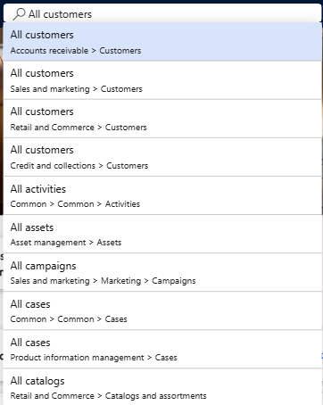

### Company picker

You can select a legal entity by using the **Company picker**. Transactions in the finance and operations apps pertain to the selected legal entity. A legal entity is an organization that is identified through registration with a legal authority.

### Show messages

The **Show messages** option opens the Action center, which has all the system messages generated in the finance and operations apps.

### Settings

The **Settings** option has several features, that users can configure based on their business requirements and preferences.

### User options

**User options** helps you set up user-specific configurations. The **User options** page has four tabs.

#### Visual

The first tab is named **Visual**, depicted in the following screenshot, from which a user can define the general color and size of all the interfaces of the finance and operations apps.

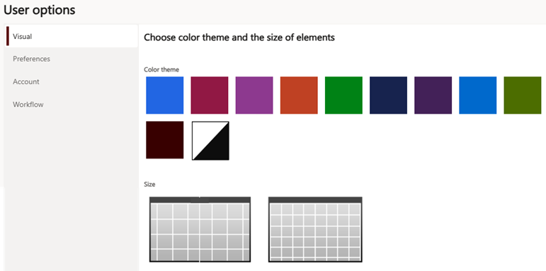

#### Preferences

In the **Preferences** tab, you can define user-specific configurations, including location and language. The **Preferences** tab has five FastTabs, depicted in the screenshot:

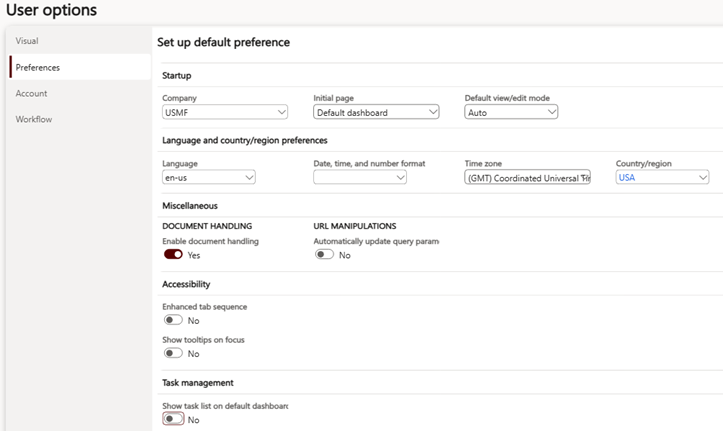

* **Startup:** In the **Startup** FastTab, you can define which legal entity to switch to when you open finance and operations apps. You can also define which default dashboard to open during startup.
* **Language and country/region preferences:** In **the Language and country/region preferences** FastTab, you can define your default country/region and the time zone in which you're working. You can also define the date, time, and number format of your region. You can define the language you want in the labels. Changes to any of these values immediately change the respective configurations for you in the finance and operations apps.
* **Miscellaneous:** In the **Miscellaneous** FastTab, you can enable the Document handling feature, which associates documents, images, and notes with the records entered into the finance and operations apps. For example, you can associate a brochure for and photo of a new product that you added in the finance and operations apps.
* **Accessibility:** In the **Accessibility** FastTab, you can enable the **Enhanced tab sequence** field. Enabling this functionality ensures that all page elements are in the tab sequence. The only exceptions are elements that are explicitly marked as not being in the tab sequence through personalization. The **Show tooltips on focus** field ensures that when a control receives focus, the tooltip for that control displays automatically to the user.
* **Task management:** In the **Task management** FastTab, you can enable a task list on the default dashboard.

#### Account

The **Account** tab, depicted in the following screenshot, contains the user credentials along with the email provider and email ID of the user. This information allows you to send mail directly from the finance and operations apps. Users can also enable electronic signature in this tab.

#### Workflow

In finance and operations apps, there's a standard workflow framework that can be associated with different business processes. For example, during the different stages of an ongoing workflow, you might need to send an email for notification purposes. In the **Workflow** tab, as in the following screenshot, you can configure the mailing options. You can also define the delegation options to delegate workflow approval authority during your absence.

## Task recorder

This feature is a utility in finance and operations apps that allows users to record business processes for different use cases:

* Step-by-step guided tours of specific business processes in the application
* Documentation of a business process as a Microsoft Word document that can optionally include screenshots
* Regression tests for a business process
* Automatic playback of a business process in the application

Once task recorder records the business processes, you can save the processes by using the following options:

* Save to this PC
* Save to Lifecycle Services
* Export as Word document
* Save as developer recording

### Save to this PC

You can save the task recording package as an.axtr file and upload it by using the business process modeler (BPM) tool in Lifecycle Services. The .axtr file creates the test case for the business process.

### Save to Dynamics 365 Lifecycle Services

You can directly save a recorded task to Dynamics 365 Lifecycle Services corresponding to a business process in BPM. The task is automatically stored as a test case for the business process. The test case is also reflected in the Microsoft Azure DevOps instance connected to the Lifecycle Services project.

One use of task recorder is in the Regression Suite Automation Tool (RSAT). This tool facilitates regression testing and significantly reduces the time and cost of the user acceptance test (UAT). RSAT is fully integrated with DevOps for executing, reporting, and investigating test cases. You can use the RSAT tool to run the task recordings that you upload into DevOps as test cases. This helps the business process owner to automate the testing of the business process configuration and customization. The test data is stored in Excel, which is decoupled from the test steps.

### Export as Word document

You can save the recorded tasks as a Word document. This method is mostly used when a user is looking for a user manual or use case document based on a real example.

### Save as developer recording

This option helps you to generate XML files from the task recorder. You can import the XML recordings to generate test code that you can use to validate business process scenarios. Generated code is based on the SysTest Framework and FormAdaptors, which facilitate unit/component testing. You can also import the XML recordings in the Performance software development kit (SDK) tools to perform multiuser load testing.

### Personalize

Personalization options let you change the UI for yourself, such as adding fields, making fields required, or moving fields on a page.

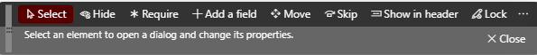

## Action pane

The Action pane is a control on a page. When you open a page, for example, the **Customer** page in the following screenshot, the topmost section of the page is the Action pane.

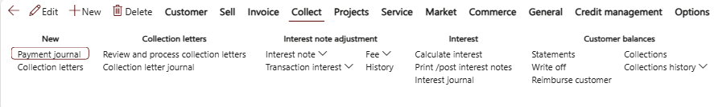

You can perform the basic actions on a page, such as creating, editing, deleting, and saving records, by using the buttons in the Action pane. In addition to the **Edit**, **New**, and **Delete** buttons, the Action pane can have other buttons that perform business scenarios related to the **Customer** page, such as customer balance, customer bank account, and forecast.

## Filters and sorting options

Finance and operations apps offer four filtering options in the pages:

* **Quick filter:** The Quick filter is a filtering mechanism that appears above any list or grid and provides fast single-column filtering. The Quick filter can search records based on one column at a time.

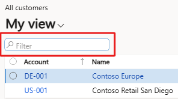

* **Filter pane:** The Filter pane is an inline pane that slides in from the left and contains multiple filter criteria that you can apply to the targeted content.

The Filter pane icon is available in the right-most pane of the finance and operations apps UI. When you select the icon, the Filter pane appears on the right side of the UI. In the filter pane, you can select multiple fields as the filter criteria for your search, like begins with, contains, and is exactly. The filter criteria allow you to find the correct set of records you're looking for.

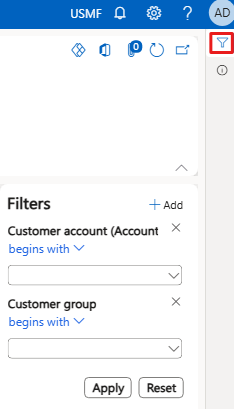

* **Grid-column filter:** The Grid-column filter enables you to define filter conditions and perform single-column sorting by using a drop-dialog control that you open from the grid column header. You can open the Grid-column filter from the **Customer group** field in the grid.

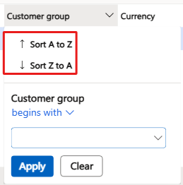

In the grid-column filter, you can use multiple search criteria like begins with, contains, or is exactly to find the correct set of records you're looking for. You can also apply sorting on a specific column using grid-column filter.

* **Advanced filter or sort:** The Advanced filter provides an advanced filter and sort capability based on multiple columns. This filtering option is available under the **Options** button in the Action pane.

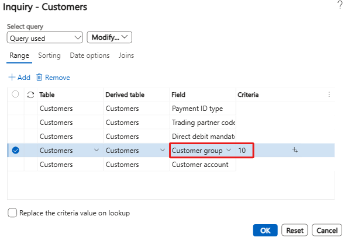

On the **Range** tab, you can add the table fields you want to apply to the filter. The preceding screenshot illustrates a filter applied on the **Customer group** field to search all the customers who belong to group 10. You can add filters on more than one field by using this filtering option.

On the **Sorting** tab, you can define the sorting condition for the data set based on multiple fields. In the following screenshot, the sorting order is based on **Customer group** and **Credit limit** fields. If the field doesn't belong to an index, you get a warning message because sorting on nonindex fields may impact the performance of the page.

The Joins tab of the Advanced filter or sort dialog shows all the tables related to the primary table of the page. If you need to filter data from a field of the related table, you can use **Add table join** to select the related table. Once selected, you can add the filter criteria on the field of the related table.

The following video demonstrates the filtering and sorting options in the finance and operations apps.

These filtering and sorting techniques are applicable to most of the pages in the finance and operations apps.

## Workspaces

A workspace is a one-stop shop for specific activities. Think of workspaces as personalized work centers with data, reports, and transactions that increase efficiency. Workspaces can help drive productivity by:

* **Providing 360-degree views of activities** - No need to navigate to multiple lists.
* **Answering specific questions** such as:

  + Which customer invoices are past due now?
  + How many purchase orders were received and are ready to be invoiced?
  + How many POS devices are activated?
* **Providing insights** – You can compare multiple sources of data and get a comprehensive view that might be difficult to achieve when only looking at lists in specific modules.
* **Navigating by data** – A workspace provides a concise view of the business data, which helps you search for results by spending less time on the filtering process.
* **Providing direct access to tasks** - Tasks can be performed directly from the workspace.

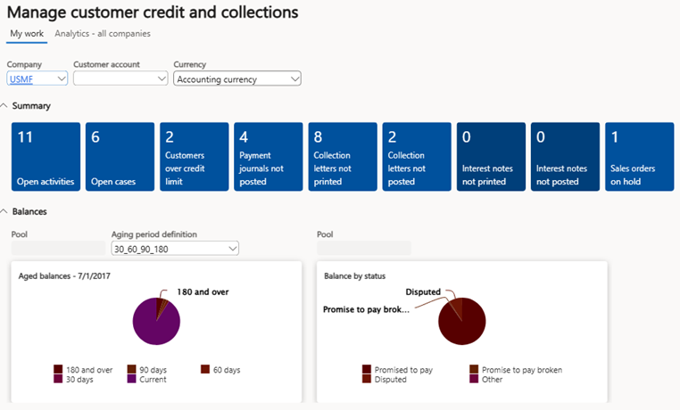

## Analytical workspaces

The Dynamics 365 suite of applications includes analytical workspaces. These workspaces include a set of reports that offer insights into standard business operations. These reports are like dashboards and differ from financial reports. You can design and embed the Microsoft Power BI reports in the analytical workspace. The reports include metrics that a wide range of users from any industry may find useful. You can change the reports if needed.

Users who have access to the web-friendly Power BI report design tools can customize their analytical reports. The free-form canvas designer in Power BI helps in designing relevant business insights. The designer provides better visibility of the business and helps to make the organization successful.