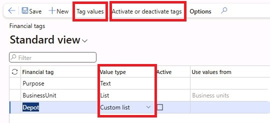

<!-- https://learn.microsoft.com/en-us/training/modules/describe-general-ledger-cash-bank-management/4-describe-financial-dimensions-set-concepts -->
<!-- refetched: original harvest URL returned 404 -->
# Describe financial dimensions and set concepts

Completed

* 15 minutes

This unit explains the various types of financial dimensions and how to set them up.

The **Financial dimensions** page contains the segments in your accounting structure, which is critical for reporting purposes.

On the **Financial dimensions** page, you can create financial dimensions to use as account segments for chart of accounts. Two types of financial dimensions are available: custom dimensions and entity-backed dimensions. Custom dimensions are shared across legal entities. Users enter and maintain the values. For entity-backed dimensions, users define the values elsewhere in the system, such as in Customers or Stores entities. Some entity-backed dimensions are shared across legal entities, whereas other entity-backed dimensions are company-specific.

After you create the financial dimensions, use the **Financial dimension values** page to assign more properties to each financial dimension.

In a nonfinance implementation, you can use a custom financial dimension to correspond to an organization. For example, you might need to maintain transactions based on depots, but Finance doesn't include an entity named **depot**. You can create a custom dimension for depot and associate it as a mandatory financial dimension with all transactions. This custom dimension helps you to segregate all transactions based on depots.

However, financial dimensions aren't designed to address the operational or business requirements of legal entities. The interunit accounting functionality in Finance is designed to address only the accounting entries created by each transaction.

Before you set up financial dimensions, evaluate your business processes in the following areas to determine whether this setup works for your organization:

* Inventory
* Sales and purchases between financial dimensions and legal entities
* Sales tax calculation and reporting
* Operational reporting

Consider some of the following limitations:

* You can use sales tax functionality only with legal entities, not with financial dimensions.
* Some reports don't include financial dimensions. Therefore, to report by financial dimension, you might have to modify the reports.

## Custom dimensions

To create a user-defined financial dimension, in the **Use values from** field, select **Custom dimension**. You can create a custom dimension for an entity that doesn't exist in Finance.

You can also specify an account mask to limit the amount and type of information entered for dimension values. You can enter characters that remain the same for each dimension value, such as letters or a hyphen (-). You can also enter number signs or hash symbols (#) and ampersands (&) as placeholders for characters that change every time a dimension value is created. Use # as a placeholder for a number and & as a placeholder for a letter. The field for the format mask is available only when you select **Custom dimension** in the **Use values from** field.

### Example

To limit the dimension value to the letters "CC" and three numbers, enter **CC-###** as the format mask.

## Entity-backed dimensions

To create an entity-backed financial dimension, in the **Use values from** field, select a system-defined entity to base the financial dimension on. Financial dimension values are then created from that entity. For example, to create dimension values for projects, select **Projects**. A dimension value is then created for each project name. The **Financial dimension values** page presents the values for the entity. If those values are company-specific, the page also displays the company.

## Activating dimensions

When you activate a financial dimension, the table updates to include the name of the financial dimension. You can enter dimension values before you activate a financial dimension. However, a financial dimension can't be consumed anywhere until activated. For example, you can't add a financial dimension to an account structure until the financial dimension is activated. When you select **Activate**, all dimensions are updated and the display status changes.

## Translations

On the **Text translation page**, you can enter text for the selected financial dimension in various languages. On the **Main account translation** page, you can enter text for the main account in various languages.

## Legal entity overrides

Not all dimensions are valid for all legal entities. Additionally, some dimensions might be relevant only for a specific period. Use the Legal entity overrides section to define which companies to suspend the dimension for, identify the owner, and set the active period for the dimension.

## Financial dimension sets

Use the **Financial dimension sets** page to create financial dimensions. A financial dimension set contains either financial dimensions or financial dimension combinations. The main account can also be included and combined with other financial dimensions. The main account can also be the only financial dimension included in a financial dimension set.

The order in which financial dimensions in a set are displayed determines how transactions are sorted, and fields are printed on reports.

For example, a financial dimension set includes the Department and Cost center financial dimensions. The financial dimension set is set up so that the Department amounts are displayed first on reports, followed by the Cost center amounts.

When you view or report on financial transactions, the defined financial dimension sets can be used individually or in pairs. You can select a primary and secondary financial dimension set. The secondary financial dimension set includes more detailed information about the amounts that are in the primary financial dimension set.

## Financial tags

Financial tags are an alternative to financial dimensions. You can store financial tags on the accounting entries but not in subledger transactions. Organizations can create and enter up to 20 user-defined fields for transactions. These fields can replace the use of document numbers, descriptions, and financial dimensions. From a usage perspective, financial tags are more flexible than financial dimensions. Like financial dimensions, financial tags are also used for reporting purposes only.

On the **General ledger parameters** page, you can define the financial tag segment delimiter. To configure the tags, go to **General ledger** > **Chart of accounts** > **Financial tags** > **Financial tags**.

The three types of financial tags are Text, List, and Custom list.

* With **Text**, you can type free text during transactions.
* You can use **List** to select an existing entity in Finance. While entering transactions, you can enter values from the selected entity. For example, Business unit, which is an existing entity, can be selected as a financial tag.
* To create a financial tag, you can create a **Custom** **list**, which has a custom list of values that can be entered while creating transactions. For example, if you create a financial tag to enter Depot in the transactions, you can use fixed values of Depots by selecting the Tag values button.

You need to select the **Activate or deactivate tags** button to activate the tags.

After the tags are activated, you can use them in a general journal. The general journal includes a new tab named **Financial tags**, where you can enter the values.

In the journal line, you can enter financial tag values based on the configured options.

You can also use journal lines to create separate financial tags for offset accounts based on your requirements. After posting the journal, you can find the voucher transactions with separate columns added for three financial tags. You can change the financial tags of the posted vouchers by selecting the **Edit voucher** option.

Currently, the following documents support financial tags:

* General journal
* Global general journal
* Allocation journal
* Fixed asset journal
* All asset leasing journals
* Periodic journal
* Reporting currency adjustment journal
* Customer payment journal
* Vendor payment journal
* Invoice journal (vendor)
* Global invoice journal (vendor)
* Invoice register
* Sales order documents (sales order, packing slip, and customer invoice)
* Purchase order documents (purchase order, product receipt, and vendor invoice)