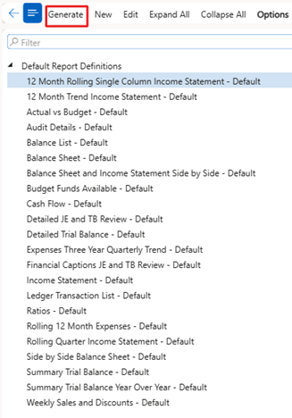
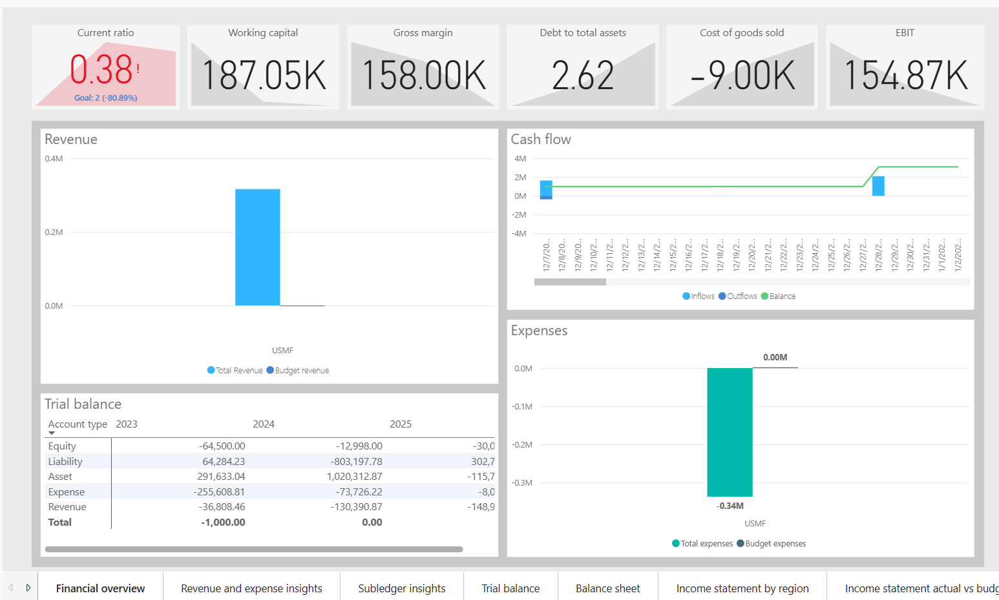

<!-- https://learn.microsoft.com/en-us/training/modules/describe-general-ledger-cash-bank-management/7-describe-financial-reporting-capabilities -->
<!-- refetched: original harvest URL returned 404 -->
# Describe financial reporting capabilities in Dynamics 365 Finance

Completed

* 15 minutes

Financial reporting and embedded Power BI are two of the key reporting capabilities, providing structured financial statements and interactive analytics alongside other reporting tools in Dynamics 365 Finance.

## Financial reporting

Financial reporting is a rich client reporting tool integrated with Dynamics 365 Finance. It enables finance and business professionals to create, maintain, deploy, and view financial statements without requiring external reporting tools.

Financial reporting supports dimension-based reporting out of the box. Account structures and financial dimensions are instantly available to use in row and column definitions, with no other configuration required.

Organizations often generate a consistent set of financial reports at scheduled intervals to support their business processes. Financial reporting supports scheduled report generation to meet daily, weekly, monthly, or annual reporting needs. Use the Report designer to create or modify traditional financial statements, such as the Income statement and Balance sheet, and share the results with other members of your organization. By using Financial reporting, users can create, maintain, deploy, and view financial statements. It moves beyond traditional reporting constraints to help you efficiently design various types of reports.

You can create new reports or modify existing ones by launching the reporting tool from **General ledger** **module** > **Inquiries and reports** > **Financial reports** within Dynamics 365 Finance.

You can select any of the reports and then select the **Generate** button in the Action pane to open a dialog box that asks for the report date. It automatically populates an expiry date that is three months from the report generation date. You can change the expiry to never.

Selecting the **New** or **Edit** button in the Action pane launches the Financial reporting tool.

A financial report has seven sections:

**Row definitions:** Here you define all the rows required in the report. You also define the main account category against each row. All the main accounts associated to the selected main account category are potential candidates for this report. Financial reporting includes dimension support to determine which financial dimensions you want to include in the row.

For example, you can create financial row structures to focus on cost accounts. You can set up unlimited financial dimensions that provide cost details. The following financial dimensions are examples that might be associated with cost accounts:

* Cost centers
* Departments
* Combinations of the two

**Column definitions:** Here you can define the columns required in the report. You configure the column based on the values in the drop-down, which includes amounts from financial dimension, calculated column, specific field values (like currency or account code), and line number.

**Reporting tree definition:** Here you can create a hierarchy of operating units, based on what you want to include in the report.

**Report definition:** Here you can bind the row definition, column definition, and reporting tree definition to create a complete report. You can also define the legal entity for which a report is applicable.

**Report group:** You can group similar reports for operational convenience in this section.

**Report schedule:** You can schedule the execution of a single report or group of reports in this section. It helps reporting operations and maintenance.

**Security:** You can use this section to define the access security of the reports.

View the following video for an example of financial reporting.

## Power BI

Power BI provides interactive analytics that complement Financial reporting by delivering real-time insights into financial and operational performance. In Dynamics 365 Finance, embedded Power BI dashboards and reports help users explore trends, monitor KPIs, and analyze data in an easy-to-understand format.

Use the features of Power BI to unify data from many sources to create interactive, immersive dashboards, and reports that provide actionable insights and drive business results.

The following are some of the available Power BI in the **Shared assets library** of Lifecycle Services. Refer to the version information in the **Shared assets library** to download the correct version for your environment.

* **Actual vs. budget:** Individuals who are responsible for monitoring actual versus budget performance in their organization can use this Power BI content. It provides visibility into your budget variances.

  You can analyze budget for the current year by account category, budget code, main account, main account descriptions, or fiscal period to gain better understanding of the cause of any variances.
* **Cash overview:** Business users who are responsible for cash in their organization can have visibility into the business cash flow by using this Power BI content. It provides forecasts that can help financial leaders make better decisions and therefore improve the health of the business cash flow.

  You can analyze cash by legal entity, currency, and bank account to gain better understanding of surpluses and shortfalls. Reports from the **Cash overview Power BI** content are displayed in the **Cash overview** and **Bank management** workspaces.
* **Credit and collections management:** The credit and collections managers and collections clerks can benefit from this Power BI content. It provides key credit and collections metrics, such as days sales outstanding, balance overdue, credit exposure, and customers that are over their credit limit.

  It uses transactional data and provides aggregate views of credit and collections across all companies. It also provides a breakdown per company, customer group, and customer.
* **Financial analysis (current company and all companies options):** Describes the dashboard and reports that are included and provides information about the data model and entities that were used to build the solution.

  Because organizations want liabilities and revenue amounts to appear as positive amounts on reports, the setup of the main accounts is important. For these main accounts to appear as positive amounts, the main account type must be set to **Liability** or **Revenue**. When these account types are used, reporting through Power BI reverses the signs and show the amounts as positive.

  
* **Fixed asset management:** This workspace shows information that is related to fixed assets that are entered in the system. It includes a summary view and an analytics view. The **My work** tab shows summary tiles, fixed asset details, and related information about fixed assets in the current company.

  You can also add analytics to the **Power BI analytics** section directly in the workspace. The **Analytics – all companies** tab uses capabilities of Microsoft Power BI to show visuals that are related to fixed assets in all companies.

  
* **Vendor payment:** This Power BI content shows information that is related to the processing of vendor payments. This workspace includes a **My work** view and an **Analytics** page.