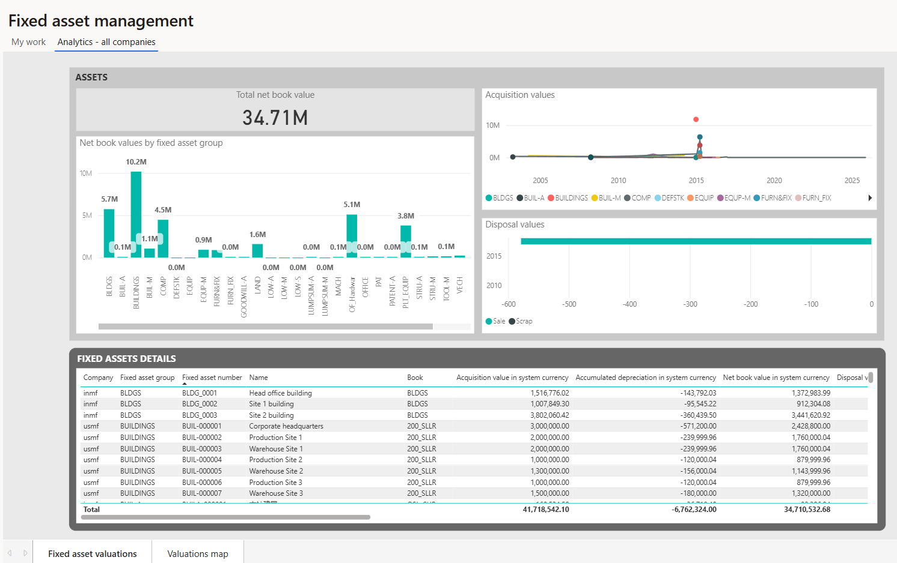

<!-- https://learn.microsoft.com/en-us/training/modules/describe-report-integration/2-describe-built-in-reporting -->
<!-- refetched: original harvest URL returned 404 -->
# Describe built-in reporting capabilities

Completed

* 8 minutes

Generally, ERP software automates back-office processes for finance, sales, procurement, inventory management, and manufacturing. Organizations can gain a real-time view across their operations by using one central database. An ERP system supports many business functions. These include general ledgers, project accounting, procurement and sourcing, inventory management, master planning, supply chain management, and assembly. Robust reporting capabilities are essential to provide actionable insights and support informed decision-making across all these functions.

Finance and operations apps also support statutory and regulatory reporting requirements, such as VAT, Intrastat, or other government-mandated financial submissions, ensuring compliance across different regions.

## View and export inquiry data

Inquiry pages in finance and operations apps display transactional data in grid views. Users can filter, sort, and export the grid views to Excel for further analysis. These pages provide quick, on-demand reporting capabilities without requiring custom report development.

## Create SSRS reports

To create a report, you need to use Microsoft Visual Studio and a finance and operations apps development environment. In Visual Studio, you first create a new report object. Then, you assign a data set to the report.

A data set defines the data that the report uses. In the data set parameters, you can select a data source for the data set and the data source type. The data source type explains how the system retrieves data from the data source.

The four data source types are:

* **Query** - Use an existing Application Object Tree (AOT) query. Using an existing query allows for faster data filtering in SQL to quickly generate reports and requires limited X++ code to develop. The only X++ code used is for the display methods in the tables.
* **Business logic** - Use a data source other than finance and operations apps. You can only use the business logic data source type with a single report because the name of the class used must match the name of the report.
* **Report data provider (RDP)** - Use when added logic is needed to run the report. This situation usually arises when you use dynamic filters. An RDP class is an X++ class. You can apply advanced filter criteria to access and process data for the SSRS report. Report parameters, which are applied in the UI, can also be processed through the RDP class.
* **AX enum provider** - Use to filter a report view when the report parameter is an enumeration type. In these reports, the report references the collection of enumeration values. AX enum provider allows you to add a dataset that binds to a specific enumeration, and it forces the report to display a specific enumeration value.

After you create a data set, you can set the report layout by selecting an auto design (for simple reports) or a precision design (for more customized reports). After you finish your report, you'll need to deploy it. After deployment, your report is ready to run in finance and operations apps.

## Create and modify reports by using Microsoft Power BI

Power BI uses a series of software services, applications, and other connectors that work together to cohesively integrate unrelated sources of data to ensure they're both engaging and interactive. Power BI consists of several elements that all work together, including a Windows desktop application, an online software as a service (SaaS), and mobile apps. These elements let you easily connect to your data sources, visualize, and discover what is important, and then share that information with anyone you want.

You can use Power BI tools to interactively explore data by pivoting columns, changing the shape of charts, filtering data, and sharing reports. You can embed these reports within a workspace in finance and operations apps. Power BI is especially useful for creating dashboards and nondocument reports or any report that doesn't require printing.

Ready-made Power BI reports are available for finance and operations apps. You can download and deploy them in your environment. The following list provides examples of these reports:

* Actual vs. budget
* Cash overview
* Compensation and benefits
* Cost accounting analysis
* Credit and collections management
* Employee competencies and development
* Financial performance
* Fixed asset management
* Organizational training
* Practice manager
* Production performance
* Purchase spend analysis
* Recruiting
* Sales and profitability performance
* Vendor payments
* Warehouse performance
* Workforce metrics

The following Power BI content is available in Microsoft AppSource, which you can deploy:

* Cost management
* Financial performance
* Retail channel performance

You may need to create your own Power BI reports by using Power BI Desktop. You can publish these reports to the Power BI service and embed them in finance and operations app workspaces.

## Power BI in workspaces

Workspaces in finance and operation apps provide a central view of business processes or areas. They include visuals, KPIs, count tiles, and quick links to related pages and reports. Power BI Embedded enables interactive reports and infographics that you can integrate directly into workspaces, creating an engaging and data-driven experience. Users can explore information, identify trends, and perform simple what-if analyses without leaving the workspace.

## Create and modify reports by using Microsoft Excel

Excel helps with budget planning, financial reporting, and analyzing transactional data, including customer and vendor information. Finance and operations apps can integrate with an Excel workbook, which can update, delete, and insert data within the finance and operations apps using the Excel Data Connector add-in. This add-in follows the REST-based integration protocol that connects the data entities of the finance and operations apps through the Open Data Protocol (OData) endpoints.

The Excel Data Connector uses transactional data configured in real-time where data is both uploaded and validated. The corresponding records appear in Dynamics 365 for immediate use. You must download the Microsoft Dynamics Office Add-in to use this feature.

## Financial reporting

Financial reporting is a rich client reporting tool integrated with Dynamics 365 Finance. It allows finance and business professionals to create, maintain, deploy, and view financial statements.

To create a new report or modify an existing one, you can launch the reporting tool from the Dynamics 365 Finance application. To view the report, you need to access the Inquiries and reports menu under the General ledger module.

Using the reporting tool, you can create financial reporting filtered by dimensions. Account segments or dimensions are immediately available with no extra tools or configuration steps required.

Many companies run a core set of financial reports at scheduled intervals to align with their business processes. Financial reporting allows regular report scheduling, such as daily, weekly, monthly, or annually.