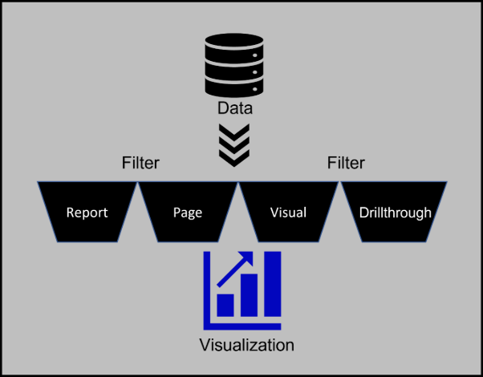

<!-- https://learn.microsoft.com/en-us/training/modules/describe-report-integration/3-describe-analyze-data-power-bi -->
<!-- refetched: original harvest URL returned 404 -->
# Describe options for analyzing data with Power BI

Completed

* 15 minutes

Dynamics 365 applications deliver interactive reports that integrate into application workspaces. Workspaces use rich infographics and visuals supported by Power BI to give you a highly visual and interactive experience. Using infographics in the overview page, you can get a quick glance of the state of the business.

## Power BI

Power BI:

* Is a business analytics service that delivers insights to enable fast, informed decisions and helps you harness data and turn it into actionable insights.
* Connects to hundreds of data sources using standard connectors and to unlimited data sources using custom connectors.
* Simplifies how you derive insights from transactional and observational data, and helps you create a data culture where employees make decisions based on facts, not opinions.
* Helps you collect data and display it as visually immersive, captivating, and interactive insights. The insights allow you to drill down and analyze financial and operational data.

An advantage of Power BI is the ability to include data from multiple sources including Excel workbooks and a collection of cloud-based and on-premises hybrid data warehouses. You can connect to your data sources, visualize what is important, and share the information with anyone you want.

The dashboard includes data from the following sources:

* Salesforce
* Microsoft Access
* Microsoft SharePoint
* OneDrive
* Excel
* SQL databases
* Microsoft Exchange
* Dynamics 365 business applications.

Power BI for Office 365 cloud service works with model-driven apps in Dynamics 365 to provide a self-service analytics solution.

It refreshes the data displayed automatically. Your organization can use Power BI Desktop or Power Query to author reports. You can also use Power BI to share dashboards and refresh data from model-driven apps in Dynamics 365.

## Dashboards and reports in Power BI

Power BI has dashboards and tiles to build visualizations using both browser-based, mobile, and desktop tools. When you need to see data analysis in the context of an opportunity record, you can consume Power BI tiles in other Dynamics 365 applications. You can also embed canvas apps on Power BI dashboards.

Two other elements extend the features of Power BI: Power BI Report Builder and Power BI Report Server. Report Builder is good for creating paginated reports to share in the Power BI Service. Report Server provides an on-premises report server where you can publish your Power BI reports after creating the reports in Power BI Desktop.

How you use Power BI depends on your role. You might primarily use the Power BI service to view reports and dashboards. Your colleagues who create business reports might use Power BI Desktop or Power BI Report Builder to create reports and publish them to the Power BI service for you to view.

The following video demonstrates how embedded Power BI lets you use Power BI to gain deeper insights into key financial analytics.

You can embed customized reports in the dashboard with the help of the Power BI desktop or Power BI services.

## Custom visuals

### AppSource Power BI visuals

Microsoft and community members contribute Power BI visuals for public benefit and publish them to AppSource, the place for apps, add-ins, and extensions for your Microsoft software. You can download these visuals and add them to your Power BI reports. Every product available in AppSource is certified based on specific criteria.

Note

By using Power BI visuals created with the Microsoft software development kit (SDK), you may be importing data from, or sending data to, third-party, or other services located outside your Power BI tenant’s geographic area, compliance boundary, or national cloud instance.  
Power BI certified visuals are visuals in AppSource that were additionally tested to confirm that the visual doesn't access external services or resources. When Power BI visuals from AppSource are imported, visuals may be updated automatically without any other notice.

### Certified Power BI visuals

Certified Power BI visualizations in AppSource meet certain specified code requirements that the Power BI team tested and approved. The tests are designed to check that the visual doesn't access external services or resources.

### Filter data with Power BI

Data is the core of Power BI. As you explore reports, each visual draws its underlying data from sources that often have far more data than you need. Power BI offers several ways to filter and highlight reports. Knowing how to filter data is the key to finding the right information. The following illustration depicts the important features of the Power BI reporting tool.

Note

Filtering only applies to reports, not to dashboards.

Note

When you filter a visual, such as a bar chart, you're just changing the view of the data in that visual. You aren't changing the source data in any way.

### Explore the Filters pane

Another way to filter data is by opening and changing filters in the **Filters** pane. The **Filters** pane has filters that were added to the report by the report designer. As a consumer, you can interact with the filters and save your changes, but you can't add new filters.

The four types of filters are:

* **Report** – Applies to all pages in the report.
* **Page** – Applies to all the visuals on the current report page.
* **Visual** – Applies to a single visual on a report page. You only see visual level filters if you selected a visual on the report canvas.
* **Drill through** – Allows you to explore successively more detailed views within a single visual.

### Use buttons in Power BI

Buttons in Power BI let you create reports that behave like apps, creating an engaging environment where users can hover, select, and interact with Power BI content. You can add buttons to reports in Power BI Desktop and in the Power BI service. When you share your reports in the Power BI service, the reports provide an app-like experience for your users.

To create a button in Power BI Desktop, on the **Insert** ribbon, select **Buttons**. A menu appears, where you can select the button you want from a collection of options, as depicted in the following screenshot:

### Transform data

Sometimes, you may have too much data or the data might not be formatted correctly. Power BI Desktop includes the Power Query Editor tool, which can help you shape and transform data so that it's ready for your models and visualizations, as the following illustration depicts.

