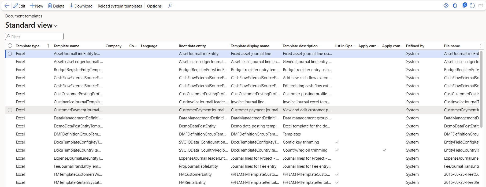
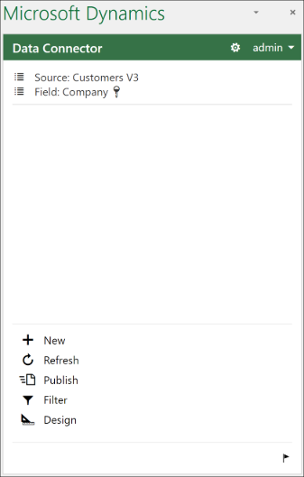
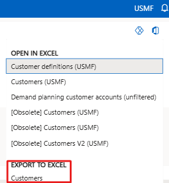

<!-- https://learn.microsoft.com/en-us/training/modules/describe-report-integration/4-describe-integration-office-365 -->
<!-- refetched: original harvest URL returned 404 -->
# Describe integration capabilities with Microsoft 365

Completed

* 12 minutes

Microsoft 365 integration with finance and operations apps enables seamless collaboration and productivity. By connecting tools like Excel, Word, and Outlook, users can edit business documents, share insights, and schedule meetings directly within familiar Office applications. This streamlines workflows and improves efficiency across the organization.

## Microsoft Office

Microsoft Office integration capabilities give you a productive environment that helps you get the job done by using Office products, such as Excel and Word. The key to this integration is the Microsoft Dynamics Office Add-in for Excel and Word.

The Microsoft Dynamics Office Add-in uses the existing Dynamics 365 OAuth security protocol. It retrieves the application security roles for the current user to supply consistent permissions. Users who don't have the proper permissions can't download sensitive data. The add-in app allows create, read, update, and delete (CRUD) operations on entities exposed as public.

Word and Excel are the most used business analysis applications. All Dynamics 365 apps have Microsoft Office integration capabilities. These templates span across all major system entities, such as projects, products, customers, and various journal entities. It's also possible to add other templates or edit the existing templates. You can find the document templates by navigating to **Common** > **Common** > **Office integration** > **Document templates**.

## Integrate with Excel

Finance and operations apps use an out-of-the-box application called Excel Data Connector to view, update, and edit data within an Excel workbook. You need to download the Microsoft Dynamics Office Add-in to use this feature.

This feature is available at the upper-right corner of a page in the links under the **Open in Excel** menu.

With Open in Excel, you can use the data entity that is related to the primary data source of the page. The columns that appear in your Excel workbook are defined in the Auto-Report field group on the entity. You can also add or remove fields in Excel by using the **Design** button in the app. Additionally, you can filter the data by using the **Filter** button. The app also gives you the ability to change the data in Excel and publish the changes back to finance and operations apps.

### Manipulate data from finance and operations apps within Excel

You can export data from finance and operations apps by using the Export to Excel feature, which is in the upper-right corner of most pages.

If you want to export data from the customer grid to Excel, you can select the option under **Export to Excel**. This process exports only those columns that are available in the grid. If you add a new column by using the **Personalize** option, that column is also exported to Excel.

You can also trigger the Excel export by creating a custom button. To do so, you need to create a command button by using the command **ExportToMicrosoftExcel**.

### Publish data by using the Excel add-in

To ensure you publish valid data by using the Microsoft Dynamics Office Add-in, any updates pass through the existing data entity logic validation. This validation ensures data integrity and provides you with immediate feedback of relevant error messages if a data publish was unsuccessful.

#### What is a data entity?

A data entity is an object in a data model. You design data by breaking down things into the smallest parts that are useful for representing data relationships. For example, the vendor entity encompasses and combines over 17 different tables and data sources into a single vendor entity. During import or export events, entities use business logic to validate and transform the data being received or sent. Finance and operations apps also allow the creation of custom data entities. Each data entity has a property named Enable public API. If this property value is set to **Yes**, the data entity is automatically exposed as an OData endpoint. Excel Data Connector can consume this OData endpoint and establish synchronous integration with finance and operations apps.

### Open entity data in Excel

To open the entity data, you can start from either Excel or the finance and operations apps.

By opening entity data in Excel, you can quickly and easily view and edit the data by using the Microsoft Dynamics Office Add-in.

With the Microsoft Dynamics Office Add-in, you can:

* Open entity data in Excel when you start from the finance and operations apps.
* Open entity data in Excel when you start from Excel.
* View, edit, and update entity data in Excel.
* Add or remove columns. You can use the designer to adjust the columns that the system automatically adds to the worksheet.
* Copy configuration data from one environment to another using a workbook. However, you can't just change the connection URL because the data cache in the workbook continues to treat the data as existing data. Instead, you must use the Copy Environment Data functionality to publish the data to a new environment as new data.

The preceding features enable Excel to interact with finance and operations apps seamlessly through the OData endpoint.

### Excel workbook designer

Finance and operations apps have a simple-to-use interface to create Excel templates. It allows you to use data entities and the corresponding field definitions. You can use the Excel workbook designer page to design an editable custom export workbook that contains an entity and a set of fields.

### Generated Open in Excel

Generated Open in Excel options are automatically added to pages when the system finds data entities that have the same root data source as the page. The workbook generated contains a single table data source where the data from that entity is loaded.

The Open in Excel experiences are listed on the **Open in Microsoft Office** menu. When an entity has the same root data source as a page, it's added as an option in the **Open in Excel** section of the **Open in Microsoft Office** menu. This process is referred to as a generated option.

The Excel app has a design experience that lets users add and edit bindings to entity data sources and labels.

## Microsoft Word

You can use Export to Word experiences for lightweight reporting. These experiences are powered by prebuilt templates. Available Export to Word templates are listed on the **Export to Word** menu. When the **Open in Microsoft Office** menu is selected from the upper-right corner of a page, the **Export to Word** option is available.

To create a Word template:

* Navigate to **Common** > **Common** > **Office integration** > **Excel workbook designer**.
* Select the required entity and the fields you want to display in the Word template.
* Select the **Create blank document** button in the Action Pane once the field selection is complete.
* The system prompts you to download the Word template, which you need to design according to your reporting format.
* Navigate to **Common** > **Common** > **Office integration** > **Document templates** and upload the newly created Word template.

You should be able to see the **Export to Word** menu on the corresponding page.

The **Export to Word** option provides you with the report in the Word template with the data selected in the finance and operations apps.

## Integrate with SharePoint

SharePoint gives organizations a secure place to store, organize, share, and manage content, knowledge, and applications, which help the organization:

* Empower teamwork.
* Quickly find information.
* Seamlessly collaborate across the organization.

You can access information within SharePoint from any device that has a web browser, such as Microsoft Edge, Chrome, or Firefox.

Note

Before you can use SharePoint to store documents, it must be enabled by your system administrator.

Important

This feature requires that you have a Microsoft 365 subscription or a subscription to an online service, such as SharePoint.

### Document management using SharePoint

Document management is a common framework in finance and operations apps that can be applicable for all the modules and pages. You can associate a file or an image with any record in the finance and operations apps by selecting the **Attachments** icon in the upper-left corner of your page.

You can associate different types of documents with a record. These document types can be added under **Organization administration** > **Document management** > **Document types**.

Selecting **Attach file** in the **Class** field allows you to select **SharePoint** in the **Location** field. In the **SharePoint Address** field, you can provide the SharePoint location where files are stored.

## Email integration

A combination of administrator configuration, user configuration, and user choices influences the behavior of the email subsystem. Both administrators and users set the behavior of the email subsystem.

### Behaviors set by administrators

#### Configuration tab

* **Batch email provider**: Specifies which email provider the system uses to send emails that generated by processes in a batch or non-interactive manner. The Exchange provider uses the account associated with the batch process.
* **Attachment size limit**: Specifies the maximum size of a single email that can be sent by using the email subsystem.

#### SMTP settings tab

* **Outgoing mail server**: The host name of the desired SMTP server.
* **SMTP port number**: Typically, the port number should be set to 587 for secure transport.
* **Username and password** - Specify, as needed, to send the email from the proper mail account. All users must have SMTP account Send As and Send On Behalf Of permissions to send Simple Mail Transfer Protocol (SMTP) mail.

  You can configure Send As permissions in the Microsoft 365 admin center (admin.microsoft.com). Navigate to **Users**, and then select **User** under **Active users**. Then, select **Send email from this mailbox** under **Edit mailbox permissions**.
* **Specify whether TLS is needed** - Determines whether secure transport is used. TLS is typically needed in all situations except for internal testing or troubleshooting scenarios.

##### Email distributor batch process

The Email distributor batch process sends email directly from the server without user interaction via SMTP. That batch process must be started to process the email queue.

If the Exchange provider is used, then the user account associated with the batch process (usually admin) is the sender.

##### User email

The default **send from** address for each user is pulled from the **Email** field on the **Users** page. (Navigate to **Users** and then **Users** again in **System administration**.) Administrators can override this **send from** default if needed by using the **Sender email** field on the **Options** page.

### Behaviors set by users

#### Email provider selection section on the Options page

* **Email provider ID**: Allows the user to select the email provider that should be used when sending an email. Selecting an option here is the equivalent of selecting **Do not ask again** in the **How would you like to send email** dialog box. Selecting the blank option **Prompt for which email provider to use** causes the **How would you like to send email** dialog box to display when an email is going to be sent.
* **Sender email**: Allows the administrator to provide an email address override for the user in the **From** field of the email. By default, the email alias that is associated with the user account is used as the **From** field in new emails, but this user option email address overrides that. When a user sends email via SMTP, the user needs to have appropriate Send As and Send On Behalf Of permissions configured in Exchange or on the SMTP server.

#### How would you like to send email dialog box (optional)?

When you send an email, the **How would you like to send email** dialog box opens with a list of available options for sending email.

* **Use an email app, such as Outlook**: Provides the user with a generated email (.eml) file.
* **Use Exchange email server**: Uses the Exchange Online server associated with the tenant. On-premises Exchange servers are currently not supported for the **Exchange** mail provider.
* **Use the system email client**: Opens the **Send email** composition dialog box and then sends the resulting email via SMTP.
* **Do not ask again**: If this field isn't selected, the next time an email is sent the most recently selected option will be used and the dialog box won't open.

#### Send email dialog box (optional)

The Send email dialog box is opened to allow the user to edit the contents of the email that is sent. The following fields may be prepopulated in this window.

* **From**: Populated from the **Email** field on the **Options** page.
* **To, Cc, Bcc, Subject, and Body**: Populated with values specified by the process that initiated the sending of the email. Users can edit these fields as needed.
* **Attachments list**: May be populated with attachments specified by the process that initiated the sending of the email. Users can edit this list as needed.