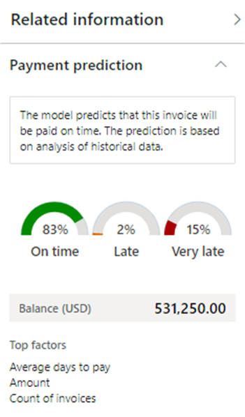

<!-- https://learn.microsoft.com/en-us/training/modules/describe-report-integration/8-describe-finance-insights -->
<!-- refetched: original harvest URL returned 404 -->
# Describe how Copilot-based insights support finance and operations apps

Completed

* 8 minutes

Dynamics 365 Finance and Dynamics 365 Supply Chain Management both use AI and machine learning to help you make faster, more informed decisions. In Finance, the Finance insights feature uses AI Builder models to predict customer payment timing, forecast cash flow, and generate budget proposals based on historical data. You can also integrate trusted third-party sources, such as credit bureau information, to improve prediction accuracy.

In Supply Chain Management, Copilot provides AI-generated summaries across procurement, sales, and product pages. These summaries analyze master and transaction data and present key information in natural language, giving you quick visibility into vendor performance, purchase order details, customer activity, sales orders, and product attributes. Together, these capabilities help finance and operations teams plan proactively, manage liquidity, and respond to changing business conditions. Administrators remain responsible for the data used with, or output from, these features to ensure compliance with their organization's data and privacy policies.

## Finance

### Data requirements

Finance insights relies on historical financial data to train and generate predictive models. Before turning on the features, make sure customer invoices, payments, and balances are complete, consistent, and posted in Dynamics 365 Finance. The system uses this transactional history, combined with master data such as payment terms and customer information, to identify patterns that influence predictions.

Integration with Dataverse and AI Builder is required to store and process the prediction results. Data should be refreshed regularly so the models can learn from the most recent transactions and improve accuracy.

### Financial predictions

Finance insights uses AI to analyze customer payment history and predict when invoices are likely to be paid. These customer payment predictions help finance teams forecast cash inflows more accurately and identify customers who might pay late. The model learns from historical payment patterns, payment terms, and other related data to estimate whether a customer pays an invoice on time, partially, or late.

You can view predictions directly on the Customers page and in the Customer payment predictions workspace. These predictions enable collections teams to prioritize outreach and make informed decisions that improve cash flow and reduce past-due balances.

### Cash flow forecasting

Finance insights enhances cash flow forecasting by using AI to predict future inflows and outflows based on historical data, open transactions, and payment schedules. Users can create, save, and compare optimistic, pessimistic, and realistic forecasts in real time. This forecasting provides a clear view of potential cash positions and supports better liquidity planning.

You can use Intelligent cash flow forecasting to save or edit cash flow forecasts and compare them in real time to the actual numbers. By using this forecasting feature, you can provide business stakeholders with an optimistic, pessimistic, and realistic view of what the cash flows could be and the differences between them.

You can use forecast models to view various potential outcomes of cash flows. You can then analyze the insights and use them for relevant planning based on expected future cash flows.

### Budget proposal

Finance insights provides an intuitive approach to handling budgets by using historical data to build a machine learning model that generates accurate budgets. Some departments, such as payroll, tend to fluctuate less than others. With the predictive capabilities of Finance insights, organizations can create accurate budgets regardless of how much departmental spending changes each year.

You can make the necessary manual adjustments and then present the information to the people who approve the budgets for the company.

## Supply Chain Management

Supply Chain Management provides Copilot-based AI-generated summaries to speed up decision-making in procurement, sales, and product insight scenarios by analyzing master and transaction data and presenting key information in natural language.

### Vendor page

The vendor page generates a snapshot of vendor performance and risk, including:

* **Vendor overview**: Status and group information.
* **Financial status**: Payables, payment history, and invoice trends.
* **Procurement activity**: Recent purchase orders, frequently purchased items, and order trends.
* **Delivery performance**: On-time rates and lead times.
* **Risks and alerts**: Overdue invoices, vendor blocks, pricing discrepancies, and delivery delays.
* **Insights**: Dependency risk, cost trends, and alternate sourcing.

### Purchase order page

The purchase order page summarizes purchase order details, including:

* **Vendor and order overview**: Total amount and line count.
* **Key product details**: Items on the order.
* **Delivery information**: Dates, address, and mode of delivery.
* **Financial insights**: Prices, discounts, and charges.
* **Risks and exceptions**: Late delivery risk, missing confirmations, pricing discrepancies, and inventory impact.

### Customer page

The customer page provides an overview of customer profile and risks, including:

* **Customer overview**: Segment and relationship status.
* **Financial status**: Outstanding balance, credit usage, and overdue invoices.
* **Sales activity**: Recent orders, value trends, and recurring or high-value purchases.
* **Delivery and operations**: Delivery preferences, locations, and fulfillment performance.
* **Risks**: Credit breaches, late payments, and disputes or returns.
* **Trends**: Buying patterns, seasonality, and upsell opportunities.

### Sales order page

The sales order page summarizes key order information, including:

* **Sales order overview**: Total value and number of lines.
* **Delivery details**: Shipping dates and fulfillment information.
* **Financial highlights**: Discounts, taxes, and totals.
* **Exceptions and alerts**: Delays, inventory shortages, and credit issues.
* **Additional insights**: Special charges, notes, and instructions.

### Product detail summary

The product detail summary includes:

* **About this product**: On-hand stock across warehouses and variants.
* **Purchase information**: Default purchase price, trade agreements and discounts, default vendor, lead time, and order multiple constraints.
* **Sale information**: Default sales price, trade agreements, and discounts.

### Product hover summary

The product hover summary consolidates product attributes such as subtype, name, searchable name, engineering category, variant info, hazardous material, and category or subcategory. This summary appears in lookups across multiple pages like purchase orders, sales orders, bills of materials, transfer orders, and journals.