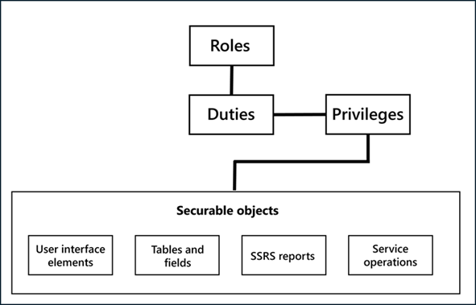

<!-- https://learn.microsoft.com/en-us/training/modules/describe-shared-features/2-describe-security-capabilities -->
<!-- refetched: original harvest URL returned 404 -->
# Describe security capabilities in finance and operations apps

Completed

* 25 minutes

Finance and operations apps offer a robust security framework to implement role-based access permission. In role-based security, users are assigned to roles. A user who is assigned to a security role can access only the set of duties or privileges associated with that role.

You can set up rules to automate role assignments so administrator involvement isn't required every time a user's responsibilities change. After security roles and rules are set up, business managers can control day-to-day user access based on business data.

## Overview of role-based security

The security model is organized in a hierarchical structure, where each element reflects varying levels of detail. Permissions define the access to individual securable objects, such as menu items and tables. Privileges, which consist of various permissions, correspond to tasks, such as canceling payments and processing deposits. Duties encompass privileges and represent parts of a business process, such as maintaining bank transactions. You can assign both duties and privileges to roles to grant access to finance and operations apps features.

## Security roles

All users must be assigned to at least one security role to have access to finance and operations apps. The security roles that are assigned to a user determine the duties that the user can perform and the parts of the user interface that the user can view.

Administrators can apply data security policies to limit the data that the users in a role have access to. For example, a user in a role may have access to data only from a single organization. The administrator can also specify the level of access that the users have to the current, past, and future records. For example, the administrator may assign user privileges that allow the users to view records for all periods but modify records for only the current period.

Security roles can be organized into a hierarchy, enabling the administrator to define a role based on another role. For example, the administrator may define the sales manager role as a parent role of the manager role and the salesperson role. A parent role automatically inherits the duties, privileges, and conditions that are assigned to its child roles. Therefore, a user who is assigned to the parent role can perform all the tasks that users in the child roles can perform. A role can have one or more child roles or one or more parent roles.

By default, finance and operations apps provide sample security roles. All functionality is associated with at least one of the sample security roles. The administrator can assign users to the sample security roles, modify the sample security roles to fit the needs of the business, or create new security roles.

## Duties

Duties are aligned with the business process defined in the system. The administrator assigns the duties to security roles. One duty can be assigned to multiple roles.

In the security model, duties contain privileges. For example, the **Maintain bank transactions** duty contains the **Generate deposit slips** and **Cancel payments** privileges. Although an administrator can assign both duties and privileges to security roles, it's advisable to use duties when granting access to finance and operations.

You can apply rules for segregation of duties to restrict a user from performing combinations of actions in a financial system. For example, you may not want the same user to both create a vendor and post payments for the vendor. You can add a new segregation of duty policy for the duties **Maintain vendor masters** and **Maintain vendor payments**. Running the **Verify Compliance of User-Role Assignments** process reveals any conflicts for users assigned to multiple duties, enabling you to resolve the conflicts.

Although the system provides default duties for users, the administrator can modify the privileges that are associated with a duty or create new duties.

## Privileges

In the security model, a privilege specifies the required level of access to perform a job, solve a problem, or complete an assignment. Administrators can assign privileges directly to the roles. However, it's advisable to assign privileges to duties. To follow best practices, administrators should assign duties to roles, so the privileges are first grouped together into a duty, making the duty easier to maintain.

The security privilege contains the Create, Read, Update, and Delete (CRUD) level permissions, which administrators can adjust to meet more granular security requirements. CRUD permission is applied to individual application objects, such as user interface elements and tables. For example, the **Cancel payments** privilege contains permissions to menu items, fields, and tables that are required to cancel payments.

By default, privileges are provided for all features in finance and operations apps. The administrator can modify the permissions that are associated with a privilege or create new privileges.

## Permissions

Each application object tree (AOT) element, such as form, report, process, or service, is accessed through an entry point. Menu items, web content items, and service operations are referred to collectively as entry points.

In the security model, permissions group the securable objects and access levels required to run a function. This group includes any tables, fields, forms, or server-side methods accessed through the entry point.

Administrators can configure user security from the Security configuration page.

## User

To be able to access the finance and operation apps, you must be added to the **User** page. On the **User** page, you can add full-time employees, contract employees, vendors, and users who belong to the external network. Administrators can import users from Microsoft Entra ID or add the users manually. Once added, an administrator must assign appropriate roles to the users so that they can access any required menus in the application.

From the **User details** page, the administrator can enter details like user ID, company, roles, or assigned organizations.

To assign roles to a user, you need to select the **Assign roles** link. The **Assign organizations** link helps you to configure the legal entities on which the roles are applicable.

The following video demonstrates how the appearance of the finance and operations apps differs for users based on their assigned security roles.