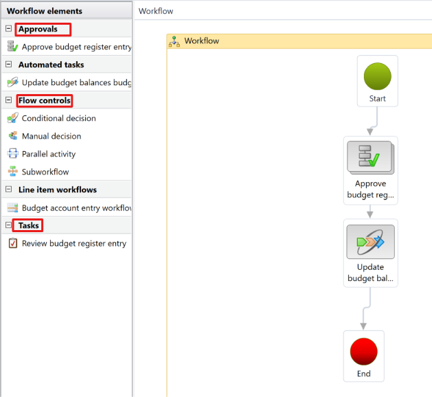
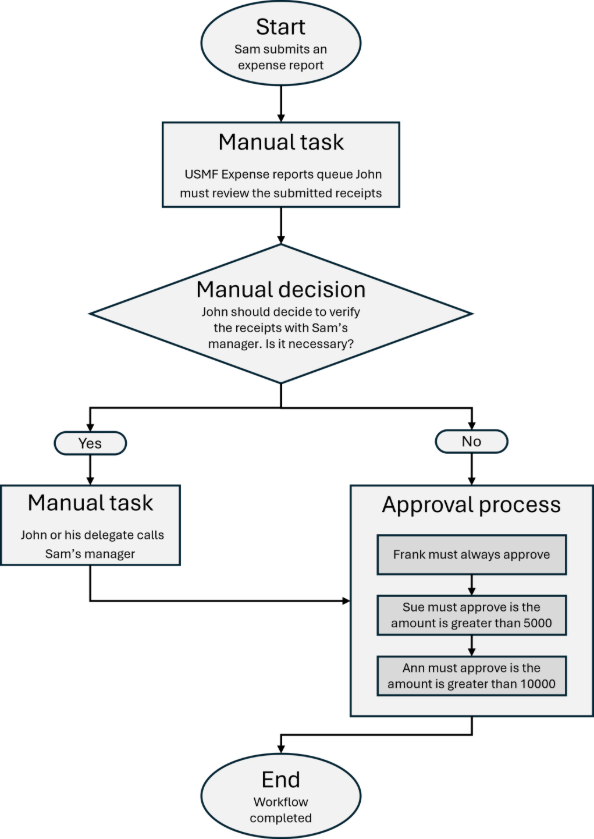
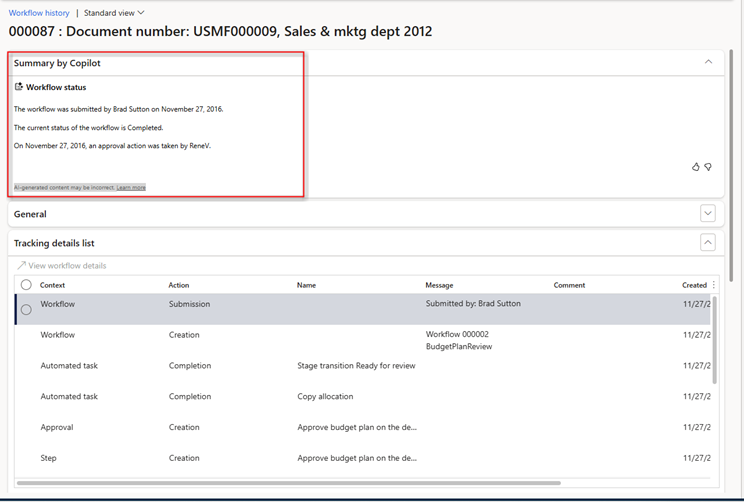
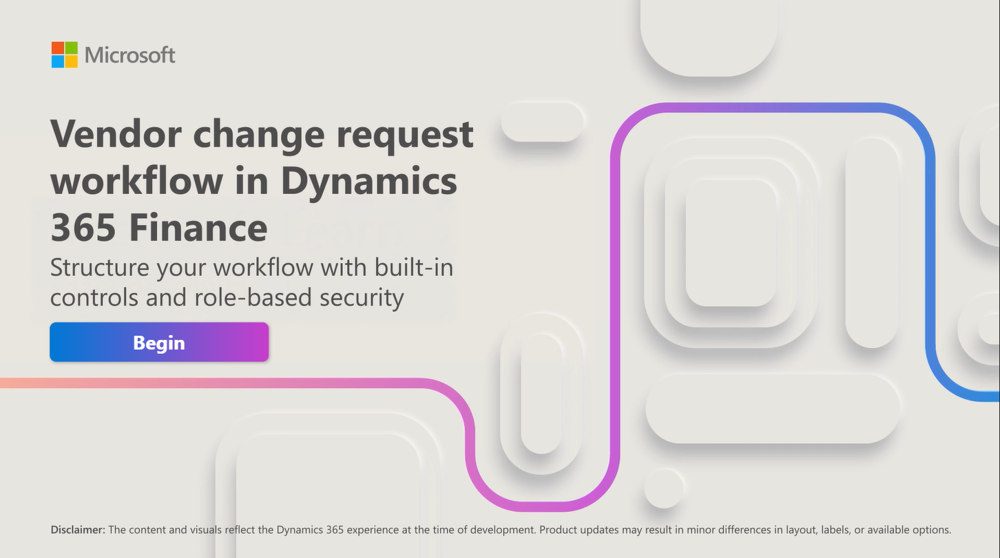

<!-- https://learn.microsoft.com/en-us/training/modules/describe-shared-features/3-describe-workflow-capabilities -->
<!-- refetched: original harvest URL returned 404 -->
# Describe workflow capabilities in Dynamics 365 finance and operations apps

Completed

* 30 minutes

A workflow is a system or a business process that defines how a document moves through a system. It shows who must complete tasks, make decisions, or approve documents.

Some organizations require a user other than the person who enters a record to approve specific processes. These workflow processes might require manual approval, workflow approval, or no approval.

Creating a workflow in finance and operations apps requires multiple configuration steps:

* Create the workflows.
* Configure workflow properties.
* Configure elements for the workflow, including:

  + Manual tasks.
  + Automated tasks.
  + Approval processes.
  + Decisions (conditional flows)
* Assign users to workflow elements.

## Workflow types

A workflow configuration is based on a workflow type. You can create multiple workflow configurations for each workflow type.

The following scenarios show how you can use workflows in finance and operations apps.

* A clerk enters a journal entry, but the entry requires approval from a manager before it can be posted.
* The accounts payable manager must approve changes to a vendor record that could affect cash flow.
* A customer exceeds their credit limit, triggering a credit hold on their orders. The credit management team reviews the customer’s history and decides which orders to release.

Finance and operations apps have more than 75 out-of-the-box workflows. You can add even more workflows as customizations to the system.

## Workflow elements

A workflow consists of the following elements:

* **Tasks**: A task is a unit of work that must be performed. You can add two types of tasks to a workflow: manual and automated.
* **Approvals**: Another user approves the process, or the system automatically approves it based on predefined conditions.
* **Line-item workflow elements**: You can create a workflow to process either documents or the line items on a document.
* **Flow-control elements**: Manual and conditional decisions, in addition to parallel activity and subworkflows would be examples of flow-control elements.

You configure workflow elements in the workflow editor.

## Manual task

A manual task is a unit of work that a user must perform. For example, an expense report workflow can have manual tasks that require the assigned users to complete the following actions:

* Review the receipts that are submitted together with an expense report.
* Call an employee's manager.

## Automated task

An automated task is a unit of work that the system must perform. No human interaction is required. For example, a sales order workflow can have automated tasks that require the system to complete the following actions:

* Perform a credit check.
* Create a customer record for a customer if a record doesn't already exist.

## Approvals

At each approval step, the user can perform the following actions:

* Approve the document.
* Reject the document.
* Request a change to the document.
* Assign the document to another user for approval.

If a document is rejected, the original submitter can correct it and resubmit it for approval.

## Line-item workflow elements

You can add a line-item workflow element to a document workflow. For example, you add a purchase order line workflow to the purchase order workflow. When the workflow runs, it processes each line item in the document. You may want to process all line items through the same workflow, or you may prefer to have each line item go through its own distinct workflow.

## Manual decision

A manual decision is a point where a workflow divides into two branches. A user must make a decision, and this decision determines which branch is used to process the submitted document.

## Conditional decision

A conditional decision is also a point where a workflow divides into two branches. However, the system decides which branch to use to process the submitted document. To make this decision, the system evaluates the document to determine whether it meets specified conditions.

## Parallel activity

A parallel activity is a workflow element that includes two or more workflow branches that run at the same time.

## Subworkflow

A subworkflow is a workflow that runs in the context of another workflow. In addition to making a complex workflow easier to read, subworkflows are reusable components that can be added to many workflows so changes only need to be made in one place.

## Workflow users

A workflow can involve several groups of people: the originator, task assignees, decision makers, and approvers. For example, consider the following workflow approval process:

* The expense report workflow is an originator.
* The members of the queue are task assignees, a decision maker, and approvers.

## Workflow step assignment

Workflow steps—like approvals and tasks—are assigned to users or groups. It’s best to assign them based on security roles or user groups, rather than individual users, so the workflow doesn’t need to be updated every time someone changes jobs. Assignments can also follow a managerial hierarchy, allowing a manager to approve a step and automatically escalate the step if no action is taken within a set time. You can choose between single approval (any individual needs to approve) or multiple approvals (everyone assigned must approve).

## Workflow history

Workflows progress through multiple steps from submission to completion. The Workflow history page displays all actions taken within the workflow, including each step assignment and completion. You can access this page from the Workflow menu item at the top of any page where you submit a workflow. Selecting this menu item shows the history for the workflow related to the current page. To view the history of all workflows, go to Organization administration > Workflow > Workflow history. Administrators use this page to review workflow activity, monitor the number of workflows in progress, and diagnose workflows stopped by errors.

The top of the Workflow history page has a Summary by Copilot FastTab that summarizes the Workflow status. Below this is the Tracking details list. The Copilot summary takes all the details and condenses it to the important points, which saves time when reviewing workflow history.

The following simulation demonstrates a vendor change request workflow. An Accounts payable clerk receives a request to change the payment terms for a vendor and makes the change. The clerk doesn't have permission to finalize the change, so the system submits it to a workflow for approval.

