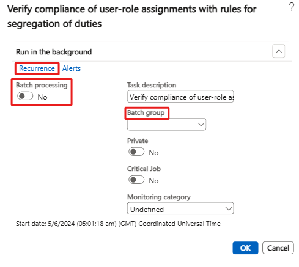
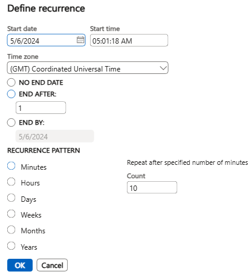
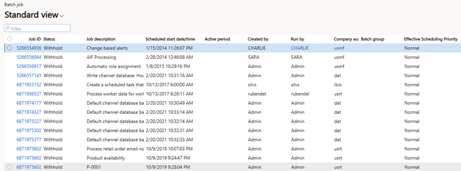
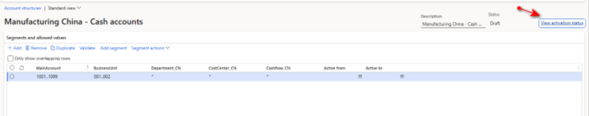

<!-- https://learn.microsoft.com/en-us/training/modules/describe-shared-features/4-describe-concept-batch-jobs -->
<!-- refetched: original harvest URL returned 404 -->
# Describe batch jobs in finance and operations apps

Completed

* 15 minutes

You can run many tasks in finance and operations apps as part of batch jobs. A batch job enables users to run a process in the background. Typically, the batch framework is used for processes that may be time-consuming, don't necessitate immediate results, or are set to occur periodically. For example, batch jobs can include tasks for printing reports, performing maintenance, or sending electronic documents.

The batch job shown in the preceding screenshot can run a process to verify the compliance of a user role assignment that has rules configured with segregation of duties. If the **Batch processing** slider is switched to **Yes**, the process runs in the batch server. Otherwise, it runs as a synchronous process in the browser. You can define the run recurrence of this process by selecting the **Recurrence** link. In the **Batch group** drop-down list, you can select the batch group with which the job can be associated.

By using batch jobs, you can avoid slowing down your computer or the server during typical working hours. If possible, you can schedule the batch job during the night. This way the processes can run without impacting regular jobs in the day.

The tasks in a batch job can run either sequentially or in parallel. Additionally, you can create dependencies between tasks. The sequence of tasks may differ, depending on whether an earlier task succeeds or fails.

You can set up recurrence patterns for batch jobs. For example, you can set up a job that processes daily at midnight and kicks off automatically.

To monitor batch jobs, you can set up alerts. Alerts can be sent when the batch job succeeds, fails, or finishes.

After a batch job is processed, you can view the history. The history includes any messages that the batch job encountered while it was running.

The Batch job page displays all the batch jobs waiting to get started, that are running, or that ended in the system. To troubleshoot a batch process, the Batch job page is the first page you need to start your investigation.

Because not everyone has access to the **Batch job** page, some pages within the system provide a link to view the status of a batch job. Account structure activation is one of the functions where a batch job is easily monitored by selecting a link on to the **Account structure** page.

The status of the batch job is easily determined from the activation status dialog box. Select the **Refresh** link to get the latest status.

## Batch framework

The batch framework provides an asynchronous, server-based batch processing environment that can process tasks across multiple instances of Application Object Server (AOS).

* A **batch job** is a process that you want to execute in the AOS. A batch job consists of one or more batch tasks.
* A **batch task** is an activity that a batch job runs. You can add batch tasks that have multiple types of dependencies to a batch job. You can also configure AOS instances to run multiple threads, each of which runs a task. The batch tasks can run in parallel in multiple threads on the available AOS instance that is configured as a batch server. This improves throughput and reduces overall execution time of the batch job.
* A **batch group** is an attribute of a batch task. It lets the administrator determine or specify which AOS instance runs the batch task. When you create a new task, it's put in the default batch group. All batch servers are configured to process the default batch group and the waiting tasks from any job. Additionally, you can create a named batch group and then set an affinity between that batch group and specific AOS instances. Once you establish this affinity, only the designated AOS instances handle tasks from the specified batch group, and they exclusively process tasks from that same batch group. You can also add the default batch group to the configured servers, if that batch group is required.

Each batch thread runs one batch task at a time. The capacity of a batch server is based on the maximum number of threads that can run concurrently on the AOS instance. You can add complex dependencies between or among tasks. If an AOS is configured as a batch server, it periodically checks for tasks that are waiting to be processed.

## Priority-based batch scheduling

The **Batch priority-based scheduling** feature decouples batch groups from the batch server. This feature is now mandatory. With this feature, you can define priorities for batch groups. The scheduling priorities based on business requirements are used to determine the order in which tasks run across available batch servers.

You can use the scheduling priority classifications to declare relative priorities, and to determine the processing order of jobs and business processes. The available values for the scheduling priority are **Low**, **Normal**, **High**, **Critical**, and **Reserved capacity**. The scheduling priority is specified for the batch group but can be overridden by jobs assigned to the group.

Advantages of priority-based batch scheduling include:

* Priorities are introduced at the batch job level.
* Near-zero downtime servicing requires the system to be able to move batch jobs to running servers while others are being updated.
* Batch jobs are not tied to a particular server.
* Critical batch jobs are guaranteed capacity as part of **Reserved capacity**.