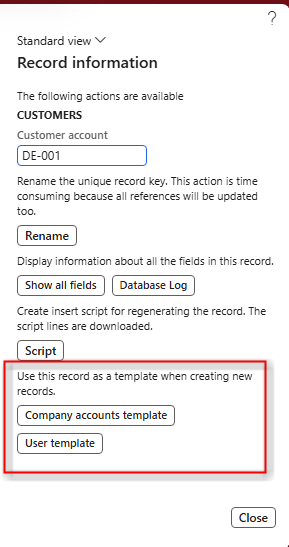
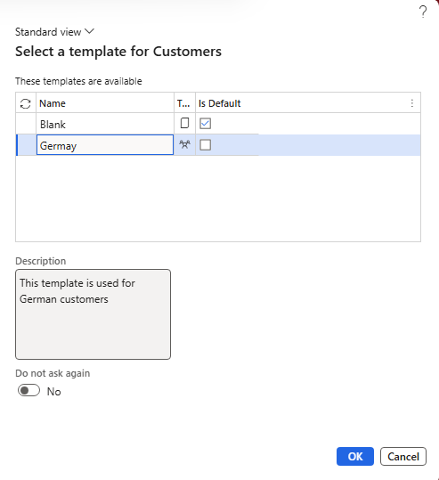

<!-- https://learn.microsoft.com/en-us/training/modules/describe-shared-features/6-create-maintain-record-templates -->
<!-- refetched: original harvest URL returned 404 -->
# Create and maintain record templates

Completed

* 10 minutes

Record templates in finance and operations apps help users create records more efficiently by prepopulating fields with commonly used values. This feature is especially useful when entering repetitive data, such as customer or vendor records, where certain fields often contain the same information. They reduce manual data entry, improve consistency, and save time. Templates are available for specific record types and can be shared across users depending on access permissions.

Here are some use cases for record templates:

* A car rental company in San Francisco frequently enters rental records for local customers. A template can automatically fill in **City**, **State**, and **Country/region** fields with "San Francisco," "California," and "USA."
* A finance team regularly creates vendor records for suppliers in a specific region. A template can prefill **Payment terms**, **Currency**, and **Tax group** fields.
* An HR department creates employee records with standard department and job title values for new hires in a specific role.

To create a template, select an existing record and select the **Options > Page options > Record info** menu item. At the bottom of the dialog is the option to create either a **Company accounts template** or a **User template**. A **Company accounts template** is available to all users with access to this page in the legal entity/company where the template is created. A **User template** is just for you and isn't shared with other users.

After you save the template, you enter a name and description.
When a user begins creating a new record, finance and operations apps check if templates are available for that record type. If so, the Select a template for dialog box appears. The user can choose a template, and the system applies the default values from that template to the new record.

Users can also choose to bypass templates by selecting **Do not ask again**. To re-enable the template selection prompt, right-click any record, choose **Record info**, and then select **Show template selection**.

Follow these best practices when using templates:

* Use clear and descriptive names for templates, especially if they're shared across users.
* Avoid including sensitive information (for example, “commission”) in template names.
* Regularly review and update templates to reflect changes in business processes or data standards.