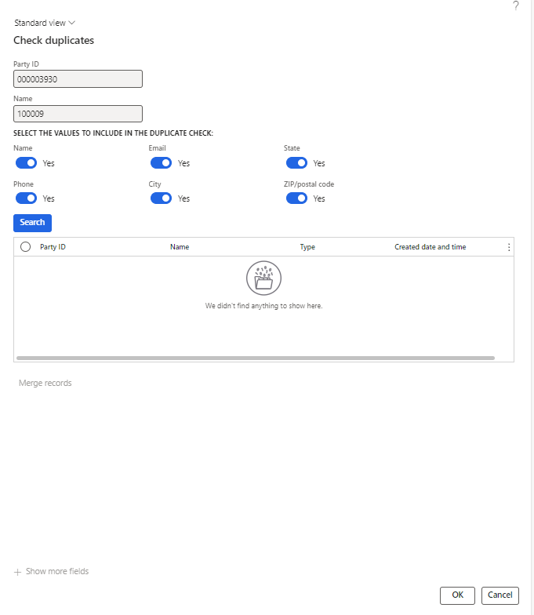

<!-- https://learn.microsoft.com/en-us/training/modules/describe-shared-features/7-describe-global-address-book -->
<!-- refetched: original harvest URL returned 404 -->
# Describe global address book features

Completed

* 25 minutes

The global address book is a centralized repository for master data that must be stored for all internal and external persons and organizations that the company interacts with. When an address changes, the update needs to be made in only one place. All other associated records are updated automatically.

The global address book is included out of the box with all finance and operations apps.

The data that is associated with party records includes the party's name, address, and contact information. Other details vary, depending on whether the party is a person or an organization.

The global address book stores party records, and each party can be associated with one or more party roles in a company. Party roles include customer, prospect, worker, user, vendor, competitor, applicant, and contact.

## Party roles

Roles that are associated with party records are referred to as party roles. Several party roles are available, and they can be assigned to both party types, person and organization. Here are the definitions for each party role:

* **Customer:** Individuals, companies, or other entities that purchase goods and services produced by others.
* **Prospect:** A party that is a potential customer for your products or services.
* **Worker:** A person who assumes the role of an employee or a contractor, and who is paid in exchange for services.
* **Vendor:** A party that supplies products to one or more legal entities in exchange for payment.
* **Competitor:** A person or organization that provides goods or services that are like the goods or services that your business provides.
* **Applicant:** A person who makes a formal written or electronic request to work for or fill an open position in an organization.
* **Contact:** Create an entry for a person, inside or outside your organization, and save details such as street and email addresses, telephone and fax numbers, and webpage URLs.

Navigate to **Common > Common > Global address book** to view entries in the global address book.

A party record can belong to one or more address books. Each party record can store one or more locations, or addresses, and is assigned a party role. The role that is assigned to the party record can have specific transaction types associated with it. The following sections provide more information about party roles, locations, and transaction types.

The global address book can help you understand the relationships among people and organizations that are associated with your organization.

For example, a customer can also be a vendor in a marketing campaign, or a worker in your organization can also be a vendor.

## Create new party records

You can choose from two methods to enter party records in the global address book:

* **Creating a party record when you don't know the role:** If you aren't sure of the party's role (such as customer or prospect), create the record directly in the global address book. You can assign the role type later.
* **Creating a party record when you know the role:** If you know the role type for the party, you can create a record on the appropriate page for that type. For example, if the party is a customer, you create a record on the **Customer** page. When you create and save a record by using the page for the party's role type, the record is automatically created in the global address book.

For transactions that are a part of the business processes, multiple parties might be associated with each transaction. An example is a customer that needs to be referenced on project quotations.

Each party record’s addresses, locations, and contact information are shared across all its roles. If you update this information, all related records are updated too. When a party role is used in a transaction, you can access the party’s address, location, or contact details during data entry.

### Duplicate records

You can check for duplicate records directly from the **Global address book** list page. In the Action pane, on the **Party** tab, in the **Maintain** group, select **Check for duplicates**. Then select the values to include in the check for duplicates.

### Add and remove multiple parties

To add multiple party records to an address book, on the **Global address book** list page, select the parties in the list. Then, in the Action pane, on the **Party** tab, in the **Maintain** group, select **Assign parties**. Select the address books to add the selected party records to, and then select **OK**. All the selected party records are added to the address books that you selected.

To remove multiple party records from an address book, on the **Global address book** list page, select the parties in the list. Then, in the Action pane, on the **Party** tab, in the **Maintain** group, select **Remove parties**. Select the address books to remove the parties from, and then select **OK**. All the selected party records are removed from the address books that you selected.

### Change or update party type or information

Sometimes, you might need to change the party type of a record from person to organization or from organization to person. To do this, first create a new party record of the correct type in the global address book. Then, associate the old party record with the new record. After making the new party association, delete the original party record that has the incorrect record type.

To update the name of a party record, open the party record, and then, in the Action pane, select **Edit**. On the **General** FastTab, enter the new name for the party, and then save the record.

To update an address for a party record, open the party record, and then, on the **Addresses** FastTab, select the address to update. Select **Edit**, and then, on the **Edit address** page, make the required changes to the address or address parameters.

### Merge party records

Occasionally, you might want to merge two or more party records into a single record. This can occur if you create one or more duplicate party records, either on purpose or unintentionally. When you merge party records, you select one record to keep.

The information from the other records is then merged into this record. You can’t merge internal party organization records in the same legal entity, team, or operating unit.

### Set up address translations

You can set up address translations so that address information appears in your system language in finance and operations apps, but in another language on documents like sales orders. You can add translations for country or region names, addresses, and name formats.

For example, your system language is Italian, and you create a sales order for a customer in Germany. In this case, you can view the customer record in Italian in finance and operations apps but display the address information in German on the printed sales order.

When you set up translations, you should enter a translation for every item in the list. Any items that you don't enter a translation for will appear in the system language.

For example, your system language is French, and you send a document to a customer in Spain. If you don't enter Spanish (ESP) translations for the address information, that information appears in French both in finance and operations apps and on the printed document.

## Plan for the global address book and other address books

You must consider many scenarios when you make decisions during the planning process, before you set up and configure the global address book and any other address books in finance and operations apps. Some of the decisions require that you confirm the decisions that were made for other areas of the product, such as the organization hierarchy.

Before you begin to work with the global address book, you must determine the default values for it. These default values are then used for any other address books you create.

The following are some examples of the decisions that you need to make:

* What sequence should names be displayed in for party records of the person type? For example, one sequence is family name, middle name, first name.
* Should party records be deleted from the address book when the role record is deleted? For example, if a customer record is deleted, should the party record also be deleted?
* When a new record is created, should users be notified if a duplicate record is found in the global address book?
* Should the Data Universal Numbering System (DUNS) number be included in a party record’s information?
* If the DUNS number is included in a party record, should the uniqueness of the number be checked?
* When a party record is created in the global address book, do you want a default party type, person, or organization?
* Which user roles should have access to the private addresses and contact information of party records?

After you create the global address book, you can create more address books if needed, such as a separate address book for each company in your organization or for each line of business.

To create more address books, go to **Organization administration > Global address book > Address books**.

When you create a new address book, you first have an opportunity to select **Teams** to populate the address book with members of Teams that are created.

To set up **Teams**, go to **Organization administration > Organizations > Teams**. From there, you can add members to a team, which then add to a specific address book.

