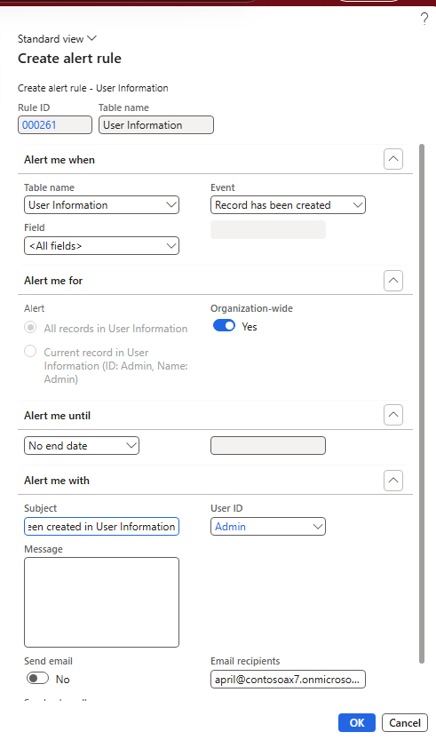
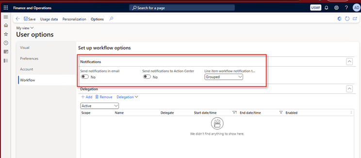

<!-- https://learn.microsoft.com/en-us/training/modules/describe-shared-features/8-describe-alerts -->
<!-- refetched: original harvest URL returned 404 -->
# Set up alerts in finance and operations apps

Completed

* 8 minutes

Alerts form a notification system for critical events in finance and operations. You can use alerts to stay informed about events that you want to track during the workday.

Alerts can be configured for various scenarios, including when:

* A batch job ends successfully, ends in error, or is canceled.
* A record is inserted, updated, or deleted in a particular table.
* Values fall below a defined threshold (for example, Inventory level).
* A particular item is added to a sales order.
* A workflow progresses and is assigned, completed, rejected, approved.
* Due dates are approaching.

Most operations in the system cause data to be changed. You can set an alert on any data change or record delete provided you have write access to the underlying data. Alerts for records being created are available with read access to the underlying data.

You can define alerts in:

* Dialogs that submit batch jobs.
* Workflow notifications.
* The **Options > Share** menu item group on every page. The options are to **Create a custom alert** or **Manage my alerts**. These alerts are based on create, update, or delete of the underlying records on the page. You can limit the alert to certain **values** being set for a particular field or any change to a field.

When creating a custom alert, you define:

* Whether it should be for all legal entities or just the legal entity you're currently running in.
* The expiration date for the alert (if you want one).
* The subject line and message for the alert.
* Who you would like to be emailed when the alert triggers (if an email is desired). You can also specify a particular record or all records of this type (for example, all vendors).

The alert system runs as a regularly scheduled batch job. It generally sends alerts within a few minutes of the event, depending on the recurrence schedule of the batch job. Due date alerts are only valid for date fields.

You can select whether the **Workflow** alerts are emailed to you or appear as notifications in the Action center or both. This is defined in the **Workflow tab > Notifications** FastTab of your **User options.**

Follow these best practices when setting up alerts:

* Set up only alerts you really need as there's a performance impact to using alerts.
* Set an expiration date if using alerts to understand a particular issue or scenario.
* Create one alert with a distribution list if many people need notification rather than creating a separate alert for each person.