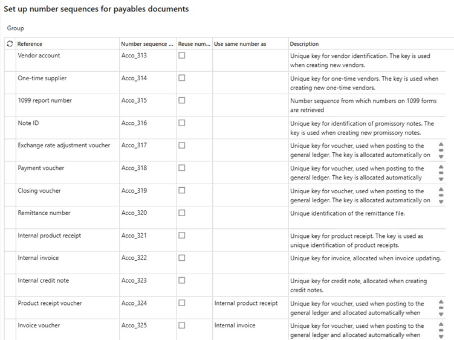

<!-- https://learn.microsoft.com/en-us/training/modules/describe-shared-features/9-describe-number-sequences -->
<!-- refetched: original harvest URL returned 404 -->
# Describe number sequences in finance and operations apps

Completed

* 10 minutes

A number sequence is a generic framework in finance and operations apps that helps generate unique identifiers for selected master and transaction entities—such as customer IDs, invoice numbers, or purchase orders. These identifiers are essential for tracking and referencing records throughout the system.

Number sequences can be applied to both master and transactional data. You can also define a specific format for each unique identifier to suit your business needs. Configuration of number sequences is done through the **Organization administration** module.

## Scope

When you create a new number sequence, you need to select the scope of the number sequence. Scope can define the uniqueness criteria of a number sequence. The following options are used to define scope:

* **Shared**: This option applies to entities where you can use the same number sequences irrespective of the legal entities. Product is an example of an entity shared across legal entities.
* **Company**: For most entities in finance and operations apps, you use different number sequences for different legal entities. These entities follow the number sequence with the Company scope. Customer, vendor, sales order, and purchase order are examples. The corresponding tables contain a field named `DataAreaId`, which holds the legal entity information. Each `DataAreaId` has a separate number sequence.
* **Legal entity**: Some entities in finance and operations apps include the legal entity as another column, such as an expense report. You may need to create the number sequence based on this legal entity field.
* **Company and fiscal calendar period**: Use this option when the number sequence is configured based on a combination of company and fiscal year.
* **Legal entity and fiscal calendar period**: Use this option when the number sequence is configured based on the combination of legal entity and fiscal year.
* **Operating unit**: Use this option when creating a number sequence based on an operating unit, such as a department or cost center.
* **Operating unit type**: If you need a separate number sequence for each type of operating unit, use this option.

## Number sequence format

On the **Segment** FastTab, you can define the number sequence format. You can include the legal entity in the format. You can also add a constant value in the number sequence followed by the unique number. If the length of the unique number is five digits, you define it as #####.

## Number sequence configuration

On the **General** FastTab of the number sequence are the following configuration options:

* **In use**: The moment you associate a number sequence with an entity and it starts generating a new number, the number sequence is marked as **In use**.
* **Stopped**: If you no longer want to use a number sequence, you can turn this on.
* **Manual**: When you select Manual, you can enter the number manually in the system.
* **Continuous**: This toggle ensures that no number is skipped while generating the number sequence. Continuous number sequence is used for legal compliance requirements. In terms of performance, a noncontinuous number sequence performs better than a continuous number sequence.

The **Automatic cleanup** FastTab appears for the **Continuous** number sequence. This can clean up the unused numbers at the defined interval. You can also run the cleanup process manually.

The **Performance** FastTab is available for **non-continuous** number sequences. It allows the system to preallocate a batch of numbers to keep in memory and assign to lessen access to the database. Although this improves performance, it can leave large sets of unused numbers that aren't recovered. Any preallocated numbers in memory when a server shuts down are never recovered.

## Number sequence usage

Each module in finance and operations apps includes a dedicated page for configuring its parameters, which can be accessed through the **Setup** submenu. The **Parameter** page includes a tab to configure module-specific number sequences. This tab contains the list of entities in the module where you can associate the relevant number sequence.

For custom entities, you can create a customized number sequence, which appears in the **Parameters** page of the corresponding module.

Many other number sequences are used by the system but never appear on a **Parameters** page of a module. Voucher series number sequences are defined for each journal name and appear on the **Journal name** page instead of a **Parameters** page. A number sequence can only be used if referenced by a **Parameters** page or some other page in the application.

Effective number sequence management ensures operational efficiency and compliance across modules. Features like manual entry, continuous toggling, and cleanup processes allow businesses to tailor systems to specific needs, enhancing accuracy and reliability.

In the following demonstration, you learn how to access and create a number sequence.