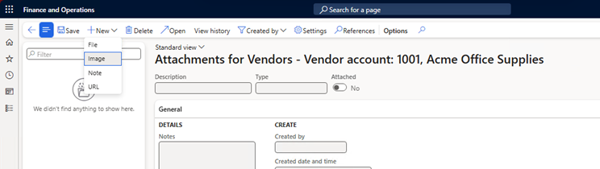
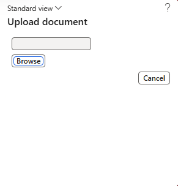

<!-- https://learn.microsoft.com/en-us/training/modules/describe-shared-features/10-describe-attachment-capabilities -->
<!-- refetched: original harvest URL returned 404 -->
# Describe attachment capabilities in finance and operations apps

Completed

* 6 minutes

Document management (document handling) stores file attachments and notes attached to records. Users can attach notes or documents to virtually any record within the finance and operations apps.

Common use cases for document attachments include:

* Vendor W-9 forms added to the vendor record.
* Invoices received from vendors linked to the vendor invoice record.
* Supporting documentation provided for a ledger journal entry.
* Product images stored with relevant records.

## Configure document types

Document types are used to categorize the documents that you attach to records or the templates that you create. Each document type can be stored in a unique location.

A default set of document types is provided. You can use these document types to categorize an attachment as a file, image, note, or URL. The **File** and **Image** default document types are configured to use **Azure Storage** as the location. Notes are stored directly in the database without requiring a separate file. You can also store URLs as an attachment. The URL is stored directly in the database.

You may choose to change the file and image locations to SharePoint. To use SharePoint storage, set the **Location** field for a document type to **SharePoint**. Then, in the **SharePoint Address** field, enter a valid SharePoint address. You must set a SharePoint server in the **Document management parameters SharePoint** tab if you plan to use SharePoint as a storage location. A single SharePoint server must be used for all documents stored in SharePoint.

Often a company adds other document types, a type for each type of document. For example, the W-9s referenced in the use case might all be placed in a document type named **W9**. If you can provide guidance to your users on which documents are placed in each document type, there's no downside to adding many extra types. Document types are added from the **Organization administration > Document management > Document types** menu item. Each document type must include the following information:

* Document type ID and name
* Content format (file, URL, or note)
* Storage location (Azure, SharePoint, or database)
* SharePoint address if using SharePoint

## Access document management attachments

Document management appears to users as the **Attach** button (paperclip) at the top of most pages that contain data. When you select the **Attach** button (or when you use the corresponding keyboard shortcut, **Ctrl**+**Shift**+**A**), the **Attachments** page is opened in the context of the data source of the control that's currently selected on the page. This page shows all the attachments that are related to the corresponding data source.

The **Attach** button also shows a count of the attachments for the currently selected record. Therefore, you can determine whether there are attachments for the current record without having to open the **Attachments** page. The button shows exact counts for zero through nine attachments. If there are more than nine attachments, the button shows **9+** as the count. In this way, the performance impact and visual noise that exact larger counts might cause are reduced.

## Add an attachment

You add a new attachment, by selecting the **Attach** button at the top of the page. This action displays all attachments for the existing page. Select the **New** menu item and select the type of attachment you want to add. All document types are listed.

If you select a document type that requires a file, you can select the file from the Browse dialog.

For file-based attachments, you can preview the document without opening it by using the viewer in the preview pane. You can preview most Office documents and images.

Notes are often included in documents such as customer invoices printed by the system. From the **Restriction** menu, you can determine whether an attachment is considered **Internal** only or can be attached to external documents. Reports are often written so the Internal notes are never displayed.