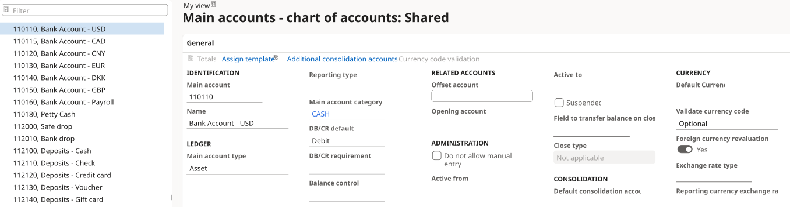
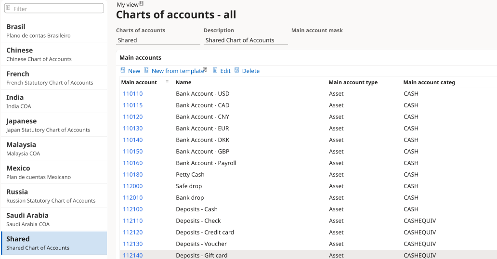
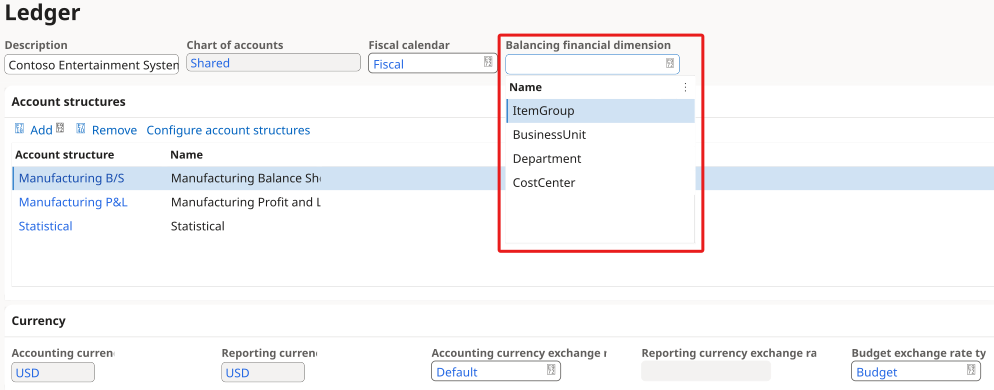

<!-- https://learn.microsoft.com/en-us/training/modules/explore-general-ledger-dynamics-365/2-explore-chart-accounts-functionality -->
<!-- refetched: original harvest URL returned 404 -->
# Describe the chart of accounts functionality

Completed

* 10 minutes

A chart of accounts (COA) consists of main account and provides a list of all the financial accounts in the general ledger of an organization. In short, it's an organizational tool that provides a digestible breakdown of all the financial transactions that a company conducted during a specific accounting period, separated into subcategories. For more reporting functionality, you can add segments, known as financial dimensions.

## Main accounts

The main account is the core setup of any finance system and a key part of the chart of accounts. The main account is an account in general ledger that contains financial balances, essential for financial postings. You need to configure the main accounts in almost all modules of finance and operations apps where financial posting is expected to happen.

You should select a main account type when you create a main account. You can choose from the following main account types:

* Profit & loss, Revenue and Expense: Record revenue and expenses in the Profit and loss accounts.
* Balance sheet, Asset, Liability and Equity: Use Balance sheet accounts to record the amounts that a legal entity owns or owes.
* Total: These main accounts display the total of the group balances for account intervals.

You can define the main account category for each main account. You can use main account categories for the default reports in financial reporting. When defining the main account category, consider the most detailed grouping level necessary for effective financial reporting, data analysis, and decision-making.

## Ledger

Each legal entity has one ledger, and you can link each ledger to one chart of accounts. You can link multiple ledgers from different legal entities to the same chart of accounts. You can then share the same chart of accounts with more than one legal entity. You also need to indicate which account structure or structures to attach to the ledger for each legal entity.

## Balancing financial dimension

Interunit accounting is the requirement that you generate a balance sheet for a specific financial dimension. Therefore, all accounting entries made to the general ledger must be balanced for the values of the financial dimension, which is referred to as the balancing financial dimension. You select the balancing financial dimension used for interunit accounting on the **Ledger** page in **General ledger** > **Ledger setup** > **Ledger**. When you enter the balancing financial dimension in Finance, every accounting entry must balance at the total level and at the level of the financial dimension values.

‎If the accounting entry doesn't balance at the level of the financial dimension values, other accounting entries can be created automatically to balance the accounting entry.

After adding account structures, you'll want to link them to the ledger.

The following video explains the creation of a new chart of accounts, main accounts, and a ledger in a new legal entity.

[**Create a chart of accounts**](https://learn-video.azurefd.net/vod/player?id=ddd9db75-397c-4cd0-958f-363f4caf61bb)

The ledger rules are applicable to all the financial transactions in the selected legal entity.

## Journal setup

Finance includes manually generated journals and system-generated journals.

Examples of system-generated journals are the journals that come from the subledgers of Accounts receivable and Accounts payable.

Manual journal entries record transactions in the system, including recurring insurance expenses and revenue redistribution. When you use a manual journal entry, the transactions aren't posted immediately. Before you can post a manual entry, journals can be in one of the following states:

* Changed
* Reviewed
* Approved
* Deleted

Journal approval is optional.

In Finance, you can use journals to do the following tasks:

* **Control different kinds of entries** - You can apply an approval system so that special journals are posted only after they're approved.
* **Review data imported from external ledger systems** - You can ensure that all valid fields contain a value and that all restrictions for the transaction are fulfilled.

You should make sure that the necessary voucher series is set up before you create journals. You can set up number sequences and attach them to the appropriate references.

You can't use both the manual approval system and the workflow approval system for the same journal name. You can use the following posting layers:

* **Current** – The default layer
* **Operations** – Used for entry of transactions
* **Tax** – Where you record transactions that impact tax reporting

In the **Detail level** list, you can specify how journal lines should be summarized.

* **Details** – Every instance of an account number in the journal lines is posted as a separate account transaction.
* **Summary** – A summation of journal lines into one transaction is performed automatically during posting if voucher with date, account number, dimension, and currency code contain the same values.

It's important to know that the summation isn't performed on transactions with sales tax.

## Transaction types

You can add other text to default descriptions for transaction types related to the following document types:

* Customer invoices
* Customer credit notes
* Customer cash payments
* Vendor payments
* Sales orders
* Purchase orders
* Inventory journals
* Master planning (MRP)
* Fixed assets

Continue on to explore financial dimensions and dimensions set concepts.