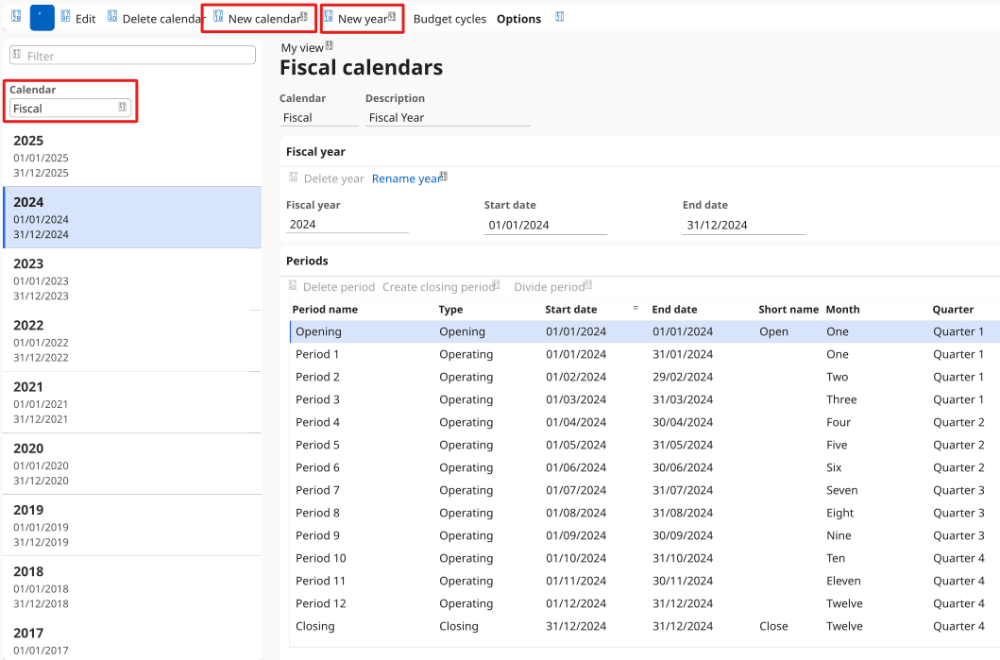
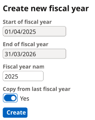
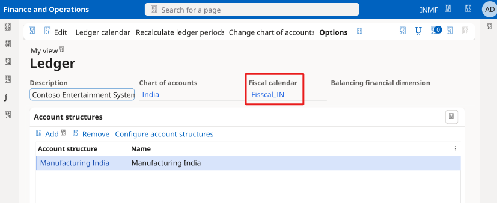
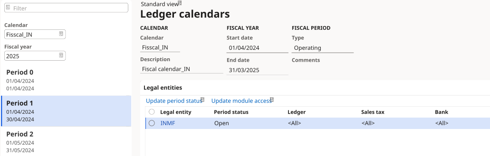
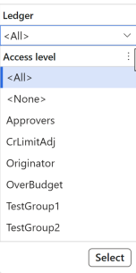

<!-- https://learn.microsoft.com/en-us/training/modules/explore-general-ledger-dynamics-365/3-concept-fiscal-calendar -->
<!-- refetched: original harvest URL returned 404 -->
# Describe the concept of a fiscal calendar

Completed

* 8 minutes

Fiscal calendars provide the base for the financial activity of an organization. A fiscal calendar contains multiple fiscal years. Each fiscal year contains multiple periods. A fiscal calendar can be based on the calendar year, such as January 1 to December 31. Different countries/regions follow different fiscal calendars. For example, in India, the fiscal calendar is defined as April 1 through March 31. You can define the fiscal year in Dynamics 365 Finance.

To create a new fiscal calendar, you can select the **New calendar** button in the action pane. A dialog **Create a new fiscal calendar** appears. You must provide the calendar name, the fiscal year name, and the fiscal year start and end date. You also need to provide the period unit and length of the period. When you select the **Create** button, a new fiscal calendar is created with one fiscal year and a defined number of periods.

When you create a new fiscal calendar, you need to define the number of periods within each fiscal year.

Scenario 1: To define the length of each period as one month, you can select **Months** for **Unit** and **1** for **Length of period**. Eventually, 12 periods are created, where each period is of one month.

Scenario 2: If your organization follows a quarterly period, you can select **Months** for **Unit** and **3** as **Length of period**. Four periods are created, where each period is three months.

Scenario 3: If you follow a six-week period in your organization, select **Days** for **Unit**. In the **Length of period** field, enter **42**. Eight periods are created, each of 42 days. One last period includes the remaining number of days in the year.

Scenario 4: If you have only one period in the entire year, you can select **Year** for **Unit** and **1** for **Length of period**.

After you create the periods in a fiscal calendar, two other periods are automatically created: Opening (first day of the fiscal year) and Closing (last day of the fiscal year).

You can select the **New year** button in the action pane of the **Fiscal calendar** page to create more fiscal years in the newly created fiscal calendar. When you select **New year,** a dialog appears with the Start and end date of the fiscal year auto populated. You can have the slider **Copy from last fiscal year** selected, which copies the periods from the previous fiscal year. If you need to change the period in the new fiscal year, you can clear the **Copy from last fiscal year** slider. The two fields **Length of period** and **Unit** appear, where you can configure the period for your new fiscal year.

A legal entity must have one and only one fiscal calendar associated with it. You can assign the same fiscal calendar to multiple legal entities. Different legal entities in an organization can have the same or different fiscal calendars associated with them. You can define the fiscal calendar associated with a legal entity in **General Ledger** > **Ledger setup** > **Ledger**. In the following screenshot, you can see Fiscal calendar Fiscal\_IN is assigned to the legal entity INMF.

After you associate the fiscal calendar with a legal entity, data will be populated in **General ledger** > **Calendar** > **Ledger calendar**. On this page, you can define which period is open for transactions using the Period status field. In the following screenshot, Period 1 is open for transactions, which means you can do financial transactions in the month of April 2023.

You can change the period status to **On hold**, which blocks any transactions from occurring in that period. You can reopen the period if the period status is **On hold**. You can also change the period status to **Permanently closed**, which prohibits you from reopening the period.

You can configure period and legal entity transaction permissions for specific users in specific business areas. These areas include:

* Ledger
* Sales tax
* Bank
* Customer
* Vendor
* You can also define the access level for the business area ledger.

You can define user groups in **System administration** > **User menu** > **User groups**. You can define specific users in the user groups. The **Access area** dialog displays all the user groups in the **Access level** lookup. Selecting a particular user group means that only its members are able to create ledger transactions within the defined period. Choosing **<None>** restricts everyone from creating transactions in that period. The default setting is **<All>**, indicating no constraints on transaction creation. Access levels can be tailored to different business areas.