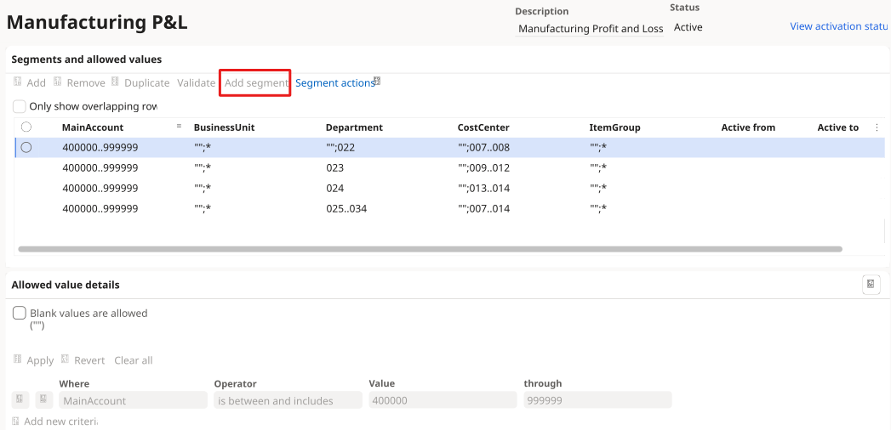
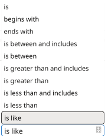

<!-- https://learn.microsoft.com/en-us/training/modules/explore-general-ledger-dynamics-365/5-describe-accounting-structure -->
<!-- refetched: original harvest URL returned 404 -->
# Describe the accounting structure

Completed

* 4 minutes

Accounting structure is a defined rule to use the main accounts and dimensions in a legal entity. Accounting structure helps to define the order and value of financial dimensions to be used for a range of main accounts.

You can set up multiple accounting structures for a legal entity. On the **General ledger** > **Setup** > **Ledger** page, you can associate accounting structures to the legal entity. It's a common business practice to define different accounting structures for balance sheet accounts and profit and loss accounts.

As a usual practice, you can have a main account as the first segment of your accounting structure. When you create a new accounting structure, the system asks you if you want to add the main account as a segment.

You can create an accounting structure without a main account; however, when you activate the accounting structure, the batch process throws an error. Therefore, the main account is a mandatory segment in the accounting structure.

You can select the **Add segment** button to add new financial dimensions to the accounting structure.

You can select a range of values applicable for the main account and dimensions. Different operators are available in the **Allowed value details** FastTab to define the range.

By selecting the **Blank values are allowed** field, you can keep the dimension fields empty in the journals.

In the accounting structure, you can add a maximum of 10 dimensions as a segment. If you need more dimensions, you need to use **Advanced rules**. To define **Advanced rules**, first you need to navigate to the **General ledger** > **Chart of accounts** > **Structures** > **Advanced rule structures** page. The interface of the Advanced rules structure is similar to accounting structures, but you don't need to include a main account as a segment in the advanced rules structures.

You can navigate back to the **Configure accounting structures** pages under the **Chart of accounts** > **Structures** menu in the **General ledger** module. You need to select the **Advanced rules** button available in the action pane of the accounting structure.

First, you need to select the **New** button in the action pane to create an advanced rule. In the Advanced rule criteria FastTab, select the **Add new criteria** link. The FastTab gives you options to select one or more segments that you already defined in the originating accounting structure. You can define advanced rules criteria for the selected segments.

In the **Advanced rule structures** FastTab, you can select the **Add** button. This button gives you the option to select the advanced rule structures that you already created. The defined rules are applicable in addition to the rules defined in the accounting structures.