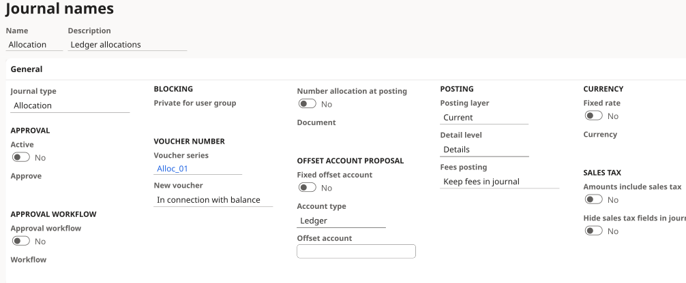

<!-- https://learn.microsoft.com/en-us/training/modules/explore-general-ledger-dynamics-365/6-explore-journaling-concepts -->
<!-- refetched: original harvest URL returned 404 -->
# Describe journaling concepts

Completed

* 10 minutes

The purpose of a journal entry is to record a business transaction in an accounting book. You record journal entries in the ledger. You then use the ledger to create financial statements for the business.

You configure different journal types in Finance based on the type of transaction. Use the **Journal names** page to set up journals for use throughout Finance.

## Journal names

Another important area to set up in Finance is Journal names. You should configure a journal name for each purpose, such as intercompany, accrual adjustment, and error correction. You can configure each journal name to ensure data entry for each purpose. You can also use journal names for reporting purposes.

On the **Journal names** page, you can set up the following elements:

* **Workflow approval** – To increase internal control, define journal workflows that establish limits for review and approval steps, based on criteria such as total debit amount. You set up workflows for the general journals on the **General ledger workflows** page.
* **Default values** – Select default values for offset accounts, currency, and financial dimensions.
* **Journal control** – You can set up restrictions on the company and account type, and also the segment values.

The following journal types are some of the more commonly used financial journals available in Finance.

## Budget journal

You can use the budget journal type to process budget appropriations. To use this journal type, select **Enable budget appropriation** on the **General ledger parameters** page. The budget journal entries include information based on the ledger accounts defined on the **Posting definitions** page.

## Check/Payment reversal

You can use the Check/Payment reversal journal type to reverse a posted check. To use this journal type, select **Use review process for payment reversals** on the **Cash and bank management parameters** page.

## Customer payment journal

You can create customer payment transactions by using this journal. You use it to settle receivables.

## Deposit slip payment cancellation

You can cancel a deposit slip by using the Deposit slip payment cancellation journal. To use this journal type, select **Use review process for deposit slip payment cancellations** on the **Cash and bank management parameters** page.

## Elimination journal

You can create elimination transactions in an eliminations journal. To use this journal type, select **Use for financial elimination process** and **Use for financial consolidation process** on the **Legal entities** page. Before you can use this journal type, you must create a ledger elimination rule on the **Ledger elimination rule** page.

## **Fixed asset budget**

You can create fixed asset budget register entries by using this journal.

## Fixed asset journal

This journal can post fixed asset transactions.

## General journal

With this journal, you can post financial transactions to general ledger accounts and other accounts, such as bank, customer, and vendor accounts. Posting with a general journal always creates entries on general ledger accounts. This is true even when a user posts a journal line to a customer account, because an entry is posted to a general ledger receivables account through a posting group.

## Global General journal

You can move between legal entities without switching the legal entity in the global General journal. It increases the productivity of general ledger accountants who work across legal entities.

## Invoice approval journal

You can post approved vendor invoices to the appropriate ledger accounts from the Invoice approval journal.

## Invoice register

You can register basic information about vendor invoices in the Invoice register journal.

## Periodic journal

In this journal, you can create periodic transactions based on schedule.

## Process allocation journal

You can create an allocation transaction in an allocations journal. Before you can create an allocation journal, you must create an allocation rule on the **Ledger allocation rule** page.

## Project expense Journal

You can create project expense transactions by using this journal.

## Remittance journal

You can create a bill of exchange remittance file for a customer, and then send the file to your organization’s bank by using this journal. You can also use this journal to create a promissory note remittance file for the vendor that can be sent to your organization’s bank.

## Reporting currency adjustment Journal

You can make adjustments in the reporting currency for balances on ledger accounts by using this journal.

## Vendor invoice pool

With this journal, you can create vendor invoice pool transactions.

## Vendor payment journal

You can create vendor disbursement transactions to settle accounts payable by using the Vendor payment journal.

The following video explains how to create and post a general journal.

[**Create and post a general journal**](https://learn-video.azurefd.net/vod/player?id=41b3ac84-51bf-4388-a007-9abe02164603)

Using the general journal, you can also perform intercompany and/or cross-currency finance transactions.