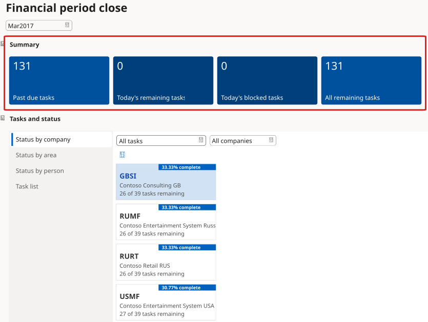
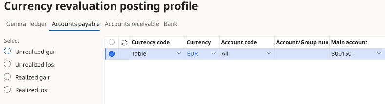
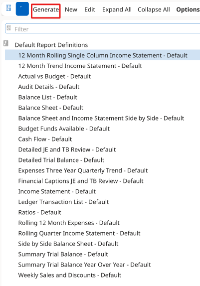
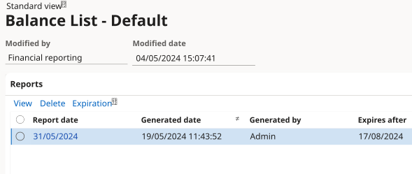

<!-- https://learn.microsoft.com/en-us/training/modules/explore-general-ledger-dynamics-365/7-explore-periodic-financial-processes -->
<!-- refetched: original harvest URL returned 404 -->
# Describe periodic financial processes

Completed

* 12 minutes

In Finance, you can complete closing procedures for a period, such as a day, month, or year. Closing processes prepare the system for a new period.

## Prepare for financial period close

Each organization has different processes and steps that it performs for the end of a period. Optional steps for period end include:

* Settle invoices and payments.
* Post all transactions for period end.
* Verify that all journals are posted.
* Run foreign currency revaluation for the general ledger to generate any unrealized gain or loss amounts.
* Run foreign currency revaluation for accounts payable and accounts receivable.
* Settle ledger transactions.
* Process any required allocations.
* Reconcile the subledgers to the general ledger.
* Post period-end adjustments manually.
* Journalize transactions and review the Ledger journal report.
* Perform a consolidation by using a consolidation company or financial reporting.
* Generate period-end financial statements by using financial reporting.
* Set ledger periods to **On hold** so that no further posting occurs. For better control, you can also restrict a period to a specific user group while period-end activities are occurring. As a best practice, don't use the **Permanently closed** status, because you can't reopen a period that was set to **Permanently closed**. This status could be used at a much later time.

## Financial period close workspace

The **Financial period close** workspace lets you track your financial closing processes across companies, areas, and people. Depending on the security role assigned to your user profile to view the **Financial period close** workspace, either all tasks and statuses for a closing schedule are displayed or only the tasks that are assigned to you.

You can find the **Financial period close** workspace by accessing **General ledger** > **Workspaces** > **Financial period close**. You can use the workspace to organize and track required tasks for various period-end processes.

You must first select a closing schedule at the top of the workspace. The selected closing schedule filters all presented data on the workspace.

Summary tiles in the workspace, shown in the following screenshot, provide an overview of the process, and indicators help you keep the closing process on track. They list out the tasks that are past due, remaining tasks for today, tasks that are due today but blocked because of dependencies, and all remaining tasks for the process. This information is for all companies included in the selected closing schedule.

To learn more about configuring the financial period close, review the links to further resources at the end of this module.

## Month-end closing

Let's go through a demo that explains how to process month-end close.

Play this video to learn more about [month-end closing](https://learn-video.azurefd.net/vod/player?id=88f64991-1d11-4ff1-a126-7bf7208e90bd).

## Create and post a closing sheet

A company might print a trial balance sheet to look for inconsistencies and make any adjustments necessary before closing the period. To make adjustments in Finance, you can perform either of the following tasks:

* Make typical journal entries, depending on adjustment.
* Use the **Closing period adjustments** page.

Consider the following information when you use the **Closing period adjustments** page:

* It presents an advanced view of the balances on accounts, and you can perform year-end postings directly from it.
* The postings to the page typically occur in the closing period of the fiscal year.
* You can create several specific closing sheets (for revenue, expenses, balance accounts, and so on) and then load the balances from the General Ledger into the closing sheet. After you load the transactions, make transfers from one account to another.
* It resembles a journal, because you can create as many new closing sheets as needed, and you can post several lines of entries.

It's not possible to make transactions to the **Opening** period in a closing sheet; use the **Opening** option only for a beginning balance transaction. You can make adjustments, however, to the regular period(s) and to the closing period(s). Usually, this field is set to **Closing**.

Which columns populate depends on the **Close** option that is selected when you set up each account in the chart of accounts.

## Post the closing period adjustment

After you complete the necessary transfers or adjustments, select the **Post** button to post the closing period adjustment. The closing period adjustment only posts to the closing period.

Before closing the period and transferring ending balances into the new year as opening balances, run reports and verify results.

To post the closing sheet, open the closing period on the **Periods** page. After you post the closing sheet, ensure that you change the period back to **On hold**.

## Year-end close

At the end of a fiscal year, you must run the year-end close process to transfer opening balances to the new year. Most companies run the year-end close process multiple times. The first time would be to move the balances into the new fiscal year. You can then run the year-end close again, as many times as required, to move the balances from adjusting entries into the new fiscal year.

You can create two types of transactions during the year-end close process. An Opening transaction is always generated and is used to create the opening balances in the new fiscal year. In the new fiscal year, the Opening transaction displays balance sheet ledger account balances and profit and loss ledger account balances in the retained earnings ledger account, excluding intercompany transactions. Optionally, you can create a Closing transaction to bring the balances of the profit and loss accounts down to zero in the fiscal year that you're closing.

**Process year-end close**

At year end, you need to complete the following tasks:

* Make adjustment entries that reflect transactions from the previous year.
* Print reports, including financial statements.
* Back up data.
* Create a new fiscal year, and transfer opening balances.

## Foreign currency revaluation

If you are in business with multiple countries/regions, you must consider multi-currency transactions in your day-to-day business. For instance, exchange rate fluctuations can cause the book value of open transactions in foreign currency to vary over time.

For example, you work for an Indian company and have a customer who is based in the United States. The default currency of your organization is INR. With the US customer, you conduct transactions in USD. You initiate a sales invoice of US $1,000 in May, when the exchange rate is USD 1 = INR 83. In June, you have accounts receivable of INR 83,000. The payment is made in the following month when the exchange rate is changed to USD 1 = INR 83.50. When you run the currency revaluation process based on the new exchange rate, you have an unrealized gain of INR 500. Balancing the unrealized gain, a posting in the realized gain account occurs when you post the settlement. A decrease in the exchange rate results in both realized and unrealized losses.

You must set up some areas in the **General ledger module** > **Currency** > **Currency revaluation posting profile** page.

You can define realized and unrealized gains/losses for general ledger transactions on the **General ledger** tab and define a specific account for a specific currency. For accounts payable transactions, you can define realized/unrealized gain/loss accounts in the combination of currency and vendor/vendor group on the **Accounts** **payable** tab. Similarly, for accounts receivable transactions, you can define realized/unrealized gain/loss accounts in the combination of currency and customer/customer group.

At the close of a period, you might have to adjust the balances of general ledger accounts in foreign currencies using various exchange rate types. For instance, one accounting standard mandates that assets and liabilities be revalued using the current exchange rate, fixed assets at the historical rate, and income statement accounts at the monthly average. When you run the revaluation process, the balance in each main account posted in a foreign currency is revalued. The unrealized gain or loss transactions created during the revaluation process are posted in the main account.

You can also define the realized/unrealized gain/loss accounts from the **General ledger module** > **Ledger setup** > **Ledger** page. If you don’t define realized/unrealized gain/loss accounts in the posting profile, the accounts defined on the Ledger page are used for the transaction posting.

## Financial reporting

By using financial reporting, users can create, maintain, deploy, and view financial statements. It moves beyond traditional reporting constraints to help you efficiently design various types of reports.

Financial reporting is a rich client tool integrated with Finance that comes with many standard reports. You can launch financial reporting from the **General ledger** **module** > **Inquiries and reports** > **Financial reports**.

You can select any of the reports and then select the **Generate** button in the action pane to open a dialog box that asks for the report date. The generated report stored as shown in the following screenshot. It automatically populates an expiry date that is three months from the report generation date. You can change the expiry to never.

Selecting the **New** or **Edit** button in the action pane launches the financial reporting tool.

A financial report has seven sections:

**Row definitions:** Here you define all the rows required in the report. You also define the main account category against each row. All the main accounts associated to the selected main account category are potential candidates for this report. Financial reporting includes dimension support to determine which financial dimensions you want to include in the row.

For example, you can create financial row structures to focus on cost accounts. You can set up unlimited financial dimensions that provide cost details. The following financial dimensions are examples that might be associated with cost accounts:

* Cost centers
* Departments
* Combinations of the two

**Column definitions:** Here you can define the columns required in the report. You configure the column based on the values in the drop-down, which includes amounts from financial dimension, calculated column, specific field values (like currency or account code) and line number.

**Reporting tree definition:** Here you can create a hierarchy of operating units, based on what you want to include in the report.

**Report definition:** Here you can bind the row definition, column definition, and reporting tree definition to create a complete report. You can also define the legal entity for which a report is applicable.

**Report group:** You can group similar reports for operational convenience in this section.

**Report schedule:** You can schedule the execution of a single report or group of reports in this section. It helps reporting operations and maintenance.

**Security:** You can use this section to define the access security of the reports.

To learn more about configuring financial reporting, review the links to further resources at the end of this module.

## Perform financial consolidation

In a consolidation, it's possible to gather transactions from several company accounts into a single set of company accounts. You can print reports, such as financial statements, from the consolidation company, but you can't use this company for daily transactions.

Before you perform a consolidation at the close of a period, you must perform the period-closing preparatory activities, but don't close the subsidiary accounts until the consolidation is complete.

You can consolidate data from companies with databases that are external to the consolidation company database, or you can consolidate data from companies in the same database, a so-called "online" consolidation.

Consolidations don't necessarily require that you set up the consolidation company in advance. However, if you want to use the consolidation conversion principles to convert subsidiary data in foreign currencies, you must set up the consolidation company main accounts.

To prepare a consolidation company (the company that collects the results and balances of the subsidiaries), you should have a legal entity created with the **Use for financial consolidation process** option enabled. Like any other legal entity, you should complete the **General ledger module configuration** for the consolidation company.

To learn more about configuring the General ledger module, access the corresponding link in the Summary unit at the end of this module.

After you complete the setup process in the consolidation company, you can focus on the subsidiary company. The amount of setup that is needed in a subsidiary depends on how closely the chart of accounts and dimensions for the consolidation company and subsidiary are aligned.

You can perform consolidation by using a shared or blank chart of accounts.

To learn more about intercompany consolidation, review the links to further resources at the end of this module.

## Intercompany eliminations

Elimination transactions are required when a parent company conducts business with one or more subsidiary companies and uses consolidated financial reporting.

When preparing consolidated financial statements, finance teams eliminate all intercompany transactions, including downstream, upstream, and lateral dealings. This ensures that the financial statements accurately reflect the economic reality of the group as a single entity, rather than as individual, separate entities. Because of this requirement, you must remove or eliminate transactions between a parent company and its subsidiary companies.

Predefined elimination rules create elimination transactions in a company that is specified as the destination company for eliminations. You can generate the elimination journals during the consolidation process or by using an elimination journal proposal.