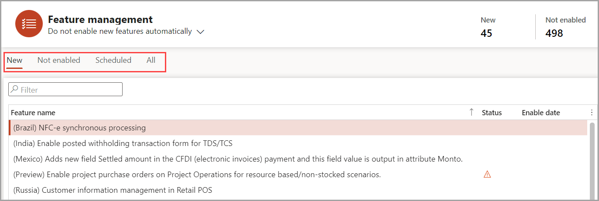

<!-- https://learn.microsoft.com/en-us/training/modules/feature-management-finance-operations/02-workspace -->
# Feature management workspace

Completed

* 5 minutes

You can open the **Feature management** workspace by selecting the appropriate tile on the dashboard. A page will display, showing a list of features for all releases that are supported by the Feature management experience.

The feature list includes the following information:

* **Feature name** – A description of the feature that was added.
* **Status** – A symbol indicating whether a feature is turned on (check mark), turned off (blank), scheduled to be turned on (clock), mandatory (lock), requires attention before you turn on the feature (warning symbol), or can't be turned on (X). The setting is used for all legal entities. When a feature has been turned on, it's still controlled by security. Therefore, the feature will be available only to users who have access to it based on their security role. It will also be available only in legal entities that the user has access to.
* **Enable date** – The date when the feature was turned on or has been scheduled to be turned on.
* **Feature added** – The date when the feature was added to your environment. This date is automatically entered when you update your environment during the monthly release cycles.
* **Feature state** – The current life cycle state of the feature: **Preview**, **Released** (shown as blank), **On by default**, and **Mandatory**. The states are covered in more detail later in this topic.
* **Module** – The module that is affected by the new feature.

When you select a feature, more information appears in the details pane to the right of the feature list. The top of the pane displays the feature name, the date when the feature was added, the module that is affected by the feature, and a **Learn more** link. Select this link to view the documentation for the feature. If documentation isn't available, you'll be directed to a temporary page. The details pane also includes a **Comments** field where you can add your own comments about the feature.

The **Feature management** workspace also has several tabs, each showing a list of features:

* **New** – This tab shows all features that have been added since the last monthly update. If you've skipped monthly updates, the tab will show all new features that have been added since the last time that you updated. The newest features appear at the top of the list. The total number of new features is also shown on a tile at the top of the page.
* **Not enabled** – This tab shows all features that aren't turned on. The newest features appear at the top of the list. In addition, a tile at the top of the page shows the total number of new features that are currently off.
* **Scheduled** – This tab shows all features that are to be turned on in the future. The features that have the earliest scheduled date appear at the top of the list. In addition, a tile at the top of the page shows the total number of scheduled features.
* **All** – This tab shows all features. The newest features appear at the top of the list.

